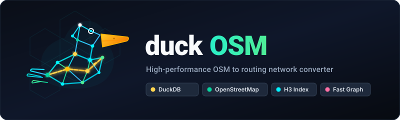
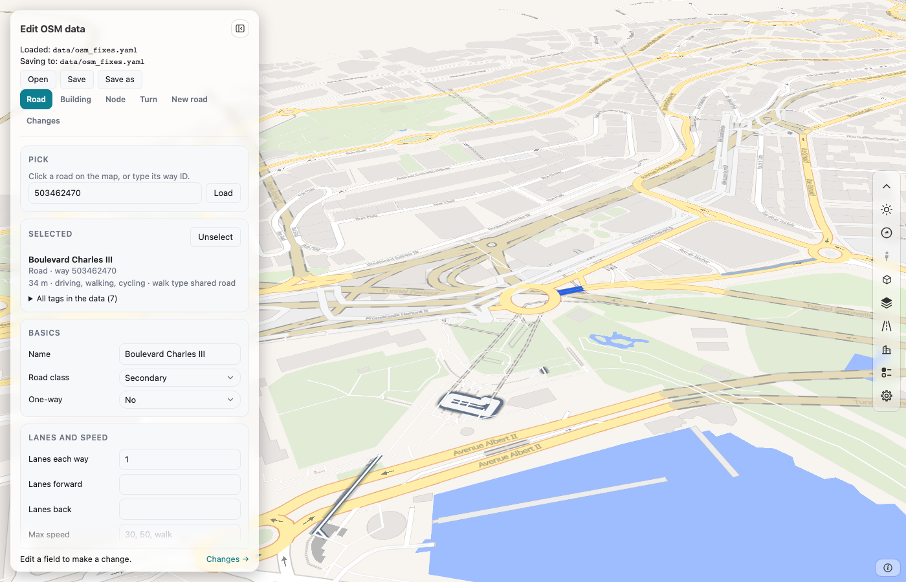

<p align="center">
  
</p>

<p align="center">
  <b>OpenStreetMap → road networks, map layers and GIS files.<br>
  One Rust program, on your computer and in the browser.</b>
</p>

<p align="center">
  <a href="https://pypi.org/project/duckosm/"></a>
  <a href="https://github.com/Khoshkhah/duckOSM/actions/workflows/ci.yml"></a>
  <a href="https://khoshkhah.github.io/duckOSM/"></a>
  
  
</p>

<p align="center">
  <a href="https://khoshkhah.github.io/duckOSM/"><b>Documentation</b></a> ·
  <a href="https://khoshkhah.github.io/duckosm-studio/">duckOSM Studio (browser)</a> ·
  <a href="https://khoshkhah.github.io/duckOSM/first_network/">Your first network</a> ·
  <a href="https://khoshkhah.github.io/duckOSM/reference/cli/">Command line</a> ·
  <a href="https://khoshkhah.github.io/duckOSM/reference/database/">Database schema</a>
</p>

---

## What duckOSM makes

All outputs come from one `.osm.pbf` file.

| Output | Command | Format |
|---|---|---|
| **Road networks**: driving, walking and cycling, and the graph of legal turns | `duckosm build` | DuckDB |
| **Base-map layers**: water, land use, buildings, POIs | `duckosm build` | DuckDB (`features.*`) |
| **Map data**: the drawing order of the roads, the walls of the buildings | `duckosm build` | DuckDB |
| **The OSM features table** of [QuackOSM](https://khoshkhah.github.io/duckOSM/concepts/quackosm/) | `duckosm quack`, [in the browser](https://khoshkhah.github.io/duckosm-studio/quack.html) | GeoParquet, DuckDB |
| **GDAL's five OSM layers**, as [QGIS reads them](https://khoshkhah.github.io/duckOSM/concepts/gdal/) | `duckosm quack --gdal`, [in the browser](https://khoshkhah.github.io/duckosm-studio/quack.html) | GeoPackage, GeoParquet |
| **Traffic simulation networks** | `duckosm sumo`, `matsim`, `gmns` | SUMO, MATSim, GMNS |
| **GIS files and graphs** of the network | `duckosm export-gis`, `export-graph` | GeoPackage, shapefile, networkx |
| **Heights**: the ground height of each node | `duckosm elevation` | DuckDB |
| **Maps and pages**: maps, a route planner, an editor, Ask | `duckosm viz`, `route-map`, `edit`, `ask` | HTML |

## Fix the OSM data

OSM has errors: a wrong one-way, a missing road, a wrong bridge layer. Fix them on a map. duckOSM keeps your fixes in one
file, `osm_fixes.yaml`, and applies them at each build, so a new OSM file does not remove them.



| Where | How |
|---|---|
| Browser | [duckOSM Studio](https://khoshkhah.github.io/duckosm-studio/), step **Edit OSM data** |
| Your computer | `duckosm edit my_area.duckdb` opens the same editor |
| Build | `duckosm build --fixes osm_fixes.yaml` |

| You can change | Examples |
|---|---|
| Roads | one-way, lanes, speed, road class, access; delete a road |
| Buildings | floors, height, roof; the type of each wall and its door |
| Nodes | traffic signals, crossings |
| Turns | a turn that a driver cannot make, or must make |
| New roads | a road that OSM does not have |

The network and all its exports use your fixes. More: [Edit OSM data](https://khoshkhah.github.io/duckOSM/guides/edit-osm-data/).

## Two versions, one engine

| | Native | Browser |
|---|---|---|
| Program | `duckosm` on your computer | [duckOSM Studio](https://khoshkhah.github.io/duckosm-studio/), a web page |
| Install | `pip install duckosm` | none |
| Rows | the same | the same |

In the browser, open:

- [**duckOSM Studio**](https://khoshkhah.github.io/duckosm-studio/): choose an area, build its network, edit the OSM data, and export.
- [**The quack page**](https://khoshkhah.github.io/duckosm-studio/quack.html): the OSM features table of QuackOSM and GDAL's five layers.

Both build every area by map tiles, so the memory does not grow with the area
([Browser and native builds](https://khoshkhah.github.io/duckOSM/concepts/browser-native/)).

## Speed on France

France: 5.1 GB `.osm.pbf`, Mac mini (12 cores, 16 GB).

| Job | Native | Browser | Other tool |
|---|---|---|---|
| Road network, driving | 3 min 36 s | 5 min 16 s | |
| OSM features table (`quack`) | 2 min 9 s | 4 min 54 s | QuackOSM: 9 min 30 s |
| GDAL's layers, GeoParquet (`quack --gdal`) | 3 min 37 s | 5 min 23 s | `ogr2ogr`: 14 min 18 s |

## Edge ids that stay the same

Other tools number their edges `0, 1, 2, …`, and the numbers change at each rebuild. duckOSM's `edge_id` is a hash of
three OSM ids: the way (`osm_id`) and the nodes where the edge starts and ends (`source`, `target`).

```text
edge_id = hash(osm_id, source, target)
```

The same OSM data gives the same ids after a rebuild, in a city cut from a country, and in every export
([details](https://khoshkhah.github.io/duckOSM/concepts/edge-ids/)).

## Quick start

```bash
pip install "duckosm[routing]"

curl -LO https://download.geofabrik.de/europe/monaco-latest.osm.pbf
duckosm build --pbf monaco-latest.osm.pbf --output monaco.duckdb --modes driving
duckosm quack monaco-latest.osm.pbf --gdal -o out --name monaco
```

```python
import duckdb
from duckosm import route

con = duckdb.connect("monaco.duckdb", read_only=True)
q = "SELECT min(edge_id) FROM driving.edges WHERE name = ?"
a = con.execute(q, ["Boulevard du Larvotto"]).fetchone()[0]
b = con.execute(q, ["Avenue Princesse Grace"]).fetchone()[0]

r = route(con, a, b)                     # fastest path; weight="length" for distance
r["time_s"], r["length_m"], r["edges"]   # ~114 s, ~1.5 km, the ordered edge_ids
```

Each output is compared with a reference tool: QuackOSM, GDAL, SUMO, MATSim and the GMNS specification
([how each output is checked](https://khoshkhah.github.io/duckOSM/concepts/checks/)).

Experimental exports: OpenDRIVE, Lanelet2, railML, lane-level routing. See the
[documentation](https://khoshkhah.github.io/duckOSM/exports/).

## For AI agents

- To use duckOSM: the agent skill [`skills/duckosm/SKILL.md`](skills/duckosm/SKILL.md) (also a
  Claude Code plugin: `/plugin marketplace add Khoshkhah/duckOSM`), and the whole documentation as
  one text file: [`llms-full.txt`](https://khoshkhah.github.io/duckOSM/llms-full.txt)
  ([`llms.txt`](https://khoshkhah.github.io/duckOSM/llms.txt) is its index).
- `duckosm info DB --json` says what a database holds; `way`, `route-lanes` and `gis-debug` also
  take `--json`.
- To change duckOSM: the rules are in [`AGENTS.md`](AGENTS.md).

## License

MIT. duckOSM is built on [DuckDB](https://duckdb.org) and its spatial extension. It is an
independent project, not affiliated with or endorsed by the DuckDB Foundation.
