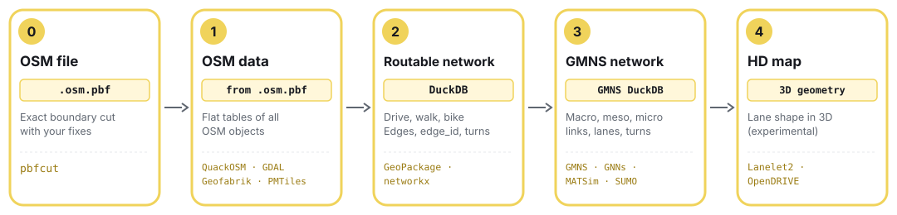

<p align="center">
  
</p>

<p align="center">
  <b>Turn OpenStreetMap into routable networks, map layers and GIS files.<br>
  One Rust engine, for your computer and your browser.</b>
</p>

<p align="center">
  <a href="https://pypi.org/project/duckosm/"></a>
  <a href="https://github.com/Khoshkhah/duckOSM/actions/workflows/ci.yml"></a>
  <a href="https://khoshkhah.github.io/duckOSM/"></a>
  
  
</p>

<p align="center">
  <a href="https://khoshkhah.github.io/duckOSM/"><b>Documentation</b></a> ·
  <a href="https://khoshkhah.github.io/duckOSM/book/"><b>The notebook manual</b></a> ·
  <a href="https://khoshkhah.github.io/duckosm-studio/">duckOSM Studio (browser)</a> ·
  <a href="https://khoshkhah.github.io/duckOSM/first_network/">Your first network</a> ·
  <a href="https://khoshkhah.github.io/duckOSM/reference/cli/">Command line</a>
</p>

---

## What duckOSM is

duckOSM reads an OpenStreetMap `.osm.pbf` file and makes the routable road network of an area, its map layers, and
files for GIS, routing and traffic simulation.

- **Large areas, little memory.** duckOSM builds an area tile by tile, so the build time stays short and the memory
  stays low, also for a whole country.
- **In the browser too.** The same Rust engine runs in a web page, [duckOSM Studio](https://khoshkhah.github.io/duckosm-studio/),
  with no install, and gives the same rows.
- **One id for each road direction.** `edge_id = hash(osm_id, source, target)` stays the same after a rebuild, so
  your own data joins to the right edge ([how](https://khoshkhah.github.io/duckOSM/concepts/edge-ids/)).
- **Fix the OSM data once.** Edit roads, turns and buildings on a map; every output uses your fixes
  ([Edit OSM data](https://khoshkhah.github.io/duckOSM/guides/edit-osm-data/)).

## What duckOSM makes

All outputs come from one `.osm.pbf` file, in five levels. Each level keeps the `edge_id` of the routing network.

<p align="center">
  <picture>
    <source media="(prefers-color-scheme: dark)" srcset="https://raw.githubusercontent.com/Khoshkhah/duckOSM/main/images/levels-dark.svg">
    
  </picture>
</p>

| Level | Command |
|---|---|
| 0. The OSM file | `duckosm get` |
| 1. OSM data | `duckosm quack` |
| 2. The routing network | `duckosm build`, `export-gis`, `export-graph` |
| 3. Simulation network | `duckosm sumo`, `matsim`, `gmns` |
| 4. HD map (experimental) | `duckosm lanelet2`, `opendrive` |

## Quick start

```bash
pip install duckosm

duckosm get "Monaco"  # -> monaco.osm.pbf, monaco.geojson
duckosm build --pbf monaco.osm.pbf --boundary monaco.geojson --modes driving
duckosm quack monaco.osm.pbf --gdal -o out --name monaco
```

```python
import duckosm

area = duckosm.get("Monaco")  # as duckosm get
db = duckosm.build(pbf=area.pbf, boundary=area.boundary)  # as duckosm build

r = duckosm.route_points(db, (7.4155, 43.7285), (7.4400, 43.7480))   # (lon, lat): Fontvieille to Larvotto
r["time_s"], r["length_m"], r["edges"]   # the fastest path, door to door, and the ordered edge_ids
duckosm.to_gis(db, "monaco.gpkg")         # a GeoPackage for QGIS
```

All functions: [Python SDK](https://khoshkhah.github.io/duckOSM/reference/python/) and [Rust SDK](https://khoshkhah.github.io/duckOSM/reference/rust/).

## Learn with the notebook manual

[**The notebook manual**](https://khoshkhah.github.io/duckOSM/book/) teaches the Python SDK in 15 chapters, from your
first network to routing, map matching, traffic simulation and HD maps. Each chapter is one Jupyter notebook on Monaco
and opens in Colab with one click.

## For AI agents

- To use duckOSM: the agent skill [`skills/duckosm/SKILL.md`](skills/duckosm/SKILL.md) (also a
  Claude Code plugin: `/plugin marketplace add Khoshkhah/duckOSM`), and the whole documentation as
  one text file: [`llms-full.txt`](https://khoshkhah.github.io/duckOSM/llms-full.txt)
  ([`llms.txt`](https://khoshkhah.github.io/duckOSM/llms.txt) is its index).
- `duckosm info DB --json` says what a database holds; `way`, `route-lanes` and `gis-debug` also
  take `--json`.
- To change duckOSM: the rules are in [`AGENTS.md`](AGENTS.md).

## Data and credits

- Map data © [OpenStreetMap contributors](https://www.openstreetmap.org/copyright), under the
  [ODbL](https://opendatacommons.org/licenses/odbl/). Outputs made from OSM data keep this license.
- The region files come from [Geofabrik](https://www.geofabrik.de/)'s free [download server](https://download.geofabrik.de/).
  `duckosm quack --geofabrik` follows Geofabrik's [layer rules](https://download.geofabrik.de/osm-data-in-gis-formats-free.pdf).

## License

MIT. duckOSM is built on [DuckDB](https://duckdb.org) and its spatial extension. It is an
independent project, not affiliated with or endorsed by the DuckDB Foundation.
