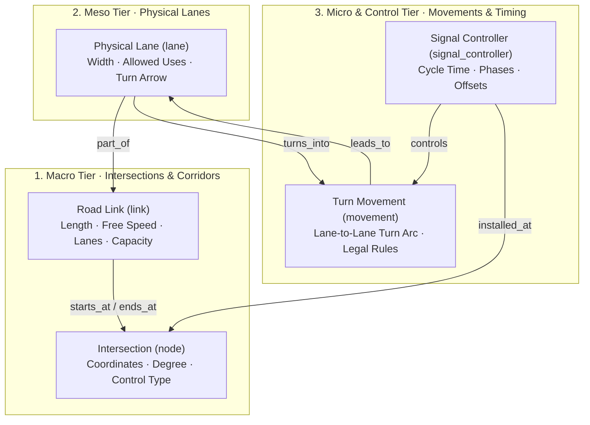

# duckOSM for graph machine learning users

This page is for users of PyTorch Geometric, DGL and city2graph who make road graphs from OSM with their own code. The
module is `duckosm.ml` ([reference](../reference/sdk/ml.md)). The notebook
[15. Graph machine learning](https://khoshkhah.github.io/duckOSM/book/15_ml.html) trains a small graph neural network on Monaco.

```bash
pip install "duckosm[ml]"      # torch and torch_geometric
```

## Your code and duckOSM

| Your code today | duckOSM |
|---|---|
| OSMnx graph → `torch_geometric.utils.from_networkx(G)` | `duckosm.ml.to_pyg(net.driving)` |
| node ids → index, by hand | `data.node_id`, `data.edge_id`: the index of each node and arc goes back to the network |
| one-hot of `highway`, by hand | `features=["highway"]` gives `highway=primary`, … (`data.edge_attr_names`) |
| a line graph for edge tasks (`nx.line_graph`) | `graph="turns"`: each edge is a node, each legal turn an arc (turn restrictions in) |
| `dgl.from_networkx(G)` | `duckosm.ml.to_dgl(net.driving)` |
| another library | `duckosm.ml.graph_arrays(net.driving)`: the same arrays as numpy |

| `graph` | A node is | An arc is | For |
|---|---|---|---|
| `"nodes"` | a junction (`lon`, `lat`) | an edge, with the `features` | tasks on junctions, or on edges as arcs |
| `"turns"` | an edge, with the `features` | a legal turn, with `cost` | tasks on edges: speed, flow, travel time |

A prediction for a node of the turn graph is a value for an edge. Key it by `data.edge_id` and draw it:

```python
data = duckosm.ml.to_pyg(net.driving, graph="turns", features=["length_m", "lanes", "highway"])
predicted = model(data.x, data.edge_index)
net.driving.map(color_by=pd.Series(predicted.detach().numpy(), index=data.edge_id.numpy()))
```

The `edge_id` is the same on each rebuild. So labels joined by `edge_id` (traffic counts, speeds) stay correct after an
OSM update.

## Heterogeneous graphs from Level 3 GMNS

While Level 2 exports homogenous turn and junction graphs (`Data` in PyTorch Geometric), Level 3 GMNS DuckDB (`<area>_gmns.duckdb`) structures urban space into a **three-tier hierarchy** represented as **`HeteroData`**:



| Hierarchy Tier | GMNS Table | `HeteroData` Entity | Features | Role in GNN |
|---|---|---|---|---|
| **Macro** | `link` | `data['road'].x` | `length`, `free_speed`, `lanes`, `capacity` | Corridor-level traffic assignment & speed estimation |
| **Macro** | `node` | `data['intersection'].x` | `lon`, `lat`, `degree`, `ctrl_type` | Network topology & routing decisions |
| **Meso** | `lane` | `data['lane'].x` | `width`, `allowed_uses`, `turn_arrow` | Lateral lane changes & bus-lane spillover |
| **Micro/Control** | `signal_controller` | `data['signal'].x` | `cycle_time`, `phase_count` | Signal timing optimization & queue control RL |
| **Micro/Control** | `movement` | `data['movement']` | `turning_angle`, `curve_length` | Lane-to-lane turning friction & delay |

```python
from torch_geometric.data import HeteroData
import torch

data = HeteroData()

# Node feature matrices: each entity type keeps its own columns
data['road'].x = torch.tensor(...)          # links: length, speed, lanes, facility_type
data['lane'].x = torch.tensor(...)          # physical lanes: width, allowed_uses, turn arrow
data['intersection'].x = torch.tensor(...)  # nodes: coordinates, in/out degrees, control type
data['signal'].x = torch.tensor(...)        # signal controllers: cycle time, phases

# Edge indices: relations connecting different entity types
data['lane', 'part_of', 'road'].edge_index = ...            # lane-to-road containment
data['road', 'starts_at', 'intersection'].edge_index = ...  # topological junction connection
data['lane', 'turns_into', 'movement'].edge_index = ...     # lane-to-movement transition
data['movement', 'leads_to', 'lane'].edge_index = ...       # movement-to-exit-lane connection
data['signal', 'controls', 'movement'].edge_index = ...     # signal phase regulation
```

This multi-relational structure allows relational GNN architectures (such as `RGCNConv` or `HGTConv`) to model lane-level friction, queue spillover, and intelligent signal coordination. See [Chapter 15 of the notebook manual](https://khoshkhah.github.io/duckOSM/book/15_ml.html).

## duckOSM and city2graph

[city2graph](https://github.com/c2g-dev/city2graph) makes graphs for graph neural networks from GeoDataFrames:
streets, buildings, transit, and graphs with more than one type of node. `net.nodes()` and `net.edges()` are
GeoDataFrames, so they go into city2graph with no change. city2graph takes the node id from the index of the nodes,
and the two ends of an edge from a two-level index of the edges:

```python
import city2graph as c2g

nodes = net.driving.nodes().set_index("node_id")
edges = net.driving.edges().set_index(["source", "target"])
data = c2g.gdf_to_pyg(nodes, edges, edge_feature_cols=["length_m", "maxspeed_kmh"], directed=True, multigraph=True)
# Monaco: Data(x=[1769, 0], edge_index=[2, 2844], edge_attr=[2844, 2], pos=[1769, 2], ...)
```

| Use | For |
|---|---|
| `duckosm.ml.to_pyg` | the road network alone: fast, the turn graph, `edge_id` in the tensors |
| city2graph with `net.nodes()`, `net.edges()` | the roads with other city data (buildings, POIs from `duckosm.gis.features`, transit) in one graph |

## DGL

DGL on PyPI has wheels for torch 2.0 to 2.1 only (Linux). For a newer torch, install DGL from its own index
(<https://www.dgl.ai/pages/start.html>). Then `duckosm.ml.to_dgl` gives a `dgl.DGLGraph` with the same arrays.
