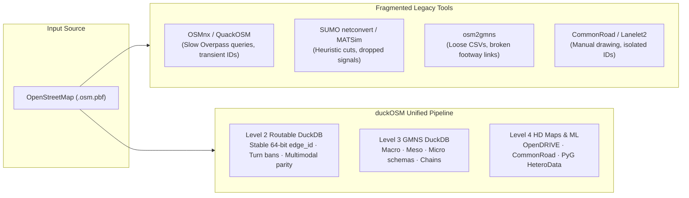

# Compare

How duckOSM compares with the specialized tools that engineers and researchers use for road networks, GIS, simulation, planning, and graph machine learning. Each category has its own dedicated comparison guide.

## Master Tool Comparison

| Other Tool | Job / Domain | duckOSM Advantage | Guide |
|---|---|---|---|
| **[OSMnx](https://osmnx.readthedocs.io/)** | Road network from OSM | Directed edges, OSM turn restrictions, persistent `edge_id`, and 10x-50x faster local PBF extraction | [duckOSM for OSMnx users](for-osmnx-users.md) |
| **[QuackOSM](https://github.com/kraina-ai/quackosm)** | OSM features table | 3 to 7 times faster, 2 to 5 times less memory, zero-copy DuckDB tables | [duckOSM for GIS users](for-gis-users.md) |
| **[GDAL](https://gdal.org/drivers/vector/osm.html)** (`ogr2ogr`) | 5 standard OSM layers | ~4 times faster on France (3m37s vs 14m18s); native GeoParquet output | [duckOSM for GIS users](for-gis-users.md) |
| **[osm2pgsql](https://osm2pgsql.org)** | Relational tables in PostGIS | Same 4 schemas directly in DuckDB or PostGIS (1.7x faster on Kentucky); survives updates | [osm2pgsql tables](../exports/osm2pgsql.md) |
| **[Tilemaker](https://tilemaker.org)** | PMTiles vector tiles | Same speed, 2.6x less memory; single-command CLI (`duckosm quack --pmtiles`) | [Vector tiles (PMTiles)](../exports/pmtiles.md) |
| **[Geofabrik shapefiles](https://download.geofabrik.de/)** | 20 standard GIS layers | Available for any custom bounding box, with OSM fixes applied, in Shapefile or GeoParquet | [Geofabrik layers](../exports/geofabrik.md) |
| **ORS, OSRM, r5py, pandana** | Routing, OD matrices, accessibility | In-process multi-threaded Rust engine; turn restrictions, zero server setup, instant OD matrices | [duckOSM for routing users](for-routing-users.md) |
| **SUMO netconvert, MATSim** | Traffic simulation networks | Streamed export with `--merge` (continuous chains using `chain_id`), signals, and results joinable via `edge_id` | [duckOSM for simulation users](for-simulation-users.md) |
| **osm2gmns, path4gmns, AequilibraE** | Transport planning networks | Multi-resolution GMNS DuckDB schemas (`gmns_*`, `meso_*`, `micro_*`); multimodal parity; CSV export | [duckOSM for planning users](for-planning-users.md) |
| **CommonRoad, Lanelet2, scenariogeneration** | Lane maps for automated driving | Automated derivation from GMNS physical lanes; OpenDRIVE 1.4 (`.xodr`), CommonRoad XML, Lanelet2 | [duckOSM for HD map users](for-hdmap-users.md) |
| **PyTorch Geometric, DGL, city2graph** | Road graphs for Machine Learning | Homogenous turn & junction graphs with `edge_id`, plus Level 3 GMNS 3-tier `HeteroData` graphs | [duckOSM for ML users](for-ml-users.md) |
| **All Tools** | Country- and city-scale benchmarks | Detailed scale profiles & speed benchmarks across Monaco (611 KB), Kentucky (282 MB), and France (5.1 GB) | [Benchmarks](speed.md) |

## Why a Single Unified Network?

Traditional workflows re-parse raw OSM per domain with conflicting assumptions—dropping directionality in GIS, creating artificial bottlenecks in simulators, and isolating IDs in HD maps.

duckOSM replaces this fragmentation with a unified **5-level pipeline** anchored in DuckDB:

- **Shared topological base:** GIS, routing, simulation, and ML all derive from one verified network.
- **Continuous corridors:** Contraction (`--merge`) avoids artificial bottleneck queues at crossings while preserving detail.
- **Multimodal parity:** Pedestrian, cycling, and transit links maintain continuous alignment with road corridors.
- **Deterministic 64-bit IDs:** Every link, lanelet, and tensor retains persistent `edge_id`s, so simulation outputs and model predictions join back with standard SQL.
