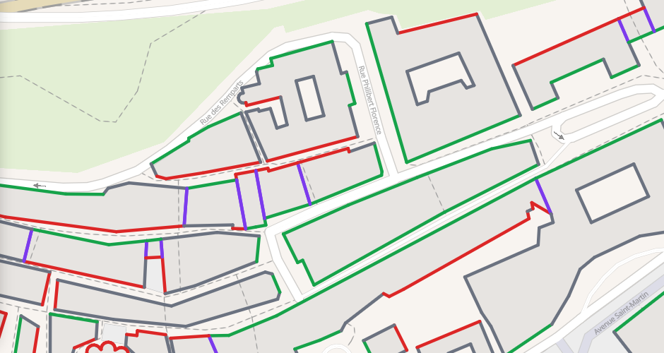

# The walls of the buildings

duckOSM can give each wall of each building a type: front, back, side, party or court. The build writes the walls to
[`main.building_faces`](../reference/database.md#building_faces). You can change a type in
[Fix the OSM data](../guides/edit-osm-data.md), and the next build keeps your change.

| Where | Turn it on |
|---|---|
| Command line | `--building-faces` |
| Config file | `options.building_faces: true` |
| duckOSM Studio | **Wall labels** |

The walls need an OSM file and a boundary.

<figure markdown="span">
  
  <figcaption>The walls of Monaco, in the Building tab of Edit OSM data: front green, back red, side gray, party purple.</figcaption>
</figure>

## The five types

| Type | Color in the editor | The wall |
|---|---|---|
| `front` | green | faces a street that it can see, or has an entrance. A corner building can have more than one front |
| `back` | red | points away from the front and faces no near street |
| `side` | gray | every other wall of the outer ring |
| `party` | purple | is shared with another building (the same two nodes) |
| `court` | cyan | is a wall of a courtyard (an inner ring of a multipolygon) |

## What the build uses

- The buildings: ways and multipolygon relations with a `building` tag.
- The streets: driving and walking edges, but not footways, paths, steps, cycleways and tracks.
- The entrances: nodes with an `entrance` tag (not `no`, `service`, `emergency` or `exit`).
- The `addr:street` tag of the building.

## How it finds the type

1. It finds the street that each wall can see, within 60 m.
2. It finds the main front: the best street, else an entrance, else the nearest street within 150 m.
3. It joins walls with almost the same direction into runs. A run gets one type.
4. It adds corner fronts, then back walls. All other walls are `side`.
5. It applies your rules from the fixes file (`extra.building_faces`).

The column `type_reason` tells which rule gave the type (`street`, `address`, `entrance`, `corner`, `inferred`, `opposite`,
`shared`, `other`, `none`, `inner`). Check `inferred` fronts by eye.

## How sure it is

The method is a rule of thumb from the shapes and a few tags. No reference data tells which wall is the real front.
