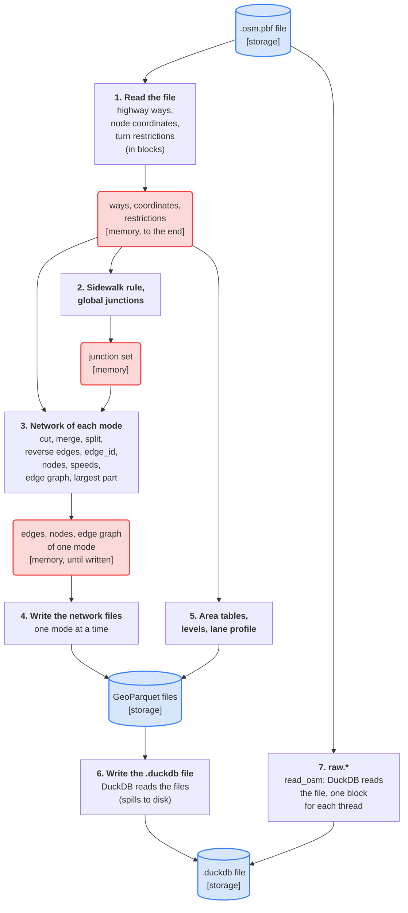
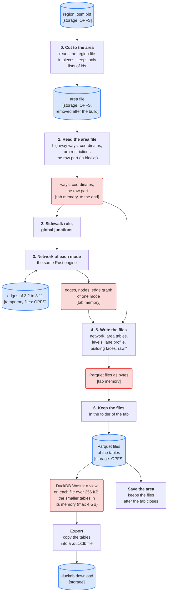
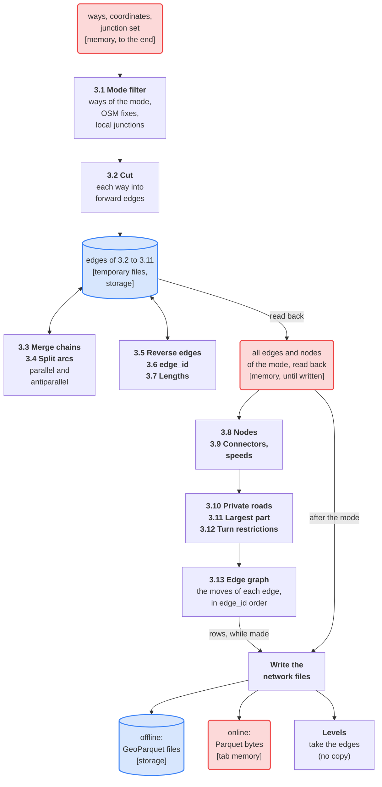

# Offline and online builds

duckOSM builds an area in two versions. They run the same Rust engine for the network, but they keep their data in
different places:

| | Offline | Online |
|---|---|---|
| Program | `duckosm-rust studio` (Rust only), or `duckosm studio` (the Python package) | [duckOSM Studio](https://khoshkhah.github.io/duckosm-studio/), a page in the browser |
| Where the build runs | on your computer, as a native program | in the browser, as WebAssembly |
| Storage | the disk of your computer | the browser's disk for the site (OPFS), which is small |
| Memory | the RAM of your computer; DuckDB has its own `memory_limit` | the memory of the tab: at most 4 GB for each WebAssembly module |
| SQL | DuckDB, built into the program | DuckDB-Wasm, a separate module in the page |
| Result | a `.duckdb` file on the disk | tables in DuckDB-Wasm; a `.duckdb` file only when you export |

This page shows each step of a build in each version: **what data the step reads, where that data is (in memory or in
storage), and how the step handles it.** It describes the Rust build. The Python `duckosm build` has the same steps,
but it cuts the file with osmium and loads `raw.*` with DuckDB first: see [How a build works](build.md).

## The signs

| Sign | Meaning |
|---|---|
| **Storage** | on a disk: a file of your computer, or a file in the browser's storage (OPFS) |
| **Memory** | in RAM: the program's memory, or the memory of the tab |
| **Kept to the end** | the data stays in memory until the build ends, also after the step that made it |
| **In blocks** | the step reads or writes a part at a time, so its memory does not grow with the area |
| **Spills** | DuckDB keeps the data in memory up to its limit, and writes the rest to a temporary file |

## The offline build

A build of a whole file with `duckosm-rust`. In the diagrams, a blue cylinder is storage, a red rounded box is memory, and a
plain box is a step.

## The online build

Studio in the browser. The page always builds an area that you choose inside a region file.

## Each step: where the data is and how it is handled

| Step | Offline | Online |
|---|---|---|
| **The input** | **Storage:** the `.osm.pbf` file on the disk. | **Storage:** the region file in OPFS. It comes one time through the relay, and the next area in the same region needs no download. |
| **0. Cut to the area** | A whole-file build has no cut. An area with a boundary: the Rust cut reads the file **in blocks** and writes the area file to **storage**. It keeps only lists of ids in **memory**. | Always. The same cut reads the region file **in blocks** from OPFS, and writes the area file to **OPFS**. It keeps only lists of ids in **tab memory**. The page removes the area file after the build. |
| **1. Read the file** | The highway ways, the coordinates of their nodes and the turn restrictions: read **in blocks**, kept in **memory to the end**, because the network, the area tables, the levels and the lane profile read them again. With the bus routes, the base-map layers or the building faces, also the raw part: the elements that these steps read. An area: from the area file. | The same, from the area file in OPFS, in **tab memory**. |
| **2. Sidewalk rule, global junctions** | Work on the ways in **memory**. The junction set is made one time for all modes, in **memory**. | The same, in tab memory. |
| **3. Network of each mode** | Sub-steps 3.2 to 3.11 keep the edges in temporary files in **storage**. Then the edges and the nodes of the mode are in **memory** until the mode is written. The rows of the edge graph go to the file while they are made. See [step 3 in detail](#step-3-in-detail-the-network-of-a-mode). | The same code. The temporary files are in **OPFS**, the rest is in **tab memory**, inside the 4 GB of the module. The rows of the edge graph go to Parquet bytes in tab memory. |
| **4. Write the network files** | GeoParquet files to **storage**, from the network in memory. | Parquet files as bytes in **tab memory**. |
| **5. Area tables, levels, lane profile** | Read the ways and the coordinates in **memory**; write files to **storage**. | The same, files as bytes in **tab memory**. |
| **6. The tables** | DuckDB reads the GeoParquet files into the `.duckdb` file in **storage**. It uses its `memory_limit` and **spills** what is more. | The page writes each file to **OPFS**, in a folder of the tab. A file larger than 256 KB **stays there**: DuckDB-Wasm reads it through a view, at each query. A smaller file, and the tables of the level editor (`visualization.*`), are copied into DuckDB-Wasm's **memory**. |
| **7. `raw.*`** | A whole-file build: `read_osm` gives the blocks of the file to DuckDB, which writes the tables to **storage**. The memory is DuckDB's limit and **one block for each thread**. An area: the area file is read again **in blocks** into Parquet files. Only the elements that the fixes change, and the tags of the network's ways, come from memory. | From the area file, as Parquet bytes in **tab memory**. DuckDB-Wasm reads them only to make the base-map layers, and then drops them: online there are no `raw.*` tables. |
| **The base-map layers** | An area: `features.sql` runs in DuckDB on `raw.*`; it **spills**. | `features.sql` runs in DuckDB-Wasm on the `raw_*` files in memory. The layers become Parquet files in **OPFS**, as the other tables. |
| **The result** | The `.duckdb` file in **storage**. | The Parquet files in **OPFS**, with views in DuckDB-Wasm (small tables in its **memory**). **Save** keeps the files after the tab closes; **Export** copies the tables into a `.duckdb` file to download. |

## Step 3 in detail: the network of a mode

The network step runs one time for each mode (driving, walking, cycling). The offline and the online build run the same
Rust code. Only the place of the files is different: offline they go to the disk, online they stay as bytes in the
memory of the tab.

The sub-steps have the numbers 3.1 to 3.13, in the order in which they run. The code (`build_network_junctions` in
`rust/duckosm-core/src/network.rs`) keeps the older numbers of the Python build, which are not in this order (for
example, its step 10 runs before its step 9b). The column "Code" in the table below gives them.

### The area: Kentucky

All measurements on this page use one area, the US state of Kentucky. The numbers come from the `.duckdb` file of the
measured build.

| Kentucky | Value |
|---|---|
| Land area | about 104,700 km² (the Geofabrik extract follows the border of the state) |
| Box | longitude −90.03 to −81.68, latitude 35.06 to 39.82 |
| Input file | `kentucky-latest.osm.pbf` from Geofabrik, 148 MB |
| OSM nodes, ways, relations | 19,621,446 / 1,739,326 / 14,561 |
| OSM roads (ways with a `highway` tag) | 643,820 |
| Driving: OSM roads in the network | 472,001 |
| Driving: edges / private edges / nodes | 2,114,699 / 221,101 / 923,134 |
| Driving: length of all edges (both directions together) | 350,771 km |
| Driving: rows of the edge graph / turn restrictions | 6,210,008 / 2,393 |

### The memory and the time of each sub-step (offline)

| How it was measured | |
|---|---|
| Computer | Mac mini (Mac18,5): Apple M6 chip, 12 cores (2 super, 4 performance, 6 efficiency), 16 GB memory, internal SSD, macOS 27.2 |
| Version | **offline only**: the native program `duckosm-rust` from duckOSM `main` of 2026-11-11 (before 3.1 to 3.11 moved to temporary files), `cargo build --release --features heap-probe`. For the whole build offline and online, see [Kentucky, offline and online](#kentucky-offline-and-online) |
| Area | Kentucky, driving mode (see [the area](#the-area-kentucky)) |
| Command | `duckosm-rust kentucky-latest.osm.pbf -o out --name kentucky -f duckdb -m driving --h3-resolution 8 --timing` |
| Memory | the live Rust heap after the sub-step: a counting allocator (`heap-probe`) that counts the bytes that the program has from the system. It does not include the memory of DuckDB |
| Time | the wall time of the sub-step: the middle value of three runs, with no other program working. The three runs had the same memory to 0.1 MiB, and times within 0.02 s |

| Sub-step | Code | What it reads | What it keeps | Change of live heap | Time |
|---|---|---|---|---|---|
| 3.1 Mode filter, local junctions | before 1 | the ways | the ways of the mode, the local junctions | +347 MiB | 0.22 s |
| 3.2 Cut | 1, 2 | the ways of the mode, the coordinates, the junctions | the forward edges, with their nodes and geometry; the local junctions are free after it | +509 MiB | 0.56 s |
| 3.3 Merge chains | 2b | the forward edges at each node | longer edges, the map of the old edge ids | 0 (peak +155 MiB) | 0.08 s |
| 3.4 Split arcs (parallel, antiparallel) | 3, 4 | the edges with the same way and end nodes | the edges, some cut in two | −142 MiB | 0.19 s |
| 3.5 Reverse edges | 5 | each two-way edge | a reversed copy of the edge | +362 MiB | 0.18 s |
| 3.6 edge_id | 6 | each edge, the nodes of its way | the stable `edge_id` and `edge_ref` | 0 | 0.20 s |
| 3.7 Lengths | 7 | each edge | a corrected length | 0 | 0.12 s |
| 3.8 Nodes | 8 | the end nodes of all edges | the nodes | +23 MiB | 0.17 s |
| 3.9 Connectors, walked edges, speeds | 8b, 8b2, 8c | each edge (driving: no connectors) | values on the edges | 0 | 0.01 s |
| 3.10 Private roads | 9 | each edge | two lists of edges | −2 MiB | 0.05 s |
| 3.11 Largest part, then the sort by `edge_id` | 10 | the end nodes of all edges | fewer edges | −6 MiB | 0.32 s |
| 3.12 Turn restrictions | 9b | the restriction relations, the edges of their ways | the restrictions | 0 | 0.05 s |
| 3.13 Edge graph | 9b2 | the edges that start at each node | nothing: the rows go to the file (the time includes the Parquet encoding) | 0 (peak +303 MiB) | 0.85 s |
| **The network step** | | | | **+1093 MiB** | **3.0 s** |

The other steps of the same build, for comparison (middle values): `raw.*` 1.2 s, the global junctions 0.18 s, writing the
network files 2.9 s, the levels 1.8 s, the lane profile 3.0 s, writing the `.duckdb` file 3.4 s, the whole build 17.0 s.

Since then, all sub-steps of step 3 and step 4 keep the edges in temporary files, not in memory (see
[the network step in limited memory](https://github.com/Khoshkhah/duckOSM/blob/main/docs/design/network_stream.md)).
The table above shows the memory before that change. On Kentucky the live heap during step 3 now holds only the ways,
the coordinates, the junctions and the nodes (770 MiB), and the peak of the network step went from 1803 MiB (the
table above) to 964 MiB. The network step takes 4.9 s: each pass writes and reads the edges. Step 5 still reads the edges
into memory again, so the peak of the build does not change yet (2347 MiB).

After the mode, 1.5 GB is live on Kentucky: the ways and the coordinates (0.4 GB, kept for the next modes and the
later steps) and the edges and the nodes of the mode (1.1 GB). The network files are then written, and the levels take
the edges. The edges are the largest part, so the next work moves them to storage (see
[What changes next](#what-changes-next)).

## Kentucky, offline and online

The same engine (duckOSM `main` of 2026-11-12, after PR #122) builds the same area offline and online. Both versions
give the same rows.

| How it was measured | |
|---|---|
| Computer | Mac mini (Mac18,5): Apple M6 chip, 12 cores, 16 GB memory, internal SSD, macOS 27.2 |
| Input | Kentucky cut from `us-south-latest.osm.pbf` (Geofabrik, 4.16 GB) with Geofabrik's border of the state, driving mode: 2,224,823 edges. This cut keeps each way with a node inside, whole, so it has more edges than `kentucky-latest.osm.pbf` |
| Offline | `duckosm-rust us-south-latest.osm.pbf --boundary kentucky.geojson --modes driving --format geoparquet`, 12 threads, `cargo build --release --features heap-probe`. Memory: the peak of the Rust heap in the step. Time: the middle value of three runs |
| Online | duckOSM Studio in Chromium (Playwright), 12 threads (the page uses the number of cores, at most 12), the area file and the temporary files of the network in OPFS. Memory: the WebAssembly memory after the step. It never gets smaller, so it is the peak up to that step. Two runs: the totals were the same to 0.1 s and the memory to 6 MiB |

**The whole build:**

| Kentucky, driving | Offline | Online |
|---|---|---|
| The network, area tables, levels and lane profile | 24.4 s, 2,161 MiB | 36.0 to 36.5 s, 2,130 MiB |
| The same, with `raw.*`, the base-map layers and the building faces | 34.4 s, 3,228 MiB | 48.4 s, 3,255 MiB |

A WebAssembly module can use at most 4 GB (4,096 MiB), so the online build with the layers has about 840 MiB free.

**Each step, with `raw.*`, the base-map layers and the building faces:**

| Step | Offline: time | Offline: peak memory | Online: time | Online: memory |
|---|---|---|---|---|
| 0. Cut to the area file | 11.4 s | 356 MiB | 17.6 s | 461 MiB |
| 1. Ways, coordinates, turn restrictions | 1.0 s | 619 MiB | 1.5 s | 886 MiB |
| 1. The raw part | 0.6 s | 1,423 MiB | 0.9 s | 1,702 MiB |
| 2. Sidewalk rule, global junctions | 0.4 s | 1,455 MiB | 0.8 s | 1,702 MiB |
| 3. The network of the mode | 4.9 s | 1,933 MiB | 9.6 s | 1,702 MiB |
| 4. Write the network files | 2.1 s | 2,085 MiB | 2.4 s | 2,350 MiB |
| 5. Read back the edges, bus routes | 0.8 s | 2,755 MiB | 1.0 s | 2,368 MiB |
| 5. Area tables, levels, lane profile | 4.2 s | 3,228 MiB | 3.4 s | 3,131 MiB |
| 5. Building faces | 4.7 s | 2,817 MiB | 6.6 s | 3,131 MiB |
| 5. `raw.*` (and online: join the parts of the files) | 2.7 s | 1,796 MiB | 4.8 s | 3,255 MiB |
| **All** | **34.4 s** | **3,228 MiB** | **48.4 s** | **3,255 MiB** |

- Step 0 is the slowest step in both versions: it reads all of the 4.16 GB region file. Online, the file comes from
  OPFS in pieces, and each thread unpacks and decodes about 1.6 times slower than natively.
- The area file has full blocks (3,053 for Kentucky). Before PR #122 it had one small block for each block of the region
  file (37,534), and each later step paid for each block.
- Step 3 takes 7.0 to 9.7 s online and 4.9 to 8.5 s offline, with 8 and with 12 threads. Its sort of the edges by
  `edge_id` writes sorted runs (about 580 MB) to temporary files. In some runs this writing paused for about 3 s (one
  native run: 3.19 s, the other three: 0.11 s). The disk of the Mac was 96% full; a nearly full SSD can pause writes, but
  this is not proved. The step does not wait for the allocator (0 spins on its lock). The table gives runs with the
  pause online (both runs) and without it offline (the middle run).
- Online, the memory in the last row includes the Parquet files of the result (2.6 GB in all), which stay in the tab
  memory until the page writes them to OPFS.
- On 2026-11-12, at the start of this work, the offline build took 54.2 s and 17,206 MiB, and the online build
  stopped at the limit of 4 GB. The changes are in
  [the cut to an area file](https://github.com/Khoshkhah/duckOSM/blob/main/docs/design/cut_stream.md).

## The limits today

- **Offline:** the network step. It keeps the ways, the coordinates and all edges of a mode in RAM, so the RAM of the
  computer limits the area. A whole country can be more than the RAM: France (driving) needed more than 26 GB.
- **Online:** the memory of the tab. A WebAssembly module has at most 4 GB. Kentucky with the layers and the building
  faces uses 3.3 GB of it (see [Kentucky, offline and online](#kentucky-offline-and-online)), so an area much larger
  than Kentucky does not fit. The area file, the temporary files and the Parquet files of the tables are in OPFS, and
  they count against the browser's storage for the site.

## What changes next

The work moves the data from memory to storage, step by step, in the same way in both versions:

1. `raw.*` and the global junctions go into DuckDB **first**, so that the later steps can query them.
2. The network step becomes passes over tables. Each pass reads one part (a batch of ways, the edges at one node, the
   edges with the same end nodes), writes its result as a table, and the next pass queries that table.
3. Online, the Parquet files stay in OPFS, and DuckDB-Wasm reads them from there (it does not copy them into memory).

The design notes are on GitHub: [the load step](https://github.com/Khoshkhah/duckOSM/blob/main/docs/design/streaming_load.md)
and [the network step in limited memory](https://github.com/Khoshkhah/duckOSM/blob/main/docs/design/network_stream.md).
