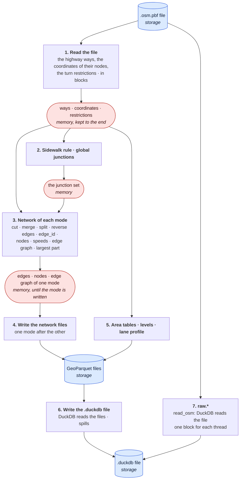
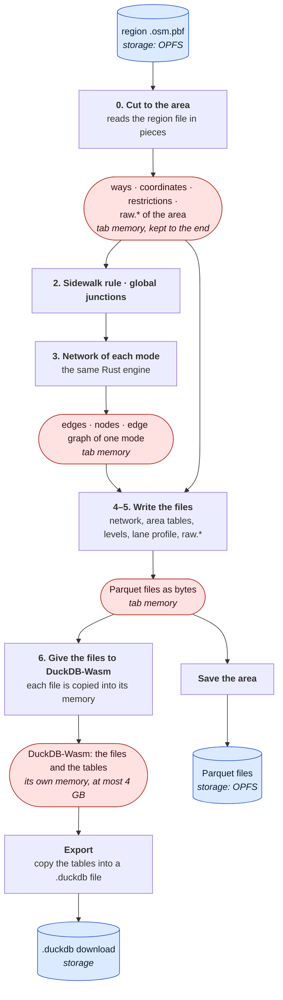

# Offline and online builds

duckOSM builds an area in two versions. They run the same Rust engine for the network, but they keep their data in
different places:

| | Offline | Online |
|---|---|---|
| Program | `duckosm-rust studio` (Rust only), or `duckosm studio` (the Python package) | [duckOSM Studio](https://khoshkhah.github.io/duckosm-studio/), a page in the browser |
| Where the build runs | on your computer, as a native program | in the browser, as WebAssembly |
| Storage | the disk of your computer | the browser's disk for the site (OPFS), which is small |
| Memory | the RAM of your computer; DuckDB has its own `memory_limit` | the memory of the tab: at most 4 GB for each WebAssembly module |
| SQL | DuckDB, built into the program | DuckDB-Wasm, a separate module in the page |
| Result | a `.duckdb` file on the disk | tables in DuckDB-Wasm; a `.duckdb` file only when you export |

This page shows each step of a build in each version: **what data the step reads, where that data is (in memory or in
storage), and how the step handles it.** It describes the Rust build. The Python `duckosm build` has the same steps,
but it cuts the file with osmium and loads `raw.*` with DuckDB first: see [How a build works](build.md).

## The signs

| Sign | Meaning |
|---|---|
| **Storage** | on a disk: a file of your computer, or a file in the browser's storage (OPFS) |
| **Memory** | in RAM: the program's memory, or the memory of the tab |
| **Kept to the end** | the data stays in memory until the build ends, also after the step that made it |
| **In blocks** | the step reads or writes a part at a time, so its memory does not grow with the area |
| **Spills** | DuckDB keeps the data in memory up to its limit, and writes the rest to a temporary file |

## The offline build

A build of a whole file with `duckosm-rust`. In the diagram, a cylinder is storage and a rounded box is memory.

## The online build

Studio in the browser. The page always builds an area that you choose inside a region file.

## Each step: where the data is and how it is handled

| Step | Offline | Online |
|---|---|---|
| **The input** | **Storage:** the `.osm.pbf` file on the disk. | **Storage:** the region file in OPFS. It comes one time through the relay, and the next area in the same region needs no download. |
| **0. Cut to the area** | A whole-file build has no cut. An area with a boundary: the Rust cut reads the file and keeps the area in **memory**. | Always. The Rust cut reads the region file **in blocks**, from OPFS, and keeps the ways, the coordinates and `raw.*` of the area in **tab memory, to the end**. |
| **1. Read the file** | The highway ways, the coordinates of their nodes and the turn restrictions: read **in blocks**, kept in **memory to the end**, because the network, the area tables, the levels and the lane profile read them again. | Part of the cut (step 0). |
| **2. Sidewalk rule, global junctions** | Work on the ways in **memory**. The junction set is made one time for all modes, in **memory**. | The same, in tab memory. |
| **3. Network of each mode** | All edges, nodes and the edge graph of the mode are in **memory** at the same time. The memory of a mode is free again when the mode is written; the largest mode sets the peak. | The same code, in **tab memory**, inside the 4 GB of the module. |
| **4. Write the network files** | GeoParquet files to **storage**, from the network in memory. | Parquet files as bytes in **tab memory**. |
| **5. Area tables, levels, lane profile** | Read the ways and the coordinates in **memory**; write files to **storage**. | The same, files as bytes in **tab memory**. |
| **6. The tables** | DuckDB reads the GeoParquet files into the `.duckdb` file in **storage**. It uses its `memory_limit` and **spills** what is more. | The page gives each file to DuckDB-Wasm, which takes a **copy** into its own memory. So each file is two times in memory: the page keeps its copy for the download. |
| **7. `raw.*`** | A whole-file build: `read_osm` gives the blocks of the file to DuckDB, which writes the tables to **storage**. The memory is DuckDB's limit and **one block for each thread**. An area: from the cut, through Parquet files. | From the cut, as Parquet bytes in tab memory, then a copy in DuckDB-Wasm. |
| **The base-map layers** | An area: `features.sql` runs in DuckDB on `raw.*`; it **spills**. | `features.sql` runs in DuckDB-Wasm on the `raw_*` files in its memory. |
| **The result** | The `.duckdb` file in **storage**. | The tables in DuckDB-Wasm (**memory**). **Save** writes the Parquet files to **OPFS**; **Export** copies the tables into a `.duckdb` file to download. |

## The limits today

- **Offline:** the network step. It keeps the ways, the coordinates and all edges of a mode in RAM, so the RAM of the
  computer limits the area. A whole country can be more than the RAM: France (driving) needed more than 26 GB.
- **Online:** the memory of the tab. The cut, the network and DuckDB-Wasm's copy of the files are all in memory, and a
  WebAssembly module has at most 4 GB. The files in OPFS also count against the browser's storage for the site.

## What changes next

The work moves the data from memory to storage, step by step, in the same way in both versions:

1. `raw.*` and the global junctions go into DuckDB **first**, so that the later steps can query them.
2. The network step becomes passes over tables. Each pass reads one part (a batch of ways, the edges at one node, the
   edges with the same end nodes), writes its result as a table, and the next pass queries that table.
3. Online, the Parquet files stay in OPFS, and DuckDB-Wasm reads them from there (it does not copy them into memory).

The design notes are on GitHub: [the load step](https://github.com/Khoshkhah/duckOSM/blob/main/docs/design/streaming_load.md)
and [the network step in limited memory](https://github.com/Khoshkhah/duckOSM/blob/main/docs/design/network_stream.md).
