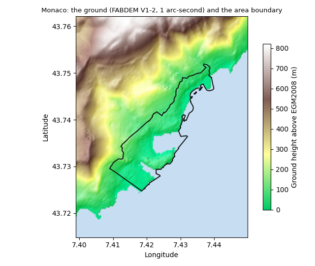

# The terrain of an area

duckOSM keeps the ground of an area and the heights of its roads in the area's database, from one elevation file (a DEM).
SimReady, roadstyle and urbanstyle read the terrain from there. The rules: [The ground reference](ground-reference.md).



*Monaco from FABDEM V1-2 (bare earth, about 30 m). The black line is the area boundary.*

## What the database holds

| Table or column | What it is |
|---|---|
| [`main.elevation_grid`](../reference/database.md#elevation_grid) | the terrain: one row for each DEM pixel over the area (`col`, `row`, `lon`, `lat`, `z`) |
| `nodes.ele` | the ground height at each node |
| `edges.z_from`, `edges.z_to` | the height at the two ends of each edge |
| `edges.z_vertices` | the height at each point of the edge line |
| [`main.elevation_metadata`](../reference/database.md#elevation_metadata) | source, product (`DTM` or `DSM`), resolution, vertical datum, license, and `sha256` (the ground id) |

- The grid covers the box of all nodes, plus 3 pixels on each side. It uses the raster's own pixels. A pixel with no value has `z` NULL.
- The Rust build writes the heights to `elevation_nodes_<mode>.parquet` and `elevation_edges_<mode>.parquet`. Studio writes them to
  `<mode>.elevation_nodes` and `<mode>.elevation_edges`. Join them on `node_id` and `edge_id`.
- `duckosm elevation` writes only the heights at the nodes and edges, not the grid.

## Who uses the terrain

| Project | Uses |
|---|---|
| SimReady | the road heights for the graded road profile, and the grid for the conformed ground in the GLB |
| roadstyle | the grid for one terrain file (PMTiles) for each area: 3D terrain, hillshade, bridge decks |
| `duckosm edit`, `ask`, `viz`, `studio` | the same terrain file in the map. With no grid, the map uses the AWS Terrain Tiles, its attribution says "Ground: AWS Terrain Tiles", and the command says it on the terminal |
| urbanstyle | not yet: it uses the AWS Terrain Tiles |

## Choose the DEM

- **Use a bare-earth model (DTM).** A surface model (DSM) has roofs and trees in it. FABDEM and national LiDAR models are DTMs.
  Copernicus GLO-30 is a DSM: `duckosm elevation` uses it when you give no `--dem` (in Europe, EU-DTM when you have an
  OpenTopography key). [DTM or DSM](../reference/elevation-sources.md#dtm-or-dsm).
- **Use a known vertical datum**, for example EGM2008.
- The file is a GeoTIFF in EPSG:4326 with 32-bit floats. Where to get one: [Elevation sources](../reference/elevation-sources.md).
- In duckOSM Studio, **Ground height (DEM)** lists the models for the area.

Give the DEM one time for each area, in the config file ([`elevation`](../reference/configuration.md#elevation)):

```yaml
elevation:
  dem: fabdem-monaco.tif
  product: DTM
  vertical_datum: EGM2008
  license: CC-BY-NC-SA-4.0
```

Or on the command line (`--dem` wins over the config):

```bash
duckosm monaco.osm.pbf --boundary monaco.geojson -m driving,walking -o monaco \
  --dem fabdem-monaco.tif --dem-product DTM --dem-vertical-datum EGM2008 --dem-license CC-BY-NC-SA-4.0
```

Without the product, the vertical datum and the license, the build stops. For a DEM that is not the reference, set
`reference: false` or `--dem-not-reference`.

## What the terrain does not show

- **Tunnels, bridges and two roads side by side at different heights.** Their heights come from the road heights, not
  from the grid: [where the ground cannot hold a road](ground-reference.md#where-the-ground-cannot-hold-a-road).
- **More detail than the DEM.** A 30 m DEM does not show a step or a curb.

Each project's terrain data, the road profile and the vehicle heights:
[terrain in detail](https://github.com/Khoshkhah/duckOSM/blob/main/docs/design/terrain_details.md). Commands:
[Add elevation](../guides/elevation.md).
