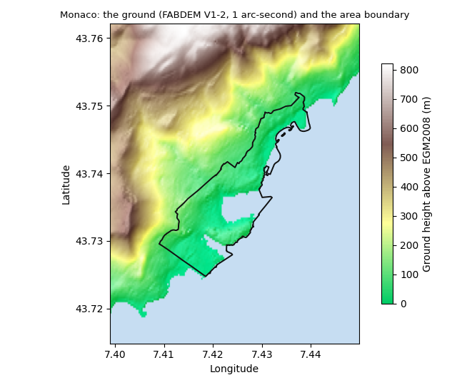
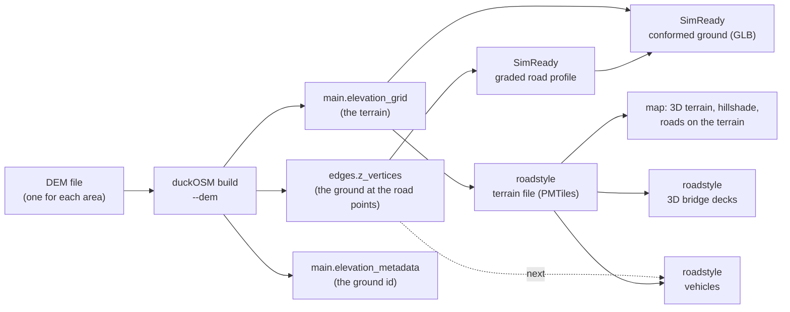
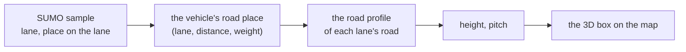

# The terrain of an area

A road network has heights at its nodes and edges. A map or a 3D scene also needs the ground **between** the roads: the hills, the
valleys and the shore. duckOSM keeps both in the area's database, from one elevation file (a DEM). The other projects (SimReady,
roadstyle, urbanstyle) read the terrain from there and do not choose a ground of their own.

This page tells what duckOSM stores, how the data goes to a map, and which choices are yours. The rules behind it are in
[The ground reference](ground-reference.md). The commands are in [Add elevation](../guides/elevation.md).



*Monaco from FABDEM V1-2 (a bare-earth model, 1 arc-second, about 30 m). The ground rises from the sea to more than 800 m in
3 km. The black line is the area boundary.*

## What the database holds

| Table or column | What it is | Made by |
|---|---|---|
| [`main.elevation_grid`](../reference/database.md#elevation_grid) | the **terrain**: one row for each pixel of the DEM over the area (`col`, `row`, `lon`, `lat`, `z`) | the Rust build with `--dem` |
| `nodes.ele` | the ground height at each node | the Rust build with `--dem`, or `duckosm elevation` |
| `edges.z_from`, `edges.z_to` | the height at the two ends of each edge | the same |
| `edges.z_vertices` | the height at each point of the edge line, in the order of the line | the same |
| [`main.elevation_metadata`](../reference/database.md#elevation_metadata) | where the heights come from: source, product (`DTM` or `DSM`), resolution, vertical datum, licence, and `sha256`, the SHA-256 of the DEM file (the ground id) | both |

The heights are in two forms today:

| Where | The heights |
|---|---|
| the `.duckdb` of the native build (`duckosm-rust --dem`) and of `duckosm elevation` | columns of each mode's `nodes` and `edges`, as in the table above |
| the Parquet files of the Rust build | apart, in `elevation_nodes_<mode>.parquet` (`node_id`, `ele`) and `elevation_edges_<mode>.parquet` (`edge_id`, `z_from`, `z_to`, `z_vertices`): the build writes `edges_<mode>.parquet` before it samples the DEM |
| duckOSM Studio, and its `make_duckdb.sql` | apart, as the tables `<mode>.elevation_nodes` and `<mode>.elevation_edges`: Studio makes one table for each Parquet file |

A reader of the Parquet files or of Studio's tables joins the heights to `nodes` on `node_id` and to `edges` on `edge_id`. One form
for every output is to do.

The grid is the terrain itself. The heights at the nodes and edges are samples of the same file at the road points.

## How the grid is made

The build reads the DEM one time and takes its pixels over the area:

- **The extent:** the box around the nodes of every mode, plus 3 pixels on each side. The margin lets a reader blend the edge of the
  terrain.
- **The pixels:** the raster's own pixels, with no resampling. A row is one pixel centre, and `z` is its height to the centimetre.
- **No data:** a pixel with no value (for example the open sea in some models) has `z` NULL.

For Monaco (`tests/data/monaco.osm.pbf`, the modes driving, walking and cycling) with the FABDEM crop, the grid has 140 × 103
pixels (14,420 rows, `z` from 0 to 543.77 m) and takes 45 KB of Parquet, about 3 bytes for each pixel. The road tables of the same area are much larger.

## From the database to a map



1. **duckOSM** writes the terrain grid, the heights at the road points and the ground id, all from the area's DEM.
2. **SimReady** makes the designed height of each road (the graded profile) from the heights at the road points. It then bends the
   ground to the roads (the conformed ground), so a road does not float above the terrain or go into it. Away from the roads, the
   ground stays as the DEM gives it.
3. **roadstyle** makes one terrain file for each area from the grid. The map draws its 3D terrain and hillshade from that file, and
   the roads, the bridge decks and the vehicles stand on it. A map of an area that has a ground does not use the AWS Terrain Tiles.

The dotted line is not built yet: the vehicles take their heights from the map's terrain today (see [The road profile](#the-road-profile)).

The same grid can go to the browser: a build with no file system (duckOSM Studio) gives the DEM as bytes, and the build writes the
same tables.

## Each part and its terrain

State on 2026-11-10.

| Part | Reads | Does | Writes or shows | State |
|---|---|---|---|---|
| **duckOSM build** (`duckosm-rust --dem`) | the DEM file (GeoTIFF, EPSG:4326, 32-bit floats) and its product, vertical datum and licence | reads the DEM one time; takes its pixels over the area and samples it at each node and at each point of each edge | `main.elevation_grid`, `nodes.ele`, `edges.z_from`, `z_to`, `z_vertices`, `main.elevation_metadata` with the ground id (`sha256`) | done |
| **duckOSM Studio** (browser) | the DEM file that you select in the step "Ground"; the step sets its product, datum and licence from a catalog | the same Rust build, in WebAssembly | the same data; the heights as the tables `<mode>.elevation_nodes` and `<mode>.elevation_edges`, not as columns; the terrain file for its map (made by roadstyle's WebAssembly) | done (Studio PRs 137 and 138) |
| **`duckosm elevation`** (Python) | a DEM file or a global source | samples the DEM at the nodes and the edge points | the same columns `ele`, `z_from`, `z_to`, `z_vertices`; no grid | done |
| **SimReady** `import-elevation` | the heights at the road points (duckOSM) and the bridge groups | writes heights at stations along each carriageway, then fits the graded profile: straight grades and vertical curves | `sim.elevation_profile` (`dem_sample`, `graded`, `earthwork_m`: cut or fill) | done for Monaco (FABDEM) and Vancouver (1 m LiDAR); some height checks still fail where a junction meets a lane |
| **SimReady** `gltf` adapter | `main.elevation_grid` and the graded profile | bends the ground to the roads (`terrain-conform`): the road's height across the roadway, a blend back to the DEM beside it | the conformed ground as a mesh in the GLB | on SimReady `main`; the conformed ground is not yet a grid that other projects read |
| **roadstyle** map terrain | the page option `ground`: the facts of `main.elevation_metadata` and the terrain file made from `main.elevation_grid` | encodes the grid as Terrarium PNG tiles in one PMTiles file (`roadstyle terrain`, `terrain_pmtiles`) | the 3D terrain and the hillshade; the attribution names the ground. With no ground: the AWS Terrain Tiles, and the page says "Ground: AWS Terrain Tiles" | done (roadstyle PRs 145, 146, 147); it draws the reference grid, not yet the conformed ground |
| **roadstyle** roads | the terrain of the page | draws each road as a line; MapLibre lays the line on the terrain | the road's height at each pixel is the terrain's height there | done |
| **roadstyle** 3D bridge decks | the terrain of the page | a deck is level between the ground at the two end nodes of its chain; its ramps rise from the ground at each free end; one height for each group of bridges (`rsSetBridgeHeight`) | the decks as one sloped mesh | done |
| **roadstyle** vehicles | a SUMO run (FCD and `net.xml`) and the page's roads | gives each vehicle the height of its road ([The road profile](#the-road-profile)) | the vehicles in 3D, with the tunnels' look | roadstyle PR 149 (not merged): the heights come from the map's terrain along each road; `z_vertices` is next |
| **urbanstyle** | the AWS Terrain Tiles (a switch "rough terrain") | sends the bridge deck heights from LiDAR to SimReady | its 3D map | to do: the same terrain file as roadstyle |

## The terrain data of SimReady and roadstyle

duckOSM's data is in [What the database holds](#what-the-database-holds). This section gives the data that SimReady and roadstyle
make from it.

### SimReady

| Data | Form | What it holds |
|---|---|---|
| `sim.elevation_profile` | a table of the model | the height of the road along each carriageway: one row for each station, with `carriageway_id`, `station_m`, `z_m` (the road surface at the reference line), `grade_pct`, `earthwork_m`, `outlier`, `source_id` and `method` |
| `method` of a row | a column | where the height comes from: `dem_node` (duckOSM's `nodes.ele`), `dem_sample` (duckOSM's `edges.z_vertices`), `osm_ele`, `dsm_sample`, `bridge_profile` (urbanstyle's LiDAR decks), `lidar_surface`, `survey_point`, `structure_line` (a span with no height: a straight line between its two ends), and `graded` |
| the `graded` rows | rows of `sim.elevation_profile` | the designed road that the lanes use: straight grades and vertical curves, fitted to the lower envelope of the samples, so a roof or a tree in a surface model is left out (`outlier`). `earthwork_m` is the graded height minus the terrain: positive is fill, negative is cut |
| a junction's height | computed in the `gltf` adapter | each movement path goes in a straight line from the graded height at the stop line of the road in to the stop line of the road out; each point of the junction area takes the height of the nearest path |
| the conformed ground | a height grid computed in the `gltf` adapter, not a table | a square grid of `gltf_terrain_step_m` (5 m). A point in the roadway has the road's height; beside it the ground blends back to the DEM over `max(terrain_blend_m, earthwork / embankment_slope_max)`; next to a road edge it stays 0.03 m under the road. A bridge or a tunnel bends nothing |
| the GLB | a file | the node `terrain` (one mesh of the conformed ground), one mesh for each carriageway and junction at its graded height, and the ground id in the root node's `extras.ground` |

Details: [elevation_profile](https://github.com/Khoshkhah/simready/blob/main/docs/2-model/elevation-profile.md),
[terrain-conform](https://github.com/Khoshkhah/simready/blob/main/docs/4-algorithms/terrain-conform.md), [the gltf adapter](https://github.com/Khoshkhah/simready/blob/main/docs/3-modules/adapters/gltf.md).

### roadstyle

| Data | Form | What it holds |
|---|---|---|
| the terrain file | one PMTiles v3 file for each area (`roadstyle terrain`, `terrain_pmtiles`) | Terrarium PNG tiles of 256 px. A pixel's RGB gives the height: `R × 256 + G + B / 256 − 32768` m (step 1/256 m). Its metadata has the ground id, `source`, `product`, `vertical_datum`, `resolution_m` and `license`. Monaco at 30 m: 105 KB, zooms 8 to 13 |
| the zooms of the file | a rule | the last zoom is the first zoom with a pixel not larger than the DEM's resolution (z13 for 30 m, at most z16); the first zoom is 5 zooms below it |
| a tile pixel | a rule | its height is the grid's bilinear value at the pixel's north-west corner (where MapLibre reads it). A pixel outside the grid takes the nearest valid height |
| the page option `ground` | JSON in the page | `{id, source, product, vertical_datum, resolution_m, license, terrain}`, where `terrain` is the file's URL, a `data:` URL or (in Studio) a file in the browser's disk. With no `ground`, the page uses the AWS Terrain Tiles and says so |
| the map's terrain | MapLibre's `raster-dem` source `rs-dem`, read through the protocol `rsground://` | the 3D terrain and the hillshade. MapLibre lays every road line on it |
| the 3D bridge decks | the style's source `decks`, one feature for each deck piece | `__rs_group` (the group of bridges), `__rs_s0`, `__rs_s1` (where the piece is along its chain), `__rs_enda`, `__rs_endb` (the chain's end nodes), `__rs_lift0`, `__rs_lift1` (0 on the ground, 1 at the full height), `__rs_full` (the full height, m). The page reads the ground under the deck from the terrain file |
| the vehicles' road profiles | in the page's memory only (roadstyle PR 149, not merged) | for each road that a vehicle uses: its length and one 4-byte height every 5 m along its line, read from the terrain file; for each SUMO lane, where its start and end are on the road's line. Made when a vehicle first needs the road; made again when the terrain changes |

Details: roadstyle's [ground_terrain.md](https://github.com/Khoshkhah/roadstyle/blob/main/docs/design/ground_terrain.md) and
[road_heights.md](https://github.com/Khoshkhah/roadstyle/blob/claude/vehicles-p2/docs/design/road_heights.md).

## The road profile

A **road profile** is the height of one road along its line: a list of (distance along the line, height), with a straight line
between two points. Every 3D product draws the road at that height, and a vehicle on the road takes its height from it, never from
the ground at its longitude and latitude. Two roads can cross at one point (a bridge over a road), so a point alone does not tell
the height. The road does.

### Where the heights come from

| Source | Heights | What it is | Who uses it |
|---|---|---|---|
| SimReady graded profile | `sim.elevation_profile`, method `graded`, at stations along each carriageway | the designed road: straight grades and vertical curves, with cut and fill (`earthwork_m`) | SimReady's `.xodr`, GLB and 3D dashboard; roadstyle vehicles (2026-11-11) |
| duckOSM `z_vertices` | one height at each point of the edge line | the DEM at the road's points: the ground, not a designed road. No cut, no fill | SimReady `import-elevation` |
| the map's terrain | the terrain file of the page, read along the road's own line | the same ground as the drawn road, at the road's centre line | roadstyle vehicles on a page with no road heights file, every 5 m |

A reader takes the first source that it has, in this order, and the page says which one it took. No source is used in silence.

### The rule for each kind of road

| Road | Profile |
|---|---|
| ground road | the heights of the source along its line |
| bridge | the heights of the source (SimReady's graded profile: the deck). The deck mesh is drawn on the same profile as the vehicles. Without a source, the deck rule of the page: level between the ground at the two ends of its chain of bridges, ramps from the ground at each free end, the group's height |
| tunnel | the heights of the source: under the ground. The tunnel is drawn at that depth, not on the hill above it. A vehicle in it has the tunnels' look: shown, faded or hidden |
| road beside a road at another height | the heights of the source. The road is drawn at that height as its own surface, with a wall at its side, not on the terrain ([The ground reference](ground-reference.md#where-the-ground-cannot-hold-a-road)) |
| junction | there is no drawn road inside a junction: the height goes in a straight line from the end of the road in to the start of the road out (SimReady: from the stop line of the road in to the stop line of the road out) |
| lane | a lane has the profile of its road. SUMO cuts each lane back from its junctions, so the lane's start and end are first put on the road's line; a place on the lane is the same fraction of that part of the road |

### An object on the road: a vehicle

A vehicle gets its height from its road, never from the ground at its longitude and latitude. roadstyle does this for the vehicles
of a SUMO run (roadstyle PR 149). The standard gives the same rule for a road surface and a bridge deck
([The ground reference](ground-reference.md), section 3).



1. **The road place.** A SUMO sample gives the vehicle's lane and the place of its front on that lane. Between two samples, the
   vehicle moves along the chain of lanes that joins them. Its middle is half its length behind its front. Its state is one to three
   entries of (lane, distance along the lane, weight):
    - one entry on a lane or in a junction;
    - two or three during a lane change, which takes 2 s: the weights go from the old lane to the new lane, and the position is the
      same blend of the two places.
2. **The height of each entry.**
    - On a lane: the profile of the lane's road, at the same fraction of the lane's part of the road.
    - In a junction (SUMO's internal lane): a straight line from the end of the road in to the start of the road out.
3. **The height of the vehicle** is the sum of the entries' heights times their weights, so a lane change has no step.
4. **The tilt.** The pitch is the slope of the main entry's profile over the vehicle's length. The roll is 0: a road is level across.
5. **The tunnel.** A vehicle on a tunnel road (or in a junction between two tunnel roads) has the tunnels' look of the page:
   shown, faded or hidden.
6. **The drawing.** The page draws each vehicle as a box: its bottom at the height, turned to its heading and pitch. The boxes are
   one custom layer in metres, above the 3D buildings, so the terrain and the buildings hide a vehicle behind them.

**A height that is not known yet** (the road's line, or a terrain tile, has not come): the vehicle is not drawn in that frame, and
the page asks again in the next frame. It is never drawn at a wrong height. `rs.vehicles.waiting()` gives how many wait.

**A vehicle with no lane** (a run with no `net.xml`, only longitude and latitude): it has no road, so it takes the terrain under it,
read on a 5 m grid. This is the only case where a point gives the height.

**The exaggeration** of the terrain applies to the vehicles too: a height from the terrain file includes it, so the road, the
deck and the vehicle stay together.

**State on 2026-11-11:** the road profiles come from SimReady's graded profile (roadstyle branch `claude/vehicles-p2`, not
merged). `edges.z_vertices` is not used: it is the DEM at the road's points, not a designed road. Next: the roads that the ground
cannot hold are drawn at the same profile.

### The road and the ground must agree

A road profile and the drawn terrain are two surfaces. Where they differ, a road or a vehicle floats or sinks. The standard fixes
this with the conformed ground ([The ground reference](ground-reference.md), section 3): under a road the ground has the road's height.

The conformed ground does this only where it can hold the road. At a bridge, a tunnel, or a road beside a road at another
height (a wall), one height grid cannot have both heights. There the road is drawn as its own surface at its profile, and
not on the terrain ([Where the ground cannot hold a road](ground-reference.md#where-the-ground-cannot-hold-a-road)). A road
laid on the terrain there is wrong, and a vehicle on it seems to leave the road in a tilted view: the vehicle is at the
road's height, and the drawn road is not.

Until roadstyle draws the conformed ground, the map lays each road on the reference terrain, and two differences stay:

- **Between road points that are far apart.** A profile is a straight line between two points; the terrain follows the hill. On
  Monaco's driving roads the median distance between two points is 7.5 m, but 9.5 % of the distances are more than 30 m (one DEM
  pixel), and the longest is 270 m.
- **Across a road on a side slope.** The terrain under a road is not level across it, but a road is. A vehicle 1.6 m beside the
  centre line has the centre line's height, and the drawn road under it can be about 1 m higher (measured on Monaco at the
  Sainte-Dévote roundabout).

### Memory

A profile is about 2 KB for each km of road (one 4-byte height every 2 m). Monaco's 2,765 driving roads (93 km) need about 0.3 MB,
and an area of 10,000 km of road about 20 MB.

## Choose the DEM

The DEM decides the quality of every height. Two choices matter:

- **A bare-earth model (DTM), not a surface model (DSM).** A DSM has the roofs and the trees in it. Its heights in a city are too
  high, and a street between tall buildings looks steep. FABDEM and national LiDAR models are DTMs. Copernicus GLO-30, the default of
  `duckosm elevation`, is a DSM. [DTM or DSM](../reference/elevation-sources.md#dtm-or-dsm).
- **A known vertical datum.** Every height is in metres above one datum, for example EGM2008. Two files on different datums do not
  agree, even when each one is correct.

To see which models cover your area, best first, use `duckosm.dem_sources.sources_for_bbox` ([Add elevation](../guides/elevation.md)). In duckOSM Studio
the step "Ground" lists them for the area on the map. You select the downloaded file, and the step fills in the product, the vertical datum and the licence.
With no file, the step can make a DEM from the AWS Terrain Tiles. That DEM is a surface model (`DSM`) with the label "Ground: AWS Terrain Tiles", so no
project takes it as the reference ground.

Give the DEM one time for each area, in the config file ([`elevation`](../reference/configuration.md#elevation)):

```yaml
elevation:
  dem: fabdem-monaco.tif
  product: DTM
  vertical_datum: EGM2008
  license: CC-BY-NC-SA-4.0
```

```bash
duckosm-rust --config my_area.yaml
```

Or give it on the command line. `--dem` wins over the config:

```bash
duckosm-rust monaco.osm.pbf --boundary monaco.geojson -m driving,walking -o monaco \
  --dem fabdem-monaco.tif --dem-product DTM --dem-vertical-datum EGM2008 --dem-license CC-BY-NC-SA-4.0
```

The DEM is the area's [ground reference](ground-reference.md): without its product, its vertical datum and its license the build stops,
unless you mark it as not the reference (`reference: false`, or `--dem-not-reference`).

The file is a GeoTIFF in EPSG:4326 with 32-bit floats. `duckosm elevation` can add heights to a database that is already built
(`--dem` or `--source`), but it writes only the heights at the nodes and edges, not the grid. Where to get a DEM:
[Elevation sources](../reference/elevation-sources.md).

## What the terrain does not show

- **Tunnels and bridges.** The ground is the ground. A tunnel lies under the hill, and a bridge spans the valley. Their own heights
  come from the road heights, not from the grid.
- **A wall between two roads.** Two roads side by side at different heights have a wall between them. The grid steps from cell
  to cell there, as a saw-tooth. The roads are drawn at their own heights, not on the grid.
- **More detail than the DEM has.** A 30 m DEM shows the hills of Monaco, not a step or a kerb. A finer DEM (a 1 m LiDAR model)
  gives a finer terrain, and a bigger grid.

Related: [The ground reference](ground-reference.md), [Add elevation](../guides/elevation.md),
roadstyle's [map terrain design](https://github.com/Khoshkhah/roadstyle/blob/main/docs/design/ground_terrain.md) and
[road heights design](https://github.com/Khoshkhah/roadstyle/blob/claude/vehicles-p2/docs/design/road_heights.md),
[Database schema](../reference/database.md#elevation_grid).
