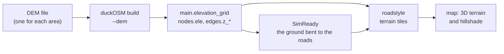

# The terrain of an area

A road network has heights at its nodes and edges. A map or a 3D scene also needs the ground **between** the roads: the hills, the
valleys and the shore. duckOSM keeps both in the area's database, from one elevation file (a DEM). The other projects (SimReady,
roadstyle, urbanstyle) read the terrain from there and do not choose a ground of their own.

This page tells what duckOSM stores, how the data goes to a map, and which choices are yours. The rules behind it are in
[The ground reference](ground-reference.md). The commands are in [Add elevation](../guides/elevation.md).


*Monaco from FABDEM V1-2 (a bare-earth model, 1 arc-second, about 30 m). The ground rises from the sea to more than 800 m in
3 km. The black line is the area boundary.*

## What the database holds

| Table or column | What it is | Made by |
|---|---|---|
| [`main.elevation_grid`](../reference/database.md#elevation_grid) | the **terrain**: one row for each pixel of the DEM over the area (`col`, `row`, `lon`, `lat`, `z`) | the Rust build with `--dem` |
| `nodes.ele` | the ground height at each node | the Rust build with `--dem`, or `duckosm elevation` |
| `edges.z_from`, `edges.z_to` | the height at the two ends of each edge | the same |
| `edges.z_vertices` | the height at each point of the edge line | the Rust build with `--dem` |
| [`main.elevation_metadata`](../reference/database.md#elevation_metadata) | where the heights come from: source, product (`DTM` or `DSM`), resolution, vertical datum, licence, and `sha256`, the SHA-256 of the DEM file (the ground id) | both |

The grid is the terrain itself. The heights at the nodes and edges are samples of the same file at the road points.

## How the grid is made

The build reads the DEM one time and takes its pixels over the area:

- **The extent:** the box around the nodes of every mode, plus 3 pixels on each side. The margin lets a reader blend the edge of the
  terrain.
- **The pixels:** the raster's own pixels, with no resampling. A row is one pixel centre, and `z` is its height to the centimetre.
- **No data:** a pixel with no value (for example the open sea in some models) has `z` NULL.

For Monaco (`tests/data/monaco.osm.pbf`, the modes driving, walking and cycling) with the FABDEM crop, the grid has 140 × 103
pixels (14,420 rows, `z` from 0 to 543.77 m) and takes 45 KB of Parquet, about 3 bytes for each pixel. The road tables of the same area are much larger.

## From the database to a map



1. **duckOSM** writes the grid and the heights from the area's DEM.
2. **SimReady** can bend the ground to the road heights ("the conformed ground"). Under a road the ground then has the road's height,
   so a road does not float above the terrain or go into it. Away from the roads, the ground stays as the DEM gives it.
3. **roadstyle** makes terrain tiles from that ground, one file for each area, and the map draws its 3D terrain and hillshade from
   that file. A map of an area that has a ground does not use the AWS Terrain Tiles.

The same grid can go to the browser: a build with no file system (duckOSM Studio) gives the DEM as bytes, and the build writes the
same tables.

## Choose the DEM

The DEM decides the quality of every height. Two choices matter:

- **A bare-earth model (DTM), not a surface model (DSM).** A DSM has the roofs and the trees in it. Its heights in a city are too
  high, and a street between tall buildings looks steep. FABDEM and national LiDAR models are DTMs. Copernicus GLO-30, the default of
  `duckosm elevation`, is a DSM. [DTM or DSM](../reference/elevation-sources.md#dtm-or-dsm).
- **A known vertical datum.** Every height is in metres above one datum, for example EGM2008. Two files on different datums do not
  agree, even when each one is correct.

Give the DEM one time for each area, in the config file ([`elevation`](../reference/configuration.md#elevation)):

```yaml
elevation:
  dem: fabdem-monaco.tif
  product: DTM
  vertical_datum: EGM2008
  license: CC-BY-NC-SA-4.0
```

```bash
duckosm-rust --config my_area.yaml
```

Or give it on the command line. `--dem` wins over the config:

```bash
duckosm-rust monaco.osm.pbf --boundary monaco.geojson -m driving,walking -o monaco \
  --dem fabdem-monaco.tif --dem-product DTM --dem-vertical-datum EGM2008 --dem-license CC-BY-NC-SA-4.0
```

The DEM is the area's [ground reference](ground-reference.md): without its product, its vertical datum and its license the build stops,
unless you mark it as not the reference (`reference: false`, or `--dem-not-reference`).

The file is a GeoTIFF in EPSG:4326 with 32-bit floats. `duckosm elevation` can add heights to a database that is already built
(`--dem` or `--source`), but it writes only the heights at the nodes and edges, not the grid. Where to get a DEM:
[Elevation sources](../reference/elevation-sources.md).

## What the terrain does not show

- **Tunnels and bridges.** The ground is the ground. A tunnel lies under the hill, and a bridge spans the valley. Their own heights
  come from the road heights, not from the grid.
- **More detail than the DEM has.** A 30 m DEM shows the hills of Monaco, not a step or a kerb. A finer DEM (a 1 m LiDAR model)
  gives a finer terrain, and a bigger grid.

Related: [The ground reference](ground-reference.md), [Add elevation](../guides/elevation.md),
[Database schema](../reference/database.md#elevation_grid).
