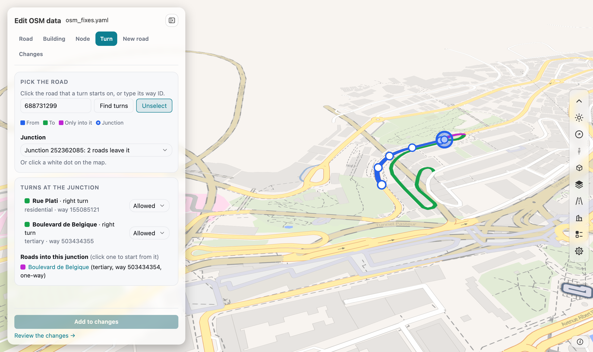

# Edit OSM data: the details of the editor

The user guide is [Fix the OSM data](../guides/edit-osm-data.md). This file keeps the details of the editor: the checks of
the forms, the box of an object that is in your changes, the time of each change, the merge of an added file, and the record
that each change writes, with its result in the tables.

## The checks of the forms

The panel checks each value while you type, and it does not let you add a change that is not correct:

- **An error** (red): the value is not correct, for example lanes `0`, a max speed `fast`, or a turn arrow `straight`. The reason is under
  the field, and **Add to changes** is off until you correct the value. A value that the OSM data has already is not blocked if you do not
  change it.
- **A warning** (amber): two fields do not agree, but OSM can have it, for example a bridge with layer 0. You can add the change.
- **A field that is off**: another choice closes it, for example a footway has no sidewalk. The reason is under the first field that it
  closes. When your choice closes a field that has a value, the panel clears the value and says so. **Reset** brings it back.

If a table has no `tags` column (an area that a host restored from saved files, for example in Studio), the tags of the object are empty and the box says so. The object is still found. The form shows no current values, and a rule that you add still works (the fixes file needs only the type and the ID of the object). The walls come from `main.building_faces` and do not need tags. A picked object is never called "not in this area" by mistake. A building is looked up in `features.buildings`, then among the walls
(`main.building_faces`); a node in the traffic features, the junctions of the ways, then any node of the networks and the doors. When a query fails, the box says
that the data could not be read, and gives the reason.

**Lanes each way** is the lanes of one direction (the rule `lanes` of duckOSM sets the two directions). **Lanes forward** and
**Lanes back** replace it for one direction. In the **New road** tab, **Lanes (total)** is the OSM tag `lanes`.

**Access** has the OSM tags `access`, `motor_vehicle` (Cars), `foot` (Walking) and `bicycle` (Bikes). A road with **No** for a mode is not
in the network of that mode after the next build. An older fixes file can have the duckOSM rule `exclude_modes`. The form shows it under
**Networks (a duckOSM rule)**, with a button that removes it.

The panel also checks between objects:

- If you pick another object, another road or junction in the **Turn** tab, or push **Esc** while you draw a road, and your edits are not
  added, the panel asks before it drops them. The page also asks before it closes.
- In the **Turn** tab, a road that gets an **Only …** rule closes the lists of the other roads at that junction. If every turn has a
  **No …** rule, the bar says that the junction is a dead end for that road.
- When you delete a road or a building, the panel offers to delete the turn rules or the wall rules of it too.
- A new road must join a junction at one point or more: the build keeps only the roads that join the network. Click near a junction to join
  it (the point turns green).
- If you type an ID that is not in the tab (for example a building ID in the **Road** tab), the panel offers the correct tab. For an ID that
  is not in the area, you must push **Add anyway**.

## An object that is in your changes

When you pick an object that is in your changes already, a box shows over the form, and the form waits:

> **This road is in your changes:** lanes 2, name "B". **Edit it** **Delete it**

- **Edit it** opens the form with the values of your changes.
- **Delete it** removes the changes of the object, and the form opens with the OSM data. **Undo** in the **Changes** tab brings them back.

The box shows for a road, a building (with its walls), a node, the turn rules of a road at a junction, and a new road that you open
from the **Changes** tab.

A file that you load can have two or more rules for one object. Then the box says how many. **Edit it** joins them into one rule: for the
same key, the later rule wins, as in the build. The build result does not change. The **Changes** tab marks such an object with "2 rules".

## The time of each change

Each record that the editor writes has the key `changed`: your local date and time, with the offset from UTC.

```yaml
overrides:
  - osm_id: 503462470
    lanes: 3
    changed: '2026-11-06T14:32:05+01:00'
```

- The editor sets the time of now on each record that you add or change. A record that you do not change keeps its time.
- When the page opens a file, each record with no `changed` (an old file, or a file that you wrote by hand) gets the time of now, and the
  page saves the file.
- The **Changes** tab shows the time under each change, for example "6 Nov 2026, 14:32", in the time zone of your browser. The box "This
  road is in your changes" shows it too.
- The build does not read `changed`.

## Add a file

**Add a file** in the **Changes** tab adds the changes of another fixes file to your changes. Select the file (`.yaml` or `.yml`) in the
dialog of your browser.

- If the file is not valid, the page shows the error and changes nothing.
- A record of the file with no `changed` gets the time of now.
- If an object is in the two files, the change with the later time stays, and the other goes. The rule of a road and its tag edit count
  as one object.
- If the two changes of an object have the same time, the two stay, the added one last. The build applies them in file order, so the
  added change wins key by key. The **Changes** tab shows "2 rules" on the object.
- If a new road of the file has the ID of one of your new roads, and other points, it is another road. It gets the next free ID, and
  the turn rules of the file that use it get the new ID too.
- A status line tells the result. **Undo** takes back all of the file in one step. The page saves the result in the fixes file at once.

Before the page writes a file that was there already, it keeps the old file as `osm_fixes.yaml.bak`. The page writes the file from the
rules of the panel, so the comments of a file that you wrote by hand do not stay. If the file is not valid YAML, the page tells you and
does not change it.

**Build again** is off when the database has no record of its build: a database from an older duckOSM, from duckOSM Studio, or from
`duckosm` without `--config`. The reason shows under the button. Build the database again with `duckosm build`, then it works.

`duckosm edit my_area.duckdb` opens the same page from duckOSM's Rust program. Its **Build again** runs the build of the Rust program
(`duckosm --config`). It writes the `.duckdb` file only, and it skips the steps that the Rust program does not have.

## What each change writes

This section shows, for each change that you make in the editor, the record that the editor writes in the fixes file, and the result
in the tables after `duckosm build`. The complete file that the editor wrote for these changes on the Monaco sample is
[`tests/data/editor_changes/osm_fixes.yaml`](https://github.com/Khoshkhah/duckOSM/blob/main/tests/data/editor_changes/osm_fixes.yaml). The test `tests/test_editor_changes.py` builds Monaco with it in the two engines and checks each result
below.

The editor writes two kinds of record for an object:

- `overrides` (by `osm_id`): the keys that act on the network of each mode: Lanes each way (`lanes`), Lanes forward and back,
  One-way yes or no, Layer, the turn lanes, and Delete (`remove`).
- `extra.tag_edits`: the OSM tags, with `set` and `delete`. `was` keeps the value before the first change; the build does not read it.

Each record also has `changed`, the time of the change ([The time of each change](#the-time-of-each-change)). The examples below leave it out.

### Road tab

```yaml
overrides:
  - osm_id: 503462470
    lanes: 3
    turn_lanes_forward: left|through|through
  - osm_id: 766768153
    layer: 1
  - osm_id: 4229577
    remove: true
extra:
  tag_edits:
    - type: way
      id: 503462470
      set: {name: Boulevard Test, maxspeed: '30', sidewalk: both, surface: paving_stones}
    - {type: way, id: 157719645, set: {highway: service}}
    - {type: way, id: 4230099, set: {motor_vehicle: 'no'}}
    - {type: way, id: 4230011, set: {foot: 'no'}}
    - {type: way, id: 165636031, set: {oneway: '-1'}}
    - {type: way, id: 766768153, set: {bridge: 'yes'}}
```

| Change in the form | Record | Result after the build |
|---|---|---|
| Lanes each way 3 | `overrides`: `lanes: 3` | `driving.edges.lanes` is 3 in each direction (before: 1) |
| Turn lanes fwd | `overrides`: `turn_lanes_forward` | `driving.lane_profile.turn` of the forward edges: left, through, through. `raw.ways` has the tag `turn:lanes:forward` |
| Name | tag edit `name` | `name` of the edges of all modes |
| Max speed 30 | tag edit `maxspeed` | `driving.edges.maxspeed_kmh` is 30 (before: 60, the default of the class), and the travel times change |
| Sidewalk both | tag edit `sidewalk` | `walking.edges.walk_type` is `sidewalk` (before: `shared_road`) |
| Surface | tag edit `surface` | `surface` of the edges |
| Road class | tag edit `highway` | `highway` of the edges (`residential` to `service`): the speed, the cost and the networks follow the new class |
| Cars No | tag edit `motor_vehicle: 'no'` | the road is not in `driving.edges` (before: 18 edges); it stays in walking and cycling |
| Walking No | tag edit `foot: 'no'` | the road is not in `walking.edges` (before: 14 edges); it stays in driving |
| Bikes No | tag edit `bicycle: 'no'` | the road is not in `cycling.edges` |
| One-way, Yes reverse | tag edit `oneway: '-1'` | one direction only, against the drawing of the way: 6 driving edges (before: 12) |
| One-way, Yes or No | `overrides`: `oneway: true` or `false` | one or two directions |
| Layer 1, Bridge yes | `overrides`: `layer: 1`, tag edit `bridge` | `layer` and `bridge` of the edges |
| Delete this road | `overrides`: `remove: true` | the road is in no network and no layer (before: 12 edges) |

### Building tab

```yaml
overrides:
  - osm_id: 1152567278
    remove: true
extra:
  tag_edits:
    - type: way
      id: 23715051
      set: {building:levels: '9', height: '30', roof:shape: flat, building:colour: '#ffffff'}
    - {type: relation, id: 393226, delete: [building]}
  building_faces:
    - {building: 23715051, from_node: 256791677, to_node: 256791676, type: front, door: main}
```

| Change in the form | Record | Result after the build |
|---|---|---|
| Floors, height, roof, facade | tag edit | `features.buildings.tags` has the new values (before: `building:levels` 2) |
| Wall type and its door | `extra.building_faces` | `main.building_faces`: `face_type` is `front`, `edited` is true and `door` is `main` (before: `side`, no door). Needs `options.building_faces` |
| Delete this building (a way) | `overrides`: `remove: true` | the building is not in `features.buildings` |
| Delete this building (a relation) | tag edit: delete `building` | the relation is not in `features.buildings` |
| Kind of a door | tag edit of the door node: `entrance` | `main.building_entrances`: `duckosm build` makes it with `options.building_faces`, as Studio does |

### Node tab

```yaml
extra:
  tag_edits:
    - {type: node, id: 21912089, set: {highway: traffic_signals}}
    - {type: node, id: 13135657937, delete: [highway]}
    - {type: node, id: 21912099, set: {highway: crossing, crossing: marked, kerb: lowered}}
```

| Change in the form | Record | Result after the build |
|---|---|---|
| Kind Traffic signals on a junction | tag edit `highway` | a new row in `features.traffic` with `kind` `traffic_signals` |
| Delete this traffic signal | tag edit: delete `highway` | the node is not in `features.traffic` |
| Kind Crossing, with crossing and kerb | tag edit | a new row in `features.traffic` with `kind` `crossing` and the tags |

### Turn tab

```yaml
turn_restrictions:
  - {from_way: 4097656, via_node: 21912099, to_way: 157719652, restriction: only_right_turn}
  - {from_way: 4097656, via_node: 21912089, to_way: 35092475, restriction: no_straight_on}
```

| Change in the form | Record | Result after the build |
|---|---|---|
| A rule for a road that leaves the junction | `turn_restrictions` | a row in `driving.turn_restrictions` (`restriction_type`, `from_edge_id`, `via_node`, `to_edge_id`); routing on `driving.edge_graph` obeys it |

After you pick a road, each of its junctions is a white dot on the map. The start of a one-way road is a junction too, with a gray ring: no turn from the road is there, and the panel says so.  The **Junction** box lists the same junctions. Click a dot to choose that junction, or choose it in the box.
The blue ring shows the chosen one.

On the map, the roads at the junction have the colors of the legend: the **From** road is blue, the roads that **leave** the junction are green, and the
roads that **only arrive** (a one-way road into the junction) are violet. The colors on the map are the same as in the legend and the list, in the light
and in the dark theme. A road of another network that meets the junction and is not in the driving network (a footway, a path) is named under the list.
It is not on the map of this tab.



### New road tab

```yaml
new_ways:
  - id: 9000000000000
    nodes: [21911886, [7.4235072, 43.7371133], 21914340]
    tags: {highway: service, name: New lane}
```

| Change in the form | Record | Result after the build |
|---|---|---|
| Points, Road class, Name, … | `new_ways`: a node ID for a point on a junction, `[lon, lat]` for a free point | 2 edges in `driving.edges` with `osm_id` 9000000000000, and in the other modes that the class allows |

