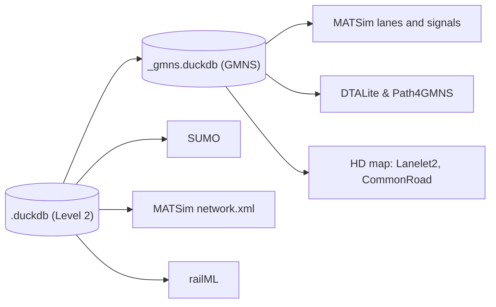

# 3. GMNS network

The multi-resolution network in the GMNS standard, from macro (links) to micro (lanes, movements, and cells), for simulation and traffic assignment.

| Read by | Export | Reads | Command |
|---|---|---|---|
| DTALite, Path4GMNS | [GMNS](../gmns.md): macro tables ([all GMNS tables](../gmns_tables.md)) | Level 2 db | `duckosm gmns` |
| Mesoscopic and microscopic simulators | [GMNS meso and micro](../gmns.md#meso-and-micro-networks): road sections and lane cells | Level 2 db | `duckosm gmns --meso --micro` |
| MATSim, BEAM, eqasim | [MATSim](../matsim.md): `network.xml` | Level 2 db | `duckosm matsim` |
| MATSim | [MATSim](../matsim.md#lanes-and-signals): lanes and signals | GMNS db | `duckosm matsim-lanes` |
| SUMO | [SUMO](../sumo.md): plain XML and `.netccfg` (netconvert makes the `.net.xml`) | Level 2 db | `duckosm sumo` |
| Rail planning: OpenTrack, RailSys | [railML 2.4](../railml.md) | Level 2 db (`raw.*`) | `duckosm railml` |

railML is **experimental**: tested for structure, not yet loaded in target tools.

## Multi-resolution model

Level 3 takes the routable network from Level 2 and builds a [GMNS (General Modeling Network Specification)](https://zephyr-data-specs.github.io/GMNS/) model in DuckDB.

GMNS has three scales:

* **Macro (`duckosm gmns`):** links, nodes, and turning movements with lane attributes. For traffic assignment, routing, and transport planning in DTALite and Path4GMNS.
* **Meso (`--meso`):** road sections and junction lane connectors. For mesoscopic simulators that move groups of vehicles through junctions.
* **Micro (`--micro`):** lane cells of 7 m, lane changes, and lane-to-lane turns. For microscopic simulators that move each vehicle.

## Which export reads which database

Only some exports read the GMNS db. The others read the Level 2 db:

* **SUMO** reads the Level 2 db. The direction is the opposite: `duckosm gmns` runs the SUMO export and netconvert to get the lane connectors of `gmns_driving`.
* **MATSim:** `network.xml` comes from the Level 2 db. The lanes and signals files (`matsim-lanes`) come from the GMNS `movement`, `link` and `node` tables.
* **railML** reads the rail ways and nodes from `raw.*` of the Level 2 db.
* **HD map exports** (Lanelet2, CommonRoad, the lane graph) read the GMNS db.
* **Same ids:** each GMNS link, SUMO edge and MATSim link has the duckOSM **`edge_id`** as its id. Thus you can join simulation results to the OSM roads.

## Graph machine learning

`duckosm.ml.to_pyg()` makes a homogeneous PyTorch Geometric `Data` from the Level 2 network ([ML reference](../../reference/sdk/ml.md)). duckOSM has no `HeteroData` export.

The GMNS tables have the entities of a heterogeneous graph, and you can read them with SQL:

| GMNS table | One row is | Joins on |
|---|---|---|
| `node` | a junction | `node_id` |
| `link` | one direction of a road | `link_id` (= `edge_id`), `from_node_id`, `to_node_id` |
| `lane` | a lane of a link | `lane_id`, `link_id` |
| `movement` | a legal turn, with its lanes in and out | `mvmt_id`, `node_id`, `ib_link_id`, `ob_link_id` |
| `signal_controller` | a node with traffic lights (OSM has no signal timing) | `controller_id`, `node_id` |

For the full specification, see [GMNS](../gmns.md) and the [GMNS tables reference](../gmns_tables.md).
