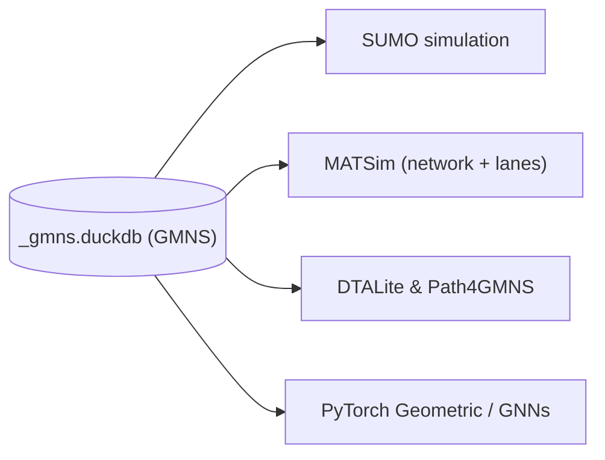

# 3. GMNS network

The multi-resolution network in the GMNS standard, from macro (links) to micro (lanes, movements, and zones), powering simulation and Graph Neural Networks.

| Read by | Export | Command |
|---|---|---|
| DTALite, Path4GMNS | [GMNS](../gmns.md): macro tables ([all GMNS tables](../gmns_tables.md)) | `duckosm gmns` |
| PyTorch Geometric, GNNs | [PyG HeteroData](../../reference/sdk/ml.md): heterogeneous urban graph tensors | `duckosm.ml.to_pyg()` |
| Mesoscopic and microscopic simulators | [GMNS meso and micro](../gmns.md#meso-and-micro-networks): road sections and lane cells | `duckosm gmns --meso --micro` |
| MATSim, BEAM, eqasim | [MATSim](../matsim.md): `network.xml`, lanes and signals | `duckosm matsim`, `matsim-lanes` |
| SUMO | [SUMO](../sumo.md): plain XML and `.netccfg` (netconvert makes the `.net.xml`) | `duckosm sumo` |
| Rail planning: OpenTrack, RailSys | [railML 2.4](../railml.md) | `duckosm railml` |

railML is **experimental**: tested for structure, not yet loaded in target tools.

## Multi-resolution model

Level 3 takes the routable network from Level 2 and builds a complete [GMNS (General Modeling Network Specification)](https://zephyr-data-specs.github.io/GMNS/) model in DuckDB.

GMNS structures the network across three scales:

* **Macro (`duckosm gmns`):** links, nodes, and turning movements with lane attributes. For traffic assignment, routing, and transport planning in DTALite and Path4GMNS.
* **Meso (`--meso`):** road sections and junction lane connectors. For mesoscopic simulators moving groups of vehicles through intersections.
* **Micro (`--micro`):** discrete 7-meter lane cells, lane changes, and lane-to-lane turning arcs. For microscopic simulators tracking individual vehicles.

## The bridge to simulation and AI

The GMNS DuckDB database serves as the common interchange format for downstream models:

* **Traffic Simulation:** Directly generates ready-to-run network configurations for [SUMO](../sumo.md) and [MATSim](../matsim.md), complete with lane counts, turning permissions, and traffic signal timing.
* **Graph Machine Learning:** Converts GMNS nodes, links, and lane movements directly into PyTorch Geometric heterogeneous tensors (`HeteroData`) for traffic prediction, speed estimation, and spatial GNNs.
* **Consistent IDs:** Every GMNS link, SUMO edge, and MATSim link preserves the exact same duckOSM **`edge_id`**, making it trivial to join simulation results back to the original OSM roads.

For the full specification and schema details, see [GMNS](../gmns.md) and the [GMNS tables reference](../gmns_tables.md).
