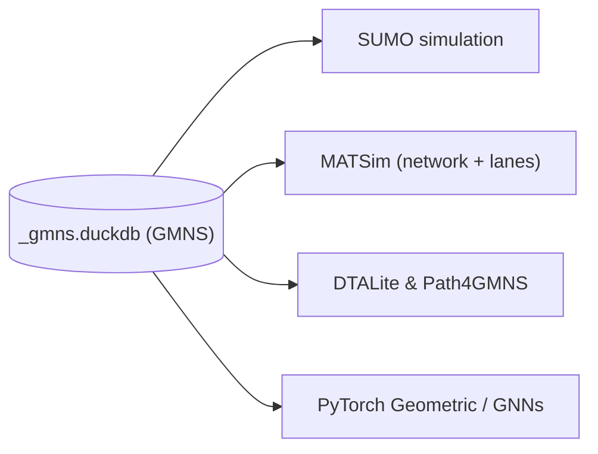
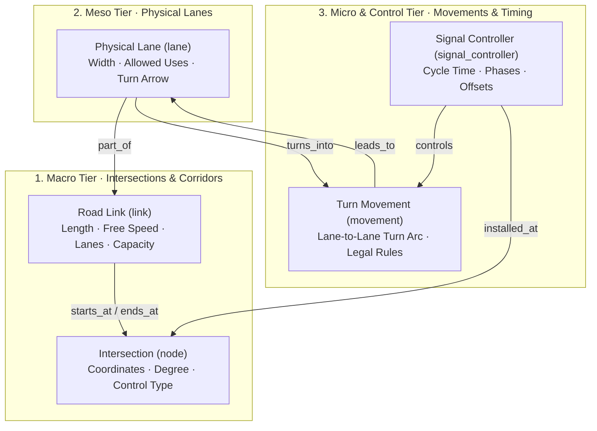

# 3. GMNS network

The multi-resolution network in the GMNS standard, from macro (links) to micro (lanes, movements, and cells), powering simulation and Graph Neural Networks.



| Read by | Export | Command |
|---|---|---|
| DTALite, Path4GMNS | [GMNS](../gmns.md): macro tables ([all GMNS tables](../gmns_tables.md)) | `duckosm gmns` |
| PyTorch Geometric, GNNs | [PyG HeteroData](../../reference/sdk/ml.md): heterogeneous urban graph tensors | `duckosm.ml.to_pyg()` |
| Mesoscopic and microscopic simulators | [GMNS meso and micro](../gmns.md#meso-and-micro-networks): road sections and lane cells | `duckosm gmns --meso --micro` |
| MATSim, BEAM, eqasim | [MATSim](../matsim.md): `network.xml`, lanes and signals | `duckosm matsim`, `matsim-lanes` |
| SUMO | [SUMO](../sumo.md): plain XML and `.netccfg` (netconvert makes the `.net.xml`) | `duckosm sumo` |
| Rail planning: OpenTrack, RailSys | [railML 2.4](../railml.md) | `duckosm railml` |

railML is **experimental**: tested for structure, not yet loaded in target tools.

## Multi-resolution model

Level 3 takes the routable network from Level 2 and builds a complete [GMNS (General Modeling Network Specification)](https://zephyr-data-specs.github.io/GMNS/) model in DuckDB.

GMNS structures the network across three scales:

* **Macro (`duckosm gmns`):** links, nodes, and turning movements with lane attributes. For traffic assignment, routing, and transport planning in DTALite and Path4GMNS.
* **Meso (`--meso`):** road sections and junction lane connectors. For mesoscopic simulators moving groups of vehicles through intersections.
* **Micro (`--micro`):** discrete 7-meter lane cells, lane changes, and lane-to-lane turning arcs. For microscopic simulators tracking individual vehicles.

## The bridge to simulation and AI

The GMNS DuckDB database (`<area>_gmns.duckdb`) serves as the Level 3 multi-resolution foundation for downstream simulation and machine learning:

* **SUMO Simulation:** Directly compiles network XML (`.nod.xml`, `.edg.xml`, `.con.xml`, `.add.xml`) and `.netccfg` from GMNS links, lanes, junction turning movements, and signal groupings.
* **MATSim Simulation:** Generates macro `network.xml` and micro `lanes.xml` plus signal control files (`matsim-lanes`) directly from GMNS link and lane tables.
* **railML Infrastructure:** Bridges railway tracks, switches, signals, and stations into standardized rail planning models (OpenTrack, RailSys).
* **Graph Machine Learning:** Converts GMNS nodes, links, and lane movements directly into PyTorch Geometric heterogeneous tensors (`HeteroData`) for traffic prediction, speed estimation, and spatial GNNs.
* **Consistent IDs:** Every GMNS link, SUMO edge, and MATSim link preserves the exact same duckOSM **`edge_id`**, making it trivial to join simulation results back to the original OSM roads.

## Heterogeneous graphs for AI (PyG `HeteroData`)

While Level 2 exports homogeneous graphs (`Data` in PyTorch Geometric) with a single entity type, Level 3 GMNS DuckDB tables structure urban space into a **three-tier hierarchy**:

### The 3-tier urban network hierarchy

1. **Tier 1: Macro Level (Corridors & Intersections)**
   * **`Intersection (node)`:** Top-level spatial decision points, centroids, and network boundaries (`lon`, `lat`, `degree`, `ctrl_type`).
   * **`Road Link (link)`:** Directed vehicular corridors between intersections with aggregated travel characteristics (`length`, `free_speed`, `lanes`, `capacity`).
2. **Tier 2: Meso Level (Physical Lanes & Cross-Sections)**
   * **`Physical Lane (lane)`:** Individual longitudinal travel channels with dedicated rights-of-way (`width`, `allowed_uses`, `turn_arrow`).
   * **`Road Section (meso_link)`:** Corridor segments trimmed at junction approaches.
3. **Tier 3: Micro & Control Level (Movements & Signal Optimization)**
   * **`Turn Movement (movement)`:** Lane-to-lane turning curves and transitions across intersections, enforcing legal turn rules.
   * **`Signal Controller (signal_controller)`:** Phase allocation, cycle timing, and signal coordination across approaches.



### Mapping GMNS to PyTorch Geometric `HeteroData`

In PyTorch Geometric, this hierarchy translates directly into multi-relational tensors:

| Hierarchy Tier | GMNS Entity | `HeteroData` Node Type | Node Features (`x`) | Role in Graph Neural Network |
|---|---|---|---|---|
| **Macro** | `link` | `data['road']` | `length`, `free_speed`, `lanes`, `capacity` | Corridor-level traffic assignment & travel time |
| **Macro** | `node` | `data['intersection']` | `lon`, `lat`, `degree`, `ctrl_type` | Network topology & junction routing decisions |
| **Meso** | `lane` | `data['lane']` | `width`, `allowed_uses`, `turn_arrow` | Lateral lane changes & bus-lane spillover |
| **Micro/Control** | `signal_controller` | `data['signal']` | `cycle_time`, `phase_count` | Signal timing optimization & queue control RL |
| **Micro/Control** | `movement` | `data['movement']` | `turning_angle`, `curve_length` | Lane-to-lane turning delay and friction |

```python
from torch_geometric.data import HeteroData
import torch

data = HeteroData()

# 1. Node feature matrices: each entity type retains its specific attributes
data['road'].x = torch.tensor(...)          # links: length, speed, lanes, capacity
data['lane'].x = torch.tensor(...)          # physical lanes: width, allowed_uses, turn arrow
data['intersection'].x = torch.tensor(...)  # nodes: coordinates, degree, control type
data['signal'].x = torch.tensor(...)        # signal controllers: cycle time, phases

# 2. Hierarchical & kinematic relations between tiers
data['lane', 'part_of', 'road'].edge_index = ...      # lane-to-road containment
data['road', 'starts_at', 'intersection'].edge_index = ...  # topological junction connection
data['lane', 'turns_into', 'movement'].edge_index = ...     # lane-to-movement transition
data['movement', 'leads_to', 'lane'].edge_index = ...       # movement-to-exit-lane connection
data['signal', 'controls', 'movement'].edge_index = ...     # signal phase regulation
```

This multi-relational structure allows Relational Graph Neural Networks (RGCN, HGT) to jointly predict lane-level bottlenecks, signal timing optimizations, and citywide congestion propagation. See [Chapter 15 of the notebook manual](https://khoshkhah.github.io/duckOSM/book/15_ml.html) and [duckOSM for Graph ML users](../../compare/for-ml-users.md).

For the full specification and schema details, see [GMNS](../gmns.md) and the [GMNS tables reference](../gmns_tables.md).
