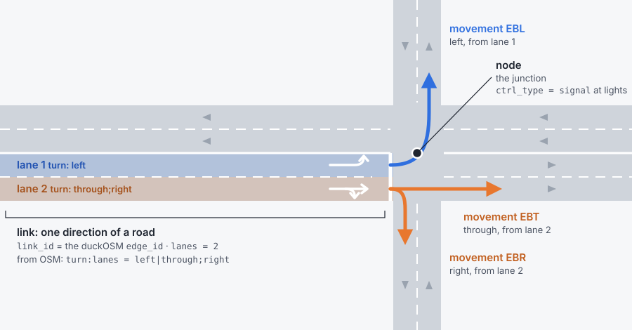

# GMNS

`duckosm gmns` writes the network in [GMNS](https://zephyr-data-specs.github.io/GMNS/) (General Modeling Network
Specification), the open table format of DTALite, Path4GMNS and other network-modelling tools. Each GMNS `link_id` is
the duckOSM `edge_id`.

| Reference and format | |
|---|---|
| Format | [GMNS](https://github.com/zephyr-data-specs/GMNS) release 0.97: the CSV tables of the specification; all tables in a [DuckDB file](https://duckdb.org/docs/stable/internals/storage) |
| Reference tool | [frictionless](https://framework.frictionlessdata.io/) and [Path4GMNS](https://github.com/jdlph/Path4GMNS) |
| Check | frictionless validates the CSV files against the schemas of the specification; Path4GMNS loads them and finds a route. [How each output is checked](../concepts/checks.md) |

```bash
pip install "duckosm[sumo]"                      # driving and cycling lanes need SUMO's netconvert
duckosm gmns monaco.duckdb                       # -> monaco_gmns.duckdb
duckosm gmns monaco.duckdb --to-csv gmns/        # also the CSV files of the specification
```

## What it makes

**One new DuckDB file.** It does not need the source database. Its tables have real geometry, so you can query them and
draw them. Each GMNS table that OSM has data for is in it.

`--to-csv DIR` also writes the standard `node.csv`, `link.csv`, `lane.csv` and the other tables into `DIR`, with one
folder for each mode when there are several modes. The CSV files have only the columns that the specification defines.
The geometries and the turns of each lane stay in the DuckDB file.



There is one schema for each mode: `gmns_driving`, `gmns_walking`, `gmns_cycling`. Monaco test build, driving:

| Table | Rows | Holds |
|---|---|---|
| `node` | 1,773 | junctions; `ctrl_type = 'signal'` at traffic lights |
| `link` | 2,862 | one row for each direction of a road (18 of them bus-only): length, speed, lanes, capacity, `facility_type` (the OSM `highway`), name |
| `geometry` | 2,862 | the link shapes |
| `lane` | 3,321 | one row for each lane: its use, width and turns where OSM has them |
| `movement` | 3,762 | the legal turns (from `edge_graph`), the lanes each turn starts from and ends in, and a curved path |
| `signal_controller` | 1 | the traffic lights (OSM has no timings) |
| `curb_seg` | 0 | on-street parking, where OSM has `parking:*` |
| `location` | 1,628 | OSM points on a link: crossings, give-way and stop signs, signals, parking entrances |
| `zone` | 1 | the area: each node is in it; its outline if the database has a boundary |
| `config`, `use_definition`, `use_group` | | units (meters, km/h), CRS (EPSG:4326), modes |
| `lane_connector` | 4,129 | duckOSM extension: one path for each lane pair of a movement, through the junction |
| `crossing`, `lane_crossing` | 492, 2,118 | duckOSM extension: the pedestrian crossings painted on the driving lanes |
| `link_along` | 0 | duckOSM extension: the roads a footpath runs along (walking: 10,765) |
| `lane_check` | 21 | duckOSM extension: the lanes and turns that did not get a lane connection |

Each column, and where its value comes from: [GMNS tables](gmns_tables.md). The tables that GMNS defines but OSM has no
data for (signal timing, time of day) are not written: see
[What is not written](gmns_tables.md#what-is-not-written-and-why).

## Lanes from OSM tags

Each link gets its lanes from its lane count. Where OSM has more detail, the lanes get it:

| OSM tag | Gives |
|---|---|
| `lanes`, `lanes:forward`, `lanes:backward` | the number of lanes in each direction |
| `turn:lanes` | the turns of each lane, and the lanes that each movement starts from |
| `width:lanes` | the lane width |
| `bicycle:lanes`, `psv:lanes` | bike lanes and bus lanes |

Most ways have none of these tags, so most lanes are general lanes with a default width. Lane details need the raw OSM
tags. A build from a PBF keeps them. An area clipped from a bigger build (`duckosm extract`) gets lane counts only.

Lane geometry:

- Each lane has a center line beside the road, on the traffic side. Use `--drive-side left` for left-hand traffic.
- A road mapped as two one-way ways that are nearer than their lanes need is placed as one road. The two directions
  do not overlap. `--no-pair-carriageways` turns this off
  ([design](https://github.com/Khoshkhah/duckOSM/blob/main/docs/design/gmns_paired_carriageways.md)).
- In the walking network, a footpath is one 2 m strip for its two directions, centered on its line.
- With `--walk-frame`, a mapped sidewalk (`footway=sidewalk`) is placed just outside the curb lane of its road, not on
  its own OSM line. Thus it is never on the carriageway. No footpath is added where OSM has none
  ([design](https://github.com/Khoshkhah/duckOSM/blob/main/docs/design/gmns_walking_frame.md)).

## Meso and micro networks

`--meso` and `--micro` also make road sections and lane cells for simulators:
[GMNS meso and micro networks](gmns-meso-micro.md).

## All modes in one network

`--combined` adds the schema `gmns_all`: one `link` table for all modes. A road that several modes use is one link,
with `allowed_uses = 'auto,bike,walk'`.

## See it

```bash
duckosm gmns-viz monaco_gmns.duckdb                                   # inspect: lanes, meso and micro; hover for ids
duckosm levels monaco.duckdb                                          # for gmns-map: the level area first
duckosm gmns-map monaco_gmns.duckdb --source-db monaco.duckdb         # present: each lane at its width, on a base map
```

Each command writes one HTML file (`-o` sets it).

| Command | Options |
|---|---|
| `gmns-viz` | `-m` the mode (default `driving`), `-o` the output (default `<name>_viewer.html`) |
| `gmns-map` | `--source-db` the database the GMNS file came from (required), `--area` the level area (default `<source-db>.levels`), `-o` the output (default `<name>_lanes.html`) |

`duckosm levels` is not ported to Rust yet.

The map below shows Monaco's lanes as `gmns-map` draws them. Each lane is a strip of road with its lane lines and an
arrow for its direction. Bridges and tunnels keep their order. **Click a lane**: it turns red, and the lanes its
movements lead into turn green. Bus lanes and bike lanes have their own color.

<iframe src="../../maps/monaco_gmns_lanes.html" title="Monaco's lanes, drawn by duckosm gmns-map"
        loading="lazy" style="width: 100%; height: 560px; border: 0; border-radius: 8px"></iframe>

## Options

| Option | Does | Default |
|---|---|---|
| `-m`, `--mode` | a mode to export; repeat it for several | each mode in the database |
| `-o`, `--out` | the output file | `<name>_gmns.duckdb` |
| `--to-csv DIR` | also write the CSV files of the specification | |
| `--csv-extensions` | keep duckOSM's extra columns in the CSV files, as user-defined fields with a `u_` prefix | standard columns only |
| `--meso`, `--micro` | also make the [meso or micro network](gmns-meso-micro.md) | off |
| `--meso-mode`, `--micro-mode` | their modes; repeat for several | `driving` |
| `--combined` | also write `gmns_all` | off |
| `--drive-side` | `right` or `left` traffic | `right` |
| `--no-pair-carriageways` | center the lanes of each one-way way on it, also next to its opposite direction | paired |
| `--walk-frame` | move a mapped sidewalk off the carriageway and join the footways that meet it | off |
| `--walk-clearance` | the gap in meters between the curb and a sidewalk that `--walk-frame` places | 0 |
| `--no-lane-geometry` | do not make the lane center lines | made |
| `--gtfs FEED` | a GTFS feed (`.zip` or folder; repeat for several): its stops become `location` rows ([how](gmns_tables.md#transit-stops-from-a-gtfs-feed)) | none |
| `--gtfs-max-m` | the largest distance in meters from a GTFS stop to its link | 30 |
| `--check` | check the values of the result (see below); exit 1 if a check fails. It also prints how connected each network is | off |

```python
from duckosm import to_gmns, to_meso, to_micro, check_gmns
to_gmns("monaco.duckdb", "monaco_gmns.duckdb")
to_meso("monaco_gmns.duckdb")                          # on a GMNS database
to_micro("monaco_gmns.duckdb", cell_length_m=7.0)
check_gmns("monaco_gmns.duckdb")
```

## Conformance to the GMNS standard

**The tables.** The tests check the CSV files against the schemas of the specification, release v0.97, with
[frictionless](https://framework.frictionlessdata.io/). The test also checks the category values (`ped_facility`,
`bike_facility`, movement `type`, `ctrl_type`). A test loads the CSV files in Path4GMNS and finds a route.
To check your own output:

```bash
duckosm gmns area.duckdb --to-csv gmns/
# put datapackage.json and *.schema.json of the specification (release v0.97) next to the CSV files, then:
frictionless validate datapackage.json
```

**The values.** The schemas check the shape of the tables, not how the values agree. `--check` does:

- a link starts and ends on its nodes, and `link.length` is the length of its geometry;
- `lane_num` runs 1..n (a lane left of lane 1, such as a bike lane on the left of a one-way road, is -1), and
  `link.lanes` is not more than the number of lane rows (not in the walking network: it has only the walking lane);
- a movement turns at the node where its inbound link ends, and its lane ranges exist and have the same length.

**Differences from the specification**, on purpose:

- The DuckDB file has extra columns and tables (marked ➕ in [GMNS tables](gmns_tables.md)). The CSV files do not have
  them, unless you use `--csv-extensions`.
- A U-turn has no `mvmt_code`: the code of the specification has no U. Its `type` is `uturn`.
- OSM `sidewalk` and `cycleway` are mapped to the categories of the specification, so the side of a sidewalk is lost.
- Walking and cycling links that cars cannot use have no `lanes` or `capacity`: the specification defines both for
  motor vehicles.

Design and audit: [gmns_spec_conformance](https://github.com/Khoshkhah/duckOSM/blob/main/docs/design/gmns_spec_conformance.md).

## Limits

- Driving and cycling need SUMO's `netconvert`: it gives the lane ranges of the movements and the paths through the
  junctions.
- OSM has no signal timing: `signal_controller` gives only where the signals are.

## duckOSM and osm2gmns

[osm2gmns](https://github.com/jiawlu/OSM2GMNS) is the established OSM-to-GMNS tool. On the same Södermalm PBF:

| | duckOSM | osm2gmns 0.7 |
|---|---|---|
| Ids | `edge_id`, the same on each build | numbered from 0 on each run |
| Lanes | turns, bus lanes and bike lanes, widths from OSM tags | lane geometry |
| Turns | from the graph of legal turns (OSM turn restrictions stay) | from geometry |
| Complex junctions | as in OSM | merged into one |
| Modes | all in one file, with the same ids | one network type for each run |

osm2gmns does more for simulation (junction merge, a mature micro network). duckOSM keeps stable ids and more of the
lane data of OSM.
