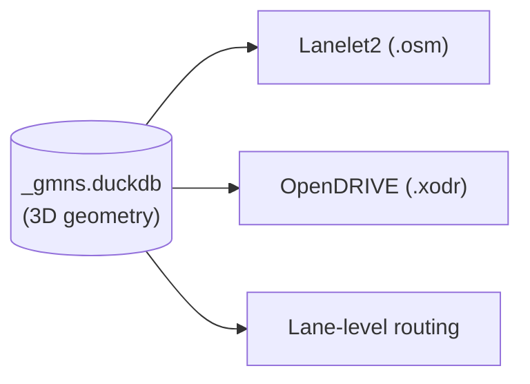

# 4. HD map

The HD map (high-definition map): each lane with its exact shape and its connections, for driving simulators and autonomous driving. These exports are experimental. These outputs read the
GMNS database of `duckosm gmns`, because it has the lanes and the turns of each lane.

The planned HD-map database (built with SimReady) has the chain as its unit: one carriageway for each chain of
`gmns_driving.chains`, which keeps the list of its links. The exports of this page work lane by lane on the GMNS links today. [Edges and chains](../../concepts/edges-and-chains.md).

| Read by | Export | Command |
|---|---|---|
| Your own lane router | [Lane-level routing](../lane-routing.md): a lane graph | `duckosm lane-graph`, `route-lanes` |
| Autoware, lanelet2 | [Lanelet2](../lanelet2.md): `.osm` | `duckosm lanelet2` |
| CARLA, esmini, Vissim | [OpenDRIVE](../opendrive.md): `.xodr` | `duckosm opendrive` |

All three are **experimental**. Tests check their structure. They are not loaded in the target tools yet.

## The tables

The HD map has no database of its own in duckOSM yet. Its exports read the lane tables of the GMNS database, and
`duckosm lane-graph` writes one table into that database.

| Table | Holds | Written by |
|---|---|---|
| [`gmns_<mode>.lane`](../gmns_tables.md#lane) | each lane of a link: its number, its width and its line | `duckosm gmns` |
| [`gmns_<mode>.movement`](../gmns_tables.md#movement) | each turn at a junction, with the lanes that it goes from and to | `duckosm gmns` |
| [`gmns_<mode>.lane_connector`](../gmns_tables.md#lane_connector) | the path of a lane through a junction | `duckosm gmns` |
| [`lane_<mode>.lane_edges`](../lane-routing.md#the-lane-graph) | the lane graph: `from_lane` and `to_lane` (VARCHAR lane ids), `kind` (VARCHAR: the type of the turn, or `lane_change`), `cost` (DOUBLE: the length in metres plus the penalty) | `duckosm lane-graph` |

Every table of the GMNS database: [GMNS tables](../gmns_tables.md).
