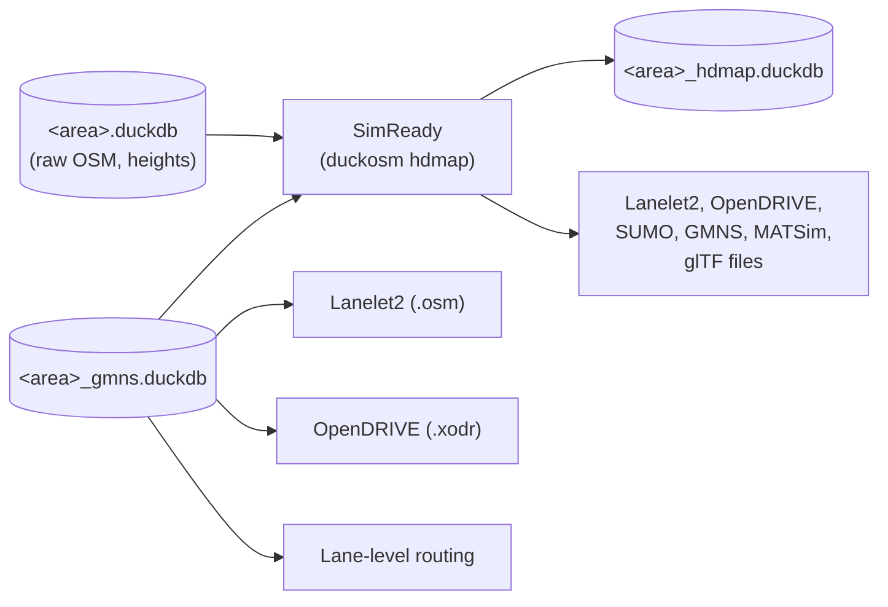

# 4. HD map

The HD map (high-definition map): each lane with its exact shape and its connections, for driving simulators and
autonomous driving. It comes in two ways:

- **The HD map database** (`<area>_hdmap.duckdb`): SimReady, a separate, optional program that
  is not public yet, makes it. `duckosm hdmap` runs SimReady.
- **duckOSM's own lane exports** (Lanelet2, OpenDRIVE, the lane graph): they read the GMNS database directly. They are
  experimental.



## The HD map database

```bash
duckosm elevation monaco.duckdb                           # heights: SimReady needs them
duckosm gmns monaco.duckdb --lane-source rules            # the GMNS database, after the heights
duckosm hdmap monaco.duckdb monaco_gmns.duckdb --formats lanelet2,opendrive
```

| Needs | Why |
|---|---|
| SimReady's `duckosm-sim` program (`--simready PATH`, `$DUCKOSM_SIM` or the `PATH`) | it makes the database. Without it the command stops with "SimReady is not installed" |
| `DB` built from a PBF file | SimReady reads its raw OSM tables (`raw.*`, with the fixes): the kerbs, the building walls, the bridges |
| heights in `DB`: [`duckosm elevation`](../../reference/cli.md#elevation) before `duckosm gmns` | the road surface is 3D. Without heights the command stops with a message |
| `GMNS_DB` from `duckosm gmns --lane-source rules` | the road network: one carriageway for each chain of `gmns_driving.chains`, with the same `chain_id` ([Edges and chains](../../concepts/edges-and-chains.md)) |

On Monaco, the run takes 14.7 s: 1,797 carriageways and 2,940 lanes, a Lanelet2 file of 24.6 MB and an OpenDRIVE file
of 13.1 MB. The 18 bus-only links of the GMNS database are not carriageways yet. SimReady also writes
`<area>_hdmap_fixes.yaml`, the OSM fixes that it suggests, for you to review. Every option:
[`duckosm hdmap`](../../reference/cli.md#hdmap). Every table and column: [HD map tables](../hdmap_tables.md).

## duckOSM's lane exports

These exports read the GMNS database of `duckosm gmns`, because it has the lanes and the turns of each lane. They work
lane by lane on the GMNS links.

| Read by | Export | Command |
|---|---|---|
| Your own lane router | [Lane-level routing](../lane-routing.md): a lane graph | `duckosm lane-graph`, `route-lanes` |
| Autoware, lanelet2 | [Lanelet2](../lanelet2.md): `.osm` | `duckosm lanelet2` |
| CARLA, esmini, Vissim | [OpenDRIVE](../opendrive.md): `.xodr` | `duckosm opendrive` |

All three are **experimental**. Tests check their structure. They are not loaded in the target tools yet.
