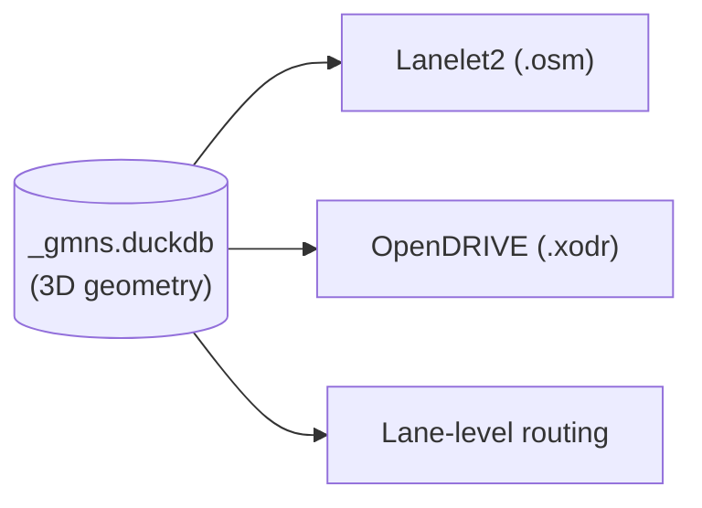

# 4. HD map

The HD map (high-definition map): each lane with its exact shape and its connections, for driving simulators and autonomous driving. These exports are experimental. These outputs read the
GMNS database of `duckosm gmns`, because it has the lanes and the turns of each lane.

| Read by | Export | Command |
|---|---|---|
| Your own lane router | [Lane-level routing](../lane-routing.md): a lane graph | `duckosm lane-graph`, `route-lanes` |
| Autoware, lanelet2 | [Lanelet2](../lanelet2.md): `.osm` | `duckosm lanelet2` |
| CARLA, esmini, Vissim | [OpenDRIVE](../opendrive.md): `.xodr` | `duckosm opendrive` |

All three are **experimental**. Tests check their structure. They are not loaded in the target tools yet.
