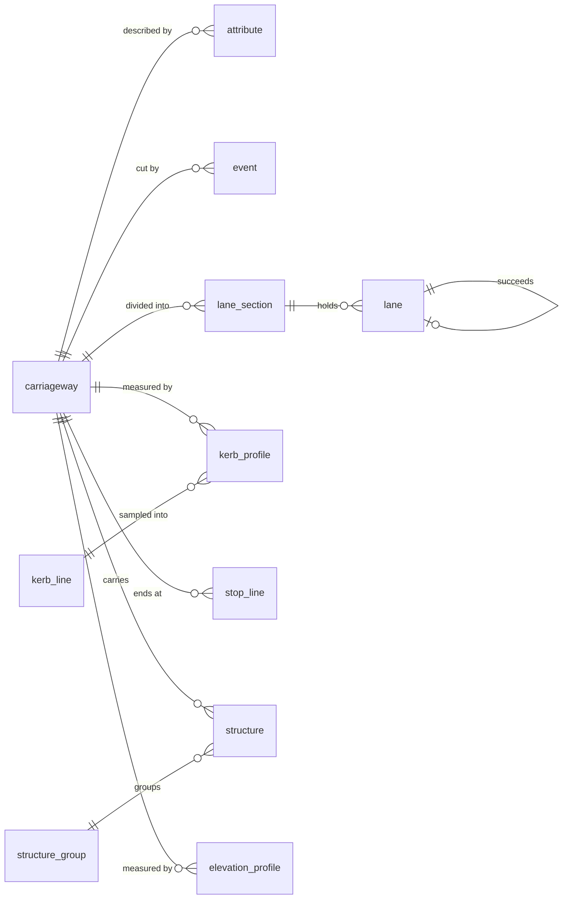
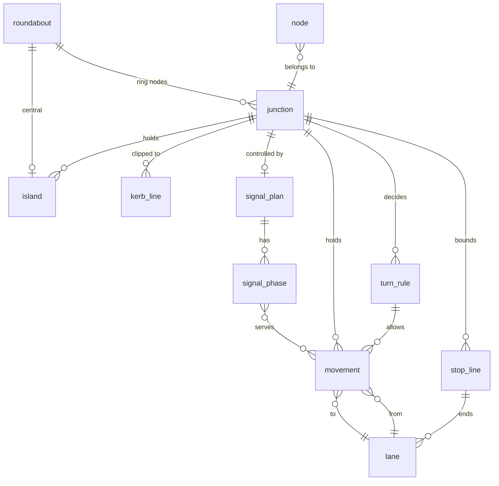

# HD map tables

Each table of the HD map database, and each of its columns. [SimReady](https://github.com/Khoshkhah/simready) builds
this database from two duckOSM databases of the same build:

- the GMNS network (`<area>_gmns.duckdb` of [`duckosm gmns`](gmns.md), [GMNS tables](gmns_tables.md)): the road
  network. Its chains are the carriageways;
- the routable network (`<area>.duckdb`, [Routable network tables](../reference/database.md)): only the raw OSM data
  ([`raw.*`](../reference/database.md#raw-schema), with the fixes) for the kerbs, the building walls and the bridges,
  and the DEM grid ([`main.elevation_grid`](../reference/database.md#elevation_grid)) for the ground.

SimReady is a separate, optional program that is not public yet. The command [`duckosm hdmap DB GMNS_DB`](../reference/cli.md#hdmap)
gives the two databases to SimReady and writes `<area>_hdmap.duckdb` ([4. HD map](hd-map/index.md)).

| Rule | |
|---|---|
| Schema | all tables are in the schema `sim` |
| Carriageway | one carriageway for each chain of `gmns_driving.chains`, with the same `chain_id` ([GMNS tables](gmns_tables.md#chains), [Edges and chains](../concepts/edges-and-chains.md)) |
| Ids | a 64-bit hash of the content keys, with the hash of duckOSM's [`edge_id`](../concepts/edge-ids.md). `node_id` is the OSM node id |
| Units | in the column name: `_m` metres, `_s` seconds, `_deg` degrees, `_kmh` km/h |
| Geometry | DuckDB `GEOMETRY` in the CRS of `project.crs`: metres, in the UTM zone of the area |
| Stations | metres along the reference line of a carriageway, from its start |
| Left and right | in the direction of travel. Lane 1 is the leftmost lane |

Made from SimReady's `schema.sql` (commit `df192a3`) by `tools/hdmap_tables_page.py`.

## The schema

A box is a table. A line joins two tables, and its label says how they are related. The fork at the end of a line is
the "many" side: one carriageway has many lane sections. A circle means "zero or more", two bars mean "exactly one".
The road and the junction meet at the lane.

### Schema: along the road

A carriageway is cut into lane sections, and each lane section holds its lanes. The other tables describe the
carriageway along its length: its values, its width, its height and its bridges.

### Schema: at the junction

A junction holds its movements (from a lane to a lane), its stop lines, its islands and its signal plan. A movement
joins a lane that ends at the junction to a lane that starts there.

## The tables

**Along the road**

| Table | One row is |
|---|---|
| [`carriageway`](#carriageway) | one directed roadway from junction to junction: one GMNS chain |
| [`attribute`](#attribute) | one value of a carriageway (lanes, speed, width), and how it was found |
| [`event`](#event) | a station where the cross-section changes |
| [`lane_section`](#lane_section) | the part of a carriageway between two events |
| [`lane`](#lane) | one lane of a lane section: number, role, width and edges |
| [`kerb_profile`](#kerb_profile) | the width of the roadway at stations |
| [`kerb_line`](#kerb_line) | an edge of the roadway as a line |
| [`street_face`](#street_face) | the street space of one group at one level |
| [`structure`](#structure) | one span of a bridge or a tunnel |
| [`structure_group`](#structure_group) | the spans of one bridge or tunnel |
| [`elevation_profile`](#elevation_profile) | the height of the road along a carriageway |

**At the junction**

| Table | One row is |
|---|---|
| [`node`](#node) | a junction point, from the nodes of duckOSM |
| [`junction`](#junction) | one node, or a cluster of nodes, with its area |
| [`stop_line`](#stop_line) | where a road ends and the junction starts |
| [`turn_rule`](#turn_rule) | one turn from a road into a road: allowed or not, and why |
| [`movement`](#movement) | one way through a junction, from a lane to a lane |
| [`island`](#island) | a traffic island in a junction |
| [`roundabout`](#roundabout) | a ring of one-way carriageways and its junctions |
| [`signal_plan`](#signal_plan) | the signal controller of a junction |
| [`signal_phase`](#signal_phase) | one phase of a signal plan and its movements |

**Project, sources and rules**

| Table | One row is |
|---|---|
| [`project`](#project) | one row: the area, the CRS and the versions of the inputs |
| [`source`](#source) | one data source: an OSM file, a DEM, a survey, a model |
| [`model_override`](#model_override) | one value that a person changed by hand |
| [`design_profile`](#design_profile) | a named set of design values |
| [`design_criterion`](#design_criterion) | one design value of a profile, with its source |
| [`rule_attribute`](#rule_attribute) | the rules that find the attributes |
| [`rule_case`](#rule_case) | the patterns of the junction and lane-change cases |
| [`rule_design`](#rule_design) | the list of the design rules |

**Checks**

| Table | One row is |
|---|---|
| [`check_result`](#check_result) | the result of one check on one row |
| [`loss_report`](#loss_report) | what a simulator format cannot hold |

## Evidence

Most tables have five evidence columns: where each value of the row came from.

| Column | Type | Holds |
|---|---|---|
| `ev_status` | VARCHAR | `observed`, `derived`, `inferred`, `assumed`, `unknown` or `conflict` |
| `ev_method` | VARCHAR | the rule, the algorithm or the model that made the value |
| `ev_confidence` | DOUBLE | 0 to 1, for `inferred` and `conflict` only |
| `ev_source_ids` | VARCHAR[] | the sources, each as `"{source_id}:{object}"` |
| `ev_review` | VARCHAR | `none`, `needed`, `accepted` or `rejected` |

## Along the road

### carriageway

One row is one directed roadway from junction to junction: one GMNS chain.

| Column | Type | Holds |
|---|---|---|
| `carriageway_id` | BIGINT | the id: a hash of its content keys |
| `edge_ids` | BIGINT[] | the `duckOSM` `edge_id`s in travel order |
| `mode` | VARCHAR | `driving` |
| `from_node_id` | BIGINT | the node at station 0 |
| `to_node_id` | BIGINT | the node at `length_m` |
| `shared_line` | BOOLEAN | TRUE when the reference line is the twin's too (one OSM way with two directions) |
| `twin_carriageway_id` | BIGINT | the carriageway of the other direction of the same street, or NULL for a one-way street |
| `highway` | VARCHAR | the OSM `highway` tag of the edges (all edges of a run share it) |
| `name` | VARCHAR | the street name, or NULL |
| `oneway` | BOOLEAN | TRUE when the street has no twin |
| `roundabout_id` | BIGINT | the roundabout this carriageway is a ring piece of, or NULL. See roundabout.md |
| `inside_junction_id` | BIGINT | the junction this carriageway lies wholly inside, when it is a piece between two nodes of one cluster |
| `posted_speed_kmh` | DOUBLE | the resolved `maxspeed` attribute for most of the run's length |
| `reference_line` | GEOMETRY (LINESTRING) | the merged line of the edges, in metres |
| `length_m` | DOUBLE | the length of `reference_line` |
| `level` | INTEGER | the level of the run: the level of its edges, the band of their tags in `driving.edges` |
| `lane_order_convention` | VARCHAR | `left_to_right_from_1` |

And the five [evidence](#evidence) columns.

### attribute

One row is one value of a carriageway (lanes, speed, width), and how it was found.

| Column | Type | Holds |
|---|---|---|
| `attribute_id` | BIGINT | the id: a hash of its content keys |
| `carriageway_id` | BIGINT | the carriageway |
| `name` | VARCHAR | the attribute |
| `station_start_m` | DOUBLE | where the value begins |
| `station_end_m` | DOUBLE | where it ends |
| `raw_value` | VARCHAR | the OSM tag value as written, or NULL when the tag is missing |
| `value` | VARCHAR | the resolved value, in the model's form: a number as text, a list with `\|`, `yes` or `no` |
| `unit` | VARCHAR | `count`, `m`, `kmh` |
| `method` | VARCHAR | `osm_tag`, `rule`, `override`, `model`, `default` |
| `rule_name` | VARCHAR | the rule of the algorithm `attribute-rules` that produced the value: `lanes_from_turn_lanes` |
| `source_ref` | VARCHAR | the object the value came from, as `"{source_id}:{object}"`: the way, the override entry, the model request |
| `network_fix` | BOOLEAN | TRUE when the resolved value differs from the raw value and changes the network |

And the five [evidence](#evidence) columns.

### event

One row is a station where the cross-section changes.

| Column | Type | Holds |
|---|---|---|
| `event_id` | BIGINT | the id: a hash of its content keys |
| `carriageway_id` | BIGINT | the carriageway |
| `station_m` | DOUBLE | the station of the event |
| `kind` | VARCHAR | what changes |
| `value_before` | VARCHAR | the value upstream of the station, as text: `2` for a lane count, `left\|through` for a turn marking |
| `value_after` | VARCHAR | the value downstream |
| `point` | GEOMETRY (POINT) | the reference line at `station_m` |
| `source_ref` | VARCHAR | the object that places the event, as `"{source_id}:{object}"`: an OSM node |
| `case_id` | VARCHAR | the transition case matched at this station |
| `case_score` | DOUBLE | its score, 0 to 1 |
| `case_alternatives` | STRUCT(case_id VARCHAR, score DOUBLE) | the other transition cases considered |

And the five [evidence](#evidence) columns.

### lane_section

One row is the part of a carriageway between two events.

| Column | Type | Holds |
|---|---|---|
| `lane_section_id` | BIGINT | the id: a hash of its content keys |
| `carriageway_id` | BIGINT | the carriageway |
| `station_start_m` | DOUBLE | the start station: an event's station |
| `station_end_m` | DOUBLE | the end station: the next event's station |
| `length_m` | DOUBLE | `station_end_m − station_start_m` |
| `event_start_id` | BIGINT | the event at the start |
| `event_end_id` | BIGINT | the event at the end |
| `lane_count_start` | INTEGER | the number of driving lanes at the start, from the resolved `lanes` attribute and the events |
| `lane_count_end` | INTEGER | the same at the end |
| `case_id` | VARCHAR | A derived section case: what the cross-section is between two events |
| `case_score` | DOUBLE | the score of `case_id`, 0 to 1 |
| `case_alternatives` | STRUCT(case_id VARCHAR, score DOUBLE) | the other cases the matcher considered, best first |
| `change_reason` | VARCHAR | why this section is not part of its neighbour, in the matcher's words: `lane added from parking`, `uniform` |
| `kerb_width_start_m` | DOUBLE | the kerb profile's width at the start, or NULL |
| `kerb_width_end_m` | DOUBLE | the kerb profile's width at the end, or NULL |
| `level` | INTEGER | the level of the section: the level of the span it lies on, else 0 or OSM `layer` |
| `structure_id` | BIGINT | the span the section lies on, or NULL |

And the five [evidence](#evidence) columns.

### lane

One row is one lane of a lane section: number, role, width and edges.

| Column | Type | Holds |
|---|---|---|
| `lane_id` | BIGINT | the id: a hash of its content keys |
| `lane_section_id` | BIGINT | the section |
| `carriageway_id` | BIGINT | the carriageway, copied for joins |
| `lane_num` | INTEGER | 1 is the left-most lane |
| `role` | VARCHAR | `through`, `pocket`, `merge`, `parking`, `bike`, `bus`, `shoulder`, `median` |
| `use` | VARCHAR[] | who can drive on it: `auto`, `bus`, `bike`, `hgv`, `taxi` |
| `turn` | VARCHAR | the lane's entry in `turn:lanes` at the section's end, or NULL |
| `width_shape` | VARCHAR | `constant`, `linear`, `smoothstep` |
| `width_start_m` | DOUBLE | the width at `station_start_m` of the section |
| `width_end_m` | DOUBLE | the width at `station_end_m` |
| `taper_start_m` | DOUBLE | the station where the width starts to change |
| `taper_length_m` | DOUBLE | the length over which it changes |
| `boundary_left` | GEOMETRY (LINESTRING Z) | the left edge of the lane, from the section's start to its end |
| `boundary_right` | GEOMETRY (LINESTRING Z) | the right edge |
| `predecessor_lane_id` | BIGINT | the lane of the previous section that this lane continues |
| `successor_lane_id` | BIGINT | the lane of the next section, or NULL when the lane ends here or the section ends at a stop line or a dead end |
| `cut_start_m` | DOUBLE | the station where the lane's area begins, when the section begins at a junction |
| `cut_end_m` | DOUBLE | the station where the lane's area ends, when the section ends at a junction |

And the five [evidence](#evidence) columns.

### kerb_profile

One row is the width of the roadway at stations.

| Column | Type | Holds |
|---|---|---|
| `kerb_profile_id` | BIGINT | the id: a hash of its content keys |
| `carriageway_id` | BIGINT | the carriageway |
| `station_m` | DOUBLE | the station of the measurement |
| `offset_left_m` | DOUBLE | the distance from the reference line to the left kerb, negative to the left |
| `offset_right_m` | DOUBLE | the distance to the right kerb, positive |
| `width_m` | DOUBLE | the roadway width kerb to kerb |
| `bound` | BOOLEAN | TRUE when the row was sampled from a `bound` kerb line: then `width_m` is the most the roadway can be |
| `share` | DOUBLE | for a twin on a shared reference line: this carriageway's part of the measured street width, 0 to 1 |
| `source_id` | VARCHAR | the source, a row of source.md |
| `method` | VARCHAR | how the width was read from the source: `osm_width`, `osm_width_lanes`, `street_edge`, `deck_edge` |
| `point_left` | GEOMETRY (POINT) | the left kerb point, or NULL |
| `point_right` | GEOMETRY (POINT) | the right kerb point, or NULL |

And the five [evidence](#evidence) columns.

### kerb_line

One row is an edge of the roadway as a line.

| Column | Type | Holds |
|---|---|---|
| `kerb_line_id` | BIGINT | the id: a hash of its content keys |
| `geometry` | GEOMETRY (LINESTRING) | LINESTRING, in metres |
| `source_id` | VARCHAR | the source, a row of source.md |
| `source_ref` | VARCHAR | the object in the source, as `"{source_id}:{object}"`: the city feature, the LiDAR tile, the image |
| `role` | VARCHAR | `kerb`: the measured edge of the roadway |
| `method` | VARCHAR | role `kerb`: `city_kerb`, `lidar_step`, `image_trace`, `osm_barrier`, `deck_profile`, `structure_width` |
| `height_m` | DOUBLE | the kerb height, when the source measures it (LiDAR, a survey), else NULL |
| `level` | INTEGER | the level of the roadway this kerb bounds: 0 for a street edge |
| `structure_id` | BIGINT | the span whose parapet or wall this is, or NULL |
| `junction_id` | BIGINT | the junction whose area this line bounds, when the line lies within `design_criterion` `junction_kerb_search_m` of a junction's core |

And the five [evidence](#evidence) columns.

### street_face

One row is the street space of one group at one level.

| Column | Type | Holds |
|---|---|---|
| `street_face_id` | BIGINT | the id: a hash of its content keys |
| `face_id` | VARCHAR | `g0` for the ground |
| `kind` | VARCHAR | `ground`, `bridge`, `tunnel`, `roundabout` |
| `level` | INTEGER | the level of the face |
| `group_id` | BIGINT | `structure_group_id` or `roundabout_id`, or NULL for the ground |
| `geometry` | GEOMETRY (POLYGON) | POLYGON or MULTIPOLYGON, in metres |
| `open_side_count` | INTEGER | the number of maximal runs of open stations, per side of a carriageway, in the face |

And the five [evidence](#evidence) columns.

### structure

One row is one span of a bridge or a tunnel.

| Column | Type | Holds |
|---|---|---|
| `structure_id` | BIGINT | the id: a hash of its content keys |
| `carriageway_id` | BIGINT | the carriageway |
| `structure_group_id` | BIGINT | the physical structure this span is part of |
| `station_start_m` | DOUBLE | where the span begins |
| `station_end_m` | DOUBLE | where it ends |
| `kind` | VARCHAR | `bridge`, `viaduct`, `tunnel`, `building_passage`, `culvert`, `covered`, `embankment`, `cutting` |
| `level` | INTEGER | the level of the carriageway on the span: the resolved `layer` |
| `source_ref` | VARCHAR | the way, as `"{source_id}:{object}"` |
| `clearance_m` | DOUBLE | the vertical clearance under a bridge or in a tunnel, or NULL |
| `width_m` | DOUBLE | the deck or bore width at this span where a source gives it |
| `twin_structure_id` | BIGINT | the same span under the twin carriageway (one deck, two directions), or NULL |

And the five [evidence](#evidence) columns.

### structure_group

One row is the spans of one bridge or tunnel.

| Column | Type | Holds |
|---|---|---|
| `structure_group_id` | BIGINT | the id: a hash of its content keys |
| `structure_ids` | BIGINT[] | the spans, sorted |
| `kind` | VARCHAR | `bridge`, `tunnel` |
| `levels` | INTEGER[] | the distinct levels of the spans, sorted |
| `name` | VARCHAR | the structure's name from OSM or a city register, or NULL |
| `source_ref` | VARCHAR | the `type=bridge` or `type=tunnel` relation, as `"{source_id}:{object}"` |
| `length_m` | DOUBLE | the sum of the spans' lengths |
| `span_count` | INTEGER | the number of spans |
| `profile_source_id` | VARCHAR | the source of the measured deck or bore profile, or NULL |
| `height_source_id` | VARCHAR | the source of the road height on the group, or NULL when the elevation profile on it is `assumed` |

And the five [evidence](#evidence) columns.

### elevation_profile

One row is the height of the road along a carriageway.

| Column | Type | Holds |
|---|---|---|
| `elevation_profile_id` | BIGINT | the id: a hash of its content keys |
| `carriageway_id` | BIGINT | the carriageway |
| `station_m` | DOUBLE | the station |
| `z_m` | DOUBLE | the height of the road surface at the reference line |
| `grade_pct` | DOUBLE | the slope at this station, positive uphill in the travel direction, from the neighbouring rows |
| `earthwork_m` | DOUBLE | on a `graded` row: the graded height minus the terrain's height at this station |
| `outlier` | BOOLEAN | TRUE on a `dem_node` or `dem_sample` row that the fit left out because it lies above the lower envelope of its neighbours |
| `source_id` | VARCHAR | the source, a row of source.md |
| `method` | VARCHAR | `osm_ele`, `dem_node`, `dem_sample`, `dsm_sample`, `bridge_profile`, `lidar_surface`, `survey_point`, `trace_mean`, `structure_line`, `graded` |

And the five [evidence](#evidence) columns.

## At the junction

### node

One row is a junction point, from the nodes of duckOSM.

| Column | Type | Holds |
|---|---|---|
| `node_id` | BIGINT | the id: a hash of its content keys |
| `xy` | GEOMETRY (POINT) | POINT, in metres |
| `kind` | VARCHAR | `priority`, `signal`, `stop`, `yield`, `roundabout`, `right_before_left`, `uncontrolled`, `dead_end`, `connector_end` |
| `degree_in` | INTEGER | the number of carriageways that end here |
| `degree_out` | INTEGER | the number that start here |
| `junction_id` | BIGINT | the junction the node belongs to |
| `highway_tag` | VARCHAR | the OSM `highway` tag of the node, or NULL |
| `level` | INTEGER | the level of the carriageways that meet here |

And the five [evidence](#evidence) columns.

### junction

One row is one node, or a cluster of nodes, with its area.

| Column | Type | Holds |
|---|---|---|
| `junction_id` | BIGINT | the id: a hash of its content keys |
| `node_ids` | BIGINT[] | the nodes of the cluster, sorted |
| `kind` | VARCHAR | `simple`, `cluster`, `roundabout_node` |
| `control` | VARCHAR | the control of the junction as a whole: the `kind` of its main node |
| `core` | GEOMETRY (POINT) | the centroid of the nodes |
| `arm_count` | INTEGER | the number of arms: a one-way carriageway is one arm, the two twins of a street are one arm |
| `arm_order` | BIGINT[] | the arms counter-clockwise by their bearing at `core`, as the id of the entering carriageway |
| `through_arms` | BIGINT[] | the through pair: the two arms, as ids of `arm_order`, that continue each other across the junction, or empty |
| `through_kind` | VARCHAR | the kind of the through pair: `two_way`, `twins`, `oneway`, `divides` or `none` |
| `side_kinds` | VARCHAR[] | the kinds of the arms that are not in the through pair, sorted: `in`, `out`, `twins`, `two_way` |
| `offset` | BOOLEAN | TRUE when the two through arms end at nodes with no node in common: an inner piece carries the through street |
| `inner_kind` | VARCHAR | the signature's `inner`: `slip`, `link`, `oneway`, `cross` or `none` |
| `fork_angle` | VARCHAR | for three one-way arms: `slight` or `turn`, by `turn_angle_slight_deg` |
| `shape` | GEOMETRY (POLYGON) | the first junction shape: the area between the lane cuts of all arms |
| `case_id` | VARCHAR | A derived junction case |
| `case_score` | DOUBLE | its score |
| `case_alternatives` | STRUCT(case_id VARCHAR, score DOUBLE) | the other cases considered |
| `area` | GEOMETRY (POLYGON) | the final junction area: `shape` with the movement sweeps and the arm ends added, clipped to the kerb lines |
| `area_m2` | DOUBLE | its area |
| `island_count` | INTEGER | the number of islands |
| `signal_plan_id` | BIGINT | the signal plan, or NULL. See signal-plan.md |
| `roundabout_id` | BIGINT | the roundabout this junction is a ring node of, or NULL |
| `level` | INTEGER | the level of the junction's nodes |

And the five [evidence](#evidence) columns.

### stop_line

One row is where a road ends and the junction starts.

| Column | Type | Holds |
|---|---|---|
| `stop_line_id` | BIGINT | the id: a hash of its content keys |
| `carriageway_id` | BIGINT | the arm |
| `junction_id` | BIGINT | the junction |
| `end` | VARCHAR | `in`: the carriageway enters the junction here (near its `length_m`) |
| `station_m` | DOUBLE | the mean of the lanes' cut stations |
| `station_min_m` | DOUBLE | the smallest cut station of the arm's lanes |
| `station_max_m` | DOUBLE | the largest |
| `geometry` | GEOMETRY (LINESTRING) | from the left border of lane 1 to the right border of the last lane, through the cut point of each lane border |
| `lane_cuts` | STRUCT(lane_id BIGINT, station_m DOUBLE, point GEOMETRY) | the cut of each lane, left to right |
| `method` | VARCHAR | how the cuts were found |
| `source_ref` | VARCHAR | the object that placed the line when `method` is `crossing`, `stop_node` or `measured` |

And the five [evidence](#evidence) columns.

### turn_rule

One row is one turn from a road into a road: allowed or not, and why.

| Column | Type | Holds |
|---|---|---|
| `turn_rule_id` | BIGINT | the id: a hash of its content keys |
| `junction_id` | BIGINT | the junction |
| `from_carriageway_id` | BIGINT | the arm that enters |
| `to_carriageway_id` | BIGINT | the arm that leaves |
| `turn` | VARCHAR | `left`, `straight`, `right`, `u`, `slight_left`, `slight_right` |
| `fork` | BOOLEAN | TRUE when the junction has more than one entering arm and one leaving arm |
| `allowed` | BOOLEAN | whether vehicles can make this turn |
| `allowed_uses` | VARCHAR[] | for which uses, when a restriction names one: the uses the turn is open to |
| `method` | VARCHAR | what decided: `osm_restriction`, `turn_lanes`, `oneway`, `geometry`, `uturn_rule`, `uturn_no_exit` |
| `source_ref` | VARCHAR | the relation, the way, the override entry or the model request, as `"{source_id}:{object}"` |
| `network_fix` | BOOLEAN | TRUE when `allowed` differs from what duckOSM's `edge_graph` has |

And the five [evidence](#evidence) columns.

### movement

One row is one way through a junction, from a lane to a lane.

| Column | Type | Holds |
|---|---|---|
| `movement_id` | BIGINT | the id: a hash of its content keys |
| `junction_id` | BIGINT | the junction |
| `turn_rule_id` | BIGINT | the turn rule that allows this movement |
| `from_lane_id` | BIGINT | the lane whose section ends at a stop line of the junction (`end = in`) |
| `to_lane_id` | BIGINT | the lane whose section begins at a stop line of the junction (`end = out`) |
| `from_carriageway_id` | BIGINT | copied for joins |
| `to_carriageway_id` | BIGINT | copied for joins |
| `turn` | VARCHAR | `left`, `straight`, `right`, `u`, `slight_left`, `slight_right` |
| `fork` | BOOLEAN | copied from the turn rule: TRUE for a merge or a diverge where the lanes continue |
| `assignment_method` | VARCHAR | how the lane pair was chosen: `turn_lanes`, `connectivity_rule`, `netconvert`, `measured`, `model` |
| `path` | GEOMETRY (LINESTRING) | the connector: a cubic Hermite curve from the from-lane's centerline at its cut to the to-lane's centerline at its cut |
| `length_m` | DOUBLE | the length of `path` |
| `width_m` | DOUBLE | the width of the connector: the from-lane's width at the stop line, or the smaller of the two lanes' widths |
| `area` | GEOMETRY (POLYGON) | the sweep: `path` buffered by `width_m / 2`, with flat ends on the two stop lines |
| `curb_radius_m` | DOUBLE | for a `right` turn: the radius of the lane's centerline through the turn |
| `allowed_uses` | VARCHAR[] | the intersection of the two lanes' `use`, further limited by `duckOSM`'s turn permissions |
| `priority` | VARCHAR | `major`, `minor`, `yield`, `stop`, `signal` |
| `conflict_movement_ids` | BIGINT[] | the movements of the same junction whose `area` crosses this one's |
| `signal_phase_ids` | BIGINT[] | the phases that serve this movement, or empty |

And the five [evidence](#evidence) columns.

### island

One row is a traffic island in a junction.

| Column | Type | Holds |
|---|---|---|
| `island_id` | BIGINT | the id: a hash of its content keys |
| `junction_id` | BIGINT | the junction, or NULL for a `central` island |
| `roundabout_id` | BIGINT | the roundabout, for a `central` island |
| `kind` | VARCHAR | `channelizing`, `refuge`, `splitter`, `central`, `median_end`, `remnant` |
| `level` | INTEGER | the level of its junction or roundabout |
| `area` | GEOMETRY (POLYGON) | POLYGON |
| `area_m2` | DOUBLE | its area |
| `case_id` | VARCHAR | the junction case that names this island, or NULL |
| `source_ref` | VARCHAR | an object that maps the island, as `"{source_id}:{object}"`: an OSM `area:highway=traffic_island` |

And the five [evidence](#evidence) columns.

### roundabout

One row is a ring of one-way carriageways and its junctions.

| Column | Type | Holds |
|---|---|---|
| `roundabout_id` | BIGINT | the id: a hash of its content keys |
| `ring_carriageway_ids` | BIGINT[] | the ring pieces in travel order, starting at the smallest id |
| `junction_ids` | BIGINT[] | the ring nodes, in the same order |
| `arm_count` | INTEGER | the number of carriageways that enter or leave the ring |
| `centre` | GEOMETRY (POINT) | the centre of the circle fitted to the ring's reference lines |
| `icd_m` | DOUBLE | the inscribed circle diameter: twice the distance from `centre` to the outer kerb line |
| `ring_lane_count` | INTEGER | the lanes of the ring pieces (the largest count when they differ) |
| `central_island_id` | BIGINT | the island of kind `central`, or NULL for a painted centre |
| `level` | INTEGER | the level of the ring (all ring pieces share it) |
| `case_id` | VARCHAR | A derived case of scope `roundabout`: `RAB.single` or `RAB.multi` by the ring lanes |
| `case_score` | DOUBLE | as on junction.md |
| `case_alternatives` | STRUCT(case_id VARCHAR, score DOUBLE) | as on junction.md |

And the five [evidence](#evidence) columns.

### signal_plan

One row is the signal controller of a junction.

| Column | Type | Holds |
|---|---|---|
| `signal_plan_id` | BIGINT | the id: a hash of its content keys |
| `junction_id` | BIGINT | the junction |
| `controller_type` | VARCHAR | `fixed_time`, `actuated`, `coordinated`, `unknown` |
| `cycle_s` | DOUBLE | the cycle length, or NULL |
| `offset_s` | DOUBLE | the offset from the coordination reference, or NULL |
| `source_id` | VARCHAR | the source, a row of source.md: a city's timing data, the OSM extract, the design profile, a decision model |
| `method` | VARCHAR | how the plan was read: `timing_sheet`, `osm_tags`, `default_plan`, `model` |
| `source_ref` | VARCHAR | the object in the source: the sheet and row, the way id, the criterion name, the request id |

And the five [evidence](#evidence) columns.

### signal_phase

One row is one phase of a signal plan and its movements.

| Column | Type | Holds |
|---|---|---|
| `signal_phase_id` | BIGINT | the id: a hash of its content keys |
| `signal_plan_id` | BIGINT | the plan |
| `phase_num` | INTEGER | 1 to n, in cycle order |
| `green_s` | DOUBLE | the green time |
| `yellow_s` | DOUBLE | the yellow time |
| `red_clearance_s` | DOUBLE | the all-red time after it |
| `movement_ids` | BIGINT[] | the movements that have green in this phase |
| `protected` | BOOLEAN | TRUE when the phase's turns face no conflicting movement with green |
| `ring` | INTEGER | the NEMA ring, 1 or 2, or NULL when the controller is not dual-ring |

## Project, sources and rules

### project

One row is one row: the area, the CRS and the versions of the inputs.

| Column | Type | Holds |
|---|---|---|
| `project_id` | BIGINT | the id: a hash of its content keys |
| `area_name` | VARCHAR | the area, as `duckOSM` names it: `monaco`, `tartu`, `granville` |
| `crs` | VARCHAR | the EPSG code of every geometry column: `EPSG:32632` for Monaco |
| `vertical_datum` | VARCHAR | the datum of every `z`: `EGM2008` by default, or the national one when a finer source uses it |
| `boundary` | GEOMETRY (POLYGON) | the area's boundary, in `crs` |
| `built_at` | TIMESTAMP | when the build started, UTC |
| `duckosm_db` | VARCHAR | the path of the `duckOSM` database the build read |
| `duckosm_version` | VARCHAR | its `duckOSM` or `duckosm-rust` version |
| `urbanstyle_version` | VARCHAR | the `urbanstyle` version whose faces the comparison read, or NULL when the build ran no comparison |
| `simready_version` | VARCHAR | the version of this model's code |
| `design_profile_id` | VARCHAR | the design profile of the build |
| `jurisdiction` | VARCHAR | the country and region of the area, as ISO 3166-2 (`CA-BC`, `MC`, `EE`) |
| `driving_side` | VARCHAR | `right`, `left` |
| `osm_timestamp` | TIMESTAMP | the timestamp of the OSM extract |

### source

One row is one data source: an OSM file, a DEM, a survey, a model.

| Column | Type | Holds |
|---|---|---|
| `source_id` | VARCHAR | the id: a hash of its content keys |
| `kind` | VARCHAR | `osm`, `city_gis`, `dem`, `lidar`, `imagery_aerial`, `imagery_street`, `survey`, `sensor`, `model`, `derived`, `profile`, `editor` |
| `title` | VARCHAR | the dataset's own name |
| `provider` | VARCHAR | who made it: `OpenStreetMap contributors`, `City of Vancouver`, `BC MoTI`, `Mapillary`, `TypeSafe AI` |
| `acquired_at` | DATE | when the data was captured or published, or NULL |
| `imported_at` | TIMESTAMP | when the build read it |
| `crs_native` | VARCHAR | the CRS of the data as delivered |
| `coverage` | GEOMETRY (POLYGON) | where the source has data, in `project.crs`, or NULL for the whole area |
| `licence` | VARCHAR | `ODbL`, `OGL-Vancouver`, `CC-BY-4.0`, a contract reference |
| `vertical_datum` | VARCHAR | for a source of heights: the datum of its heights as delivered |
| `geoid_grid` | VARCHAR | the two grid files the conversion needs when the datums differ |
| `vertical_accuracy_m` | DOUBLE | for a source of heights: its vertical error, one sigma |
| `reference` | VARCHAR | A URL or a file path |
| `note` | VARCHAR | free text |

### model_override

One row is one value that a person changed by hand.

| Column | Type | Holds |
|---|---|---|
| `override_id` | BIGINT | the id: a hash of its content keys |
| `entity_table` | VARCHAR | the table of the edited value |
| `entity_id` | BIGINT | the entity |
| `column` | VARCHAR | the column |
| `value` | VARCHAR | the value as text, in the column's unit |
| `who` | VARCHAR | who made the edit |
| `made_at` | TIMESTAMP | when |
| `applied` | BOOLEAN | TRUE when the last build found the entity and wrote the value |

### design_profile

One row is a named set of design values.

| Column | Type | Holds |
|---|---|---|
| `design_profile_id` | VARCHAR | the id: a hash of its content keys |
| `title` | VARCHAR | the full title of the standard or of the project profile |
| `standard` | VARCHAR | the publishing body: `AASHTO`, `TAC`, `NACTO`, `MUTCD`, `project` |
| `edition` | VARCHAR | the year or edition |
| `jurisdiction` | VARCHAR | where it applies: `US`, `CA`, `CA-BC`, `MC`, or NULL for a project profile |
| `parent_profile_id` | VARCHAR | the profile to read when this one has no row for a criterion |

### design_criterion

One row is one design value of a profile, with its source.

| Column | Type | Holds |
|---|---|---|
| `design_profile_id` | VARCHAR | the profile |
| `name` | VARCHAR | the criterion's name |
| `condition` | VARCHAR | when the row applies, as a DuckDB boolean expression over the entity's columns: `highway = 'primary'` |
| `specificity` | INTEGER | the order among rows of one name: the highest that matches wins |
| `value` | DOUBLE | the value |
| `unit` | VARCHAR | `m`, `m2`, `s`, `deg`, `kmh`, `ratio`, `pct`, `count` |
| `clause` | VARCHAR | the cited place in the standard: `AASHTO GDHS 7th ed., §4.3.1, Table 4-2` |
| `note` | VARCHAR | free text |

### rule_attribute

One row is the rules that find the attributes.

| Column | Type | Holds |
|---|---|---|
| `rule_name` | VARCHAR | the id: a hash of its content keys |
| `name` | VARCHAR | the attribute the rule writes |
| `reads` | VARCHAR[] | the attributes and tables the rule reads (`turn:lanes`, `kerb_profile`, `twin`) |
| `order` | INTEGER | the order in which `attributes` tries the rules for one name |
| `pass` | INTEGER | 1 when the rule can run from the tags alone, 2 when it needs the kerb profile |
| `confidence` | DOUBLE | the `ev_confidence` a value from this rule gets, fixed per rule |
| `network_fix` | BOOLEAN | whether a value from this rule changes the network |
| `clause` | VARCHAR | why the rule holds: a standard's clause, a mapping convention, or a measured error rate on a golden area |
| `source` | VARCHAR | where the knowledge comes from: `standard`, `osm-wiki`, `netconvert`, `urbanstyle`, `observation`, `review` |
| `status` | VARCHAR | `adopted`, `candidate`, `rejected` |

### rule_case

One row is the patterns of the junction and lane-change cases.

| Column | Type | Holds |
|---|---|---|
| `case_id` | VARCHAR | the id: a hash of its content keys |
| `scope` | VARCHAR | `transition`, `section`, `junction`, `roundabout` |
| `family` | VARCHAR | the case family (level 5) |
| `kinds` | VARCHAR | the signature columns |
| `lane_delta` | VARCHAR | the signature columns |
| `width_change` | VARCHAR | the signature columns |
| `opens` | VARCHAR | the signature columns |
| `closes` | VARCHAR | the signature columns |
| `kinds_start` | VARCHAR | the signature columns |
| `kinds_end` | VARCHAR | the signature columns |
| `node_count` | VARCHAR | the signature columns |
| `arm_count` | VARCHAR | the signature columns |
| `through` | VARCHAR | the signature columns |
| `sides` | VARCHAR | the signature columns |
| `offset` | VARCHAR | the signature columns |
| `inner` | VARCHAR | the signature columns |
| `ring` | VARCHAR | the signature columns |
| `angle` | VARCHAR | the signature columns |
| `ring_lanes` | VARCHAR | the signature columns |
| `w_kinds` | VARCHAR | the weight columns, `w_` and the name of the signature column |
| `w_lane_delta` | VARCHAR | the weight columns, `w_` and the name of the signature column |
| `w_width_change` | VARCHAR | the weight columns, `w_` and the name of the signature column |
| `w_opens` | VARCHAR | the weight columns, `w_` and the name of the signature column |
| `w_closes` | VARCHAR | the weight columns, `w_` and the name of the signature column |
| `w_kinds_start` | VARCHAR | the weight columns, `w_` and the name of the signature column |
| `w_kinds_end` | VARCHAR | the weight columns, `w_` and the name of the signature column |
| `w_node_count` | VARCHAR | the weight columns, `w_` and the name of the signature column |
| `w_arm_count` | VARCHAR | the weight columns, `w_` and the name of the signature column |
| `w_through` | VARCHAR | the weight columns, `w_` and the name of the signature column |
| `w_sides` | VARCHAR | the weight columns, `w_` and the name of the signature column |
| `w_offset` | VARCHAR | the weight columns, `w_` and the name of the signature column |
| `w_inner` | VARCHAR | the weight columns, `w_` and the name of the signature column |
| `w_ring` | VARCHAR | the weight columns, `w_` and the name of the signature column |
| `w_angle` | VARCHAR | the weight columns, `w_` and the name of the signature column |
| `w_ring_lanes` | VARCHAR | the weight columns, `w_` and the name of the signature column |
| `order` | INTEGER | the position of the row in the file |
| `fallback` | BOOLEAN | TRUE on the one rule of scope `section` and the one of scope `junction` that is taken when no rule reaches `case_score_min` |
| `writes` | VARCHAR | the parameters the case gives the later modules, as `key=value` pairs from this list: `open_role` |
| `example_ref` | VARCHAR | one real example as `"{source_id}:{object}"` from a golden area, O4) |
| `source` | VARCHAR | where the knowledge comes from: `standard`, `osm-wiki`, `netconvert`, `urbanstyle`, `observation`, `review` |
| `status` | VARCHAR | `adopted`, `candidate`, `rejected` |

### rule_design

One row is the list of the design rules.

| Column | Type | Holds |
|---|---|---|
| `rule_id` | VARCHAR | the id: a hash of its content keys |
| `topic` | VARCHAR | `horizontal`, `vertical`, `cross_section`, `sight`, `intersection`, `roundabout`, `interchange`, `roadside`, `structure` |
| `statement` | VARCHAR | one sentence: what must hold |
| `equation` | VARCHAR | the equation where one exists, with its symbols named |
| `criteria` | VARCHAR[] | the `design_criterion` names the rule reads |
| `clause` | VARCHAR | the standard's edition and section, never the HTML guide |
| `role` | VARCHAR | `check`, `fill`, `both` |
| `scope` | VARCHAR | what one application of the rule looks at: `vertex`, `connector`, `section`, `junction`, `roundabout` |
| `check_id` | VARCHAR | the level-6 check the rule writes, or NULL for `fill` |
| `reads` | VARCHAR[] | the modules or algorithms that apply it |
| `example_ref` | VARCHAR | one place in a golden area where the rule fires or fills, as `"{source_id}:{object}"` |
| `source` | VARCHAR | where the knowledge comes from: `standard`, `osm-wiki`, `netconvert`, `urbanstyle`, `observation`, `review` |
| `status` | VARCHAR | `adopted`, `candidate`, `rejected` |

## Checks

### check_result

One row is the result of one check on one row.

| Column | Type | Holds |
|---|---|---|
| `check_result_id` | BIGINT | the id: a hash of its content keys |
| `check_id` | VARCHAR | the check's name, as the level-6 page defines it: `lanes-no-overlap`, `width-sum`, `path-in-area` |
| `entity_table` | VARCHAR | the table of the entity checked: `lane`, `movement`, `junction`, or `project` for a count over the area |
| `entity_id` | BIGINT | the entity's id |
| `status` | VARCHAR | `pass`, `fail`, `info` |
| `value` | DOUBLE | the measured value, or NULL |
| `threshold` | DOUBLE | the threshold the check compared against, from the design profile, or NULL |
| `unit` | VARCHAR | the unit of `value` |
| `message` | VARCHAR | one sentence a person reads on the dashboard: `lane 3 overlaps lane 4 by 0.41 m² at station 163` |
| `geometry` | GEOMETRY (GEOMETRY) | where to look: the overlap polygon, the point of the largest distance, or NULL |
| `built_at` | TIMESTAMP | the build |

### loss_report

One row is what a simulator format cannot hold.

| Column | Type | Holds |
|---|---|---|
| `loss_report_id` | BIGINT | the id: a hash of its content keys |
| `adapter` | VARCHAR | `sumo`, `opendrive`, `gmns`, `matsim`, `lanelet2`, `gltf`, `vissim`, `aimsun`, `synchro` |
| `entity_table` | VARCHAR | the table of the value |
| `entity_id` | BIGINT | the entity |
| `column` | VARCHAR | the column, or `*` for the whole entity |
| `reason` | VARCHAR | `no_field`, `precision`, `enum_missing`, `not_supported`, `status` |
| `value_lost` | VARCHAR | the value as text |
| `value_written` | VARCHAR | what the adapter wrote instead, or NULL |
| `built_at` | TIMESTAMP | the build |

And the five [evidence](#evidence) columns.
