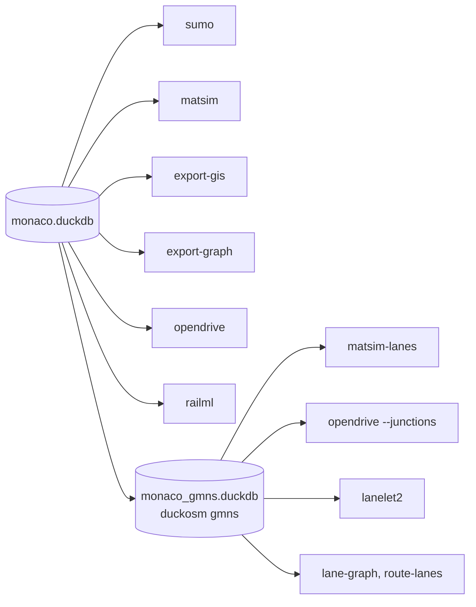

# Exports

## Exports by level

The levels go from the raw OSM data to the most detailed network. Each level is made from the level before it.

0<b>The OSM file</b>.osm.pbf, cut to your area<code>pbfcut</code>

<a class="lv" href="#1-osm-data">1<b>OSM data</b>no network<code>QuackOSM · GDAL</code></a>
<a class="lv" href="#2-the-network">2<b>The network</b>edges, edge_id, turns<code>GeoPackage · networkx</code></a>
<a class="lv" href="#3-traffic-simulation">3<b>Traffic simulation</b>links, nodes, turns<code>GMNS · MATSim · SUMO</code></a>
<a class="lv" href="#4-lane-level-and-3d">4<b>Lane level and 3D</b>each lane, its shape<code>Lanelet2 · OpenDRIVE</code></a>

Your OSM fixes go into every level.

### 1. OSM data

The OSM objects as tables, with no network. Each row is one OSM object.

| Tool | Export | Command |
|---|---|---|
| DuckDB, pandas, Spark | the OSM features table of QuackOSM, as GeoParquet ([duckOSM and QuackOSM](../concepts/quackosm.md)) | `duckosm quack` |
| QGIS, ArcGIS | GDAL's five OSM layers, as GeoPackage or GeoParquet ([duckOSM and GDAL](../concepts/gdal.md)) | `duckosm quack --gdal` |
| QGIS, ArcGIS | Geofabrik's 20 layers (roads, POIs, buildings, land use, ...), as GeoPackage, shapefiles or GeoParquet ([duckOSM and Geofabrik](geofabrik.md)) | `duckosm quack --geofabrik` |

### 2. The network

The routable network of each mode: edges with their `edge_id`, nodes, and the legal turns.

| Tool | Export | Command |
|---|---|---|
| Your own router | [the turn graph](turn-graph.md) `edge_graph` in the database | `route()`, `Router` ([Route](../guides/route.md)) |
| QGIS, a map style | the [base-map layers](base-map.md) `features.*`: water, land use, buildings, POIs | `duckosm build` |
| QGIS, ArcGIS, FME | the network as [GeoPackage or shapefile](gis.md) | `duckosm export-gis` |
| networkx | [a networkx graph](networkx.md), GraphML; gpickle only from Python (`write_graph()`) | `to_networkx()`, `duckosm export-graph` |

### 3. Traffic simulation

The network in the formats of simulation tools, from macro (links) to micro (lanes and cells).

| Tool | Export | Command |
|---|---|---|
| DTALite, Path4GMNS | [GMNS](gmns.md) tables: macro | `duckosm gmns` |
| MATSim, BEAM, eqasim | [MATSim](matsim.md) `network.xml`, lanes and signals | `duckosm matsim`, `matsim-lanes` |
| SUMO | [SUMO](sumo.md) `.net.xml` | `duckosm sumo` |
| DTALite, Path4GMNS | [GMNS meso and micro](gmns-meso-micro.md) | `duckosm gmns --meso --micro` |
| Rail planning: OpenTrack, RailSys | [railML 2.4](railml.md) | `duckosm railml` |

### 4. Lane level and 3D

Each lane with its own shape and its connections, for driving simulators and autonomous driving.

| Tool | Export | Command |
|---|---|---|
| Your own lane router | [a lane graph](lane-routing.md) | `duckosm lane-graph`, `route-lanes` |
| Autoware, lanelet2 | [Lanelet2](lanelet2.md) `.osm` | `duckosm lanelet2` |
| CARLA, esmini, Vissim | [OpenDRIVE](opendrive.md) `.xodr` | `duckosm opendrive` |

OpenDRIVE, Lanelet2, railML and the lane graph are **experimental**: tested for structure, not yet loaded in the target tools.

## The same id everywhere

Each network export keeps the **`edge_id`** as the id in the target format: the SUMO edge id, the MATSim link id, the GMNS
`link_id`, the OpenDRIVE road id, a GIS attribute. Data that you join on an `edge_id` in duckOSM (counts, speeds, sensor data)
joins on the exported network too.

## Two starting points

Most exports read the database `duckosm build` writes. The lane-level ones need the lanes and turns
per lane first, so they read a **GMNS database** made by `duckosm gmns`:

## Coordinates

Most exports write longitude / latitude (EPSG:4326). MATSim and OpenDRIVE need metres, so they
reproject to the **UTM zone of the data** (EPSG:32632 for Monaco); `--crs` picks another, e.g.
`EPSG:3006` for Sweden's national grid.

## Elevation

After [`duckosm elevation`](../guides/elevation.md), the heights go along: GIS layers get `ele` /
`z_from` / `z_to` attributes, MATSim nodes a `z`, and OpenDRIVE roads an elevation profile.
