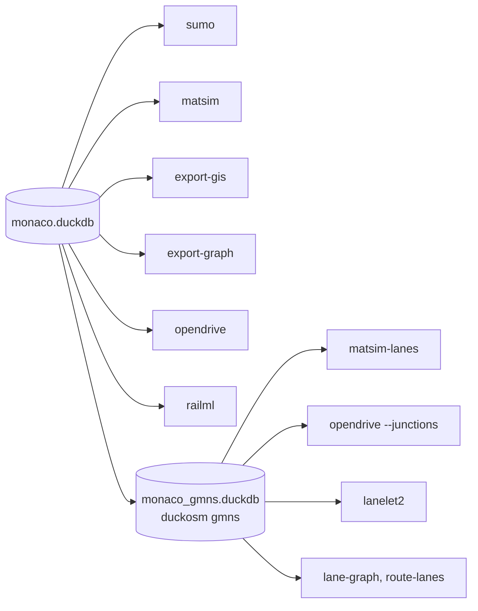

# Exports

## Exports by use

Each export reads a built database. Pick the group of your work.

### Traffic simulation

| Tool | Export | Command |
|---|---|---|
| SUMO | [SUMO](sumo.md) `.net.xml` | `duckosm sumo` |
| MATSim, BEAM, eqasim | [MATSim](matsim.md) `network.xml`, lanes and signals | `duckosm matsim`, `matsim-lanes` |
| DTALite, Path4GMNS | [GMNS](gmns.md) tables: macro; [meso and micro](gmns-meso-micro.md) (`--meso`, `--micro`) | `duckosm gmns` |
| Rail planning: OpenTrack, RailSys | [railML 2.4](railml.md) | `duckosm railml` |

### Maps and GIS

| Tool | Export | Command |
|---|---|---|
| QGIS, ArcGIS, FME | the network as [GeoPackage or shapefile](gis.md) | `duckosm export-gis` |
| QGIS, ArcGIS | GDAL's five OSM layers, as GeoPackage or GeoParquet ([duckOSM and GDAL](../concepts/gdal.md)) | `duckosm quack --gdal` |
| QGIS, a map style | the [base-map layers](base-map.md) `features.*`: water, land use, buildings, POIs | `duckosm build` |
| DuckDB, pandas, Spark | the OSM features table of QuackOSM, as GeoParquet ([duckOSM and QuackOSM](../concepts/quackosm.md)) | `duckosm quack` |

### Graph analysis

| Tool | Export | Command |
|---|---|---|
| networkx | [a networkx graph](networkx.md), GraphML; gpickle only from Python (`write_graph()`) | `to_networkx()`, `duckosm export-graph` |
| Your own router | [the turn graph](turn-graph.md) `edge_graph` in the database | `route()`, `Router` ([Route](../guides/route.md)) |

### Lane level and 3D

| Tool | Export | Command |
|---|---|---|
| CARLA, esmini, Vissim | [OpenDRIVE](opendrive.md) `.xodr` | `duckosm opendrive` |
| Autoware, lanelet2 | [Lanelet2](lanelet2.md) `.osm` | `duckosm lanelet2` |
| Your own lane router | [a lane graph](lane-routing.md) | `duckosm lane-graph`, `route-lanes` |

OpenDRIVE, Lanelet2, railML and the lane graph are **experimental**: tested for structure, not yet loaded in the target tools.

## The same id everywhere

Each network export keeps the **`edge_id`** as the id in the target format: the SUMO edge id, the MATSim link id, the GMNS
`link_id`, the OpenDRIVE road id, a GIS attribute. Data that you join on an `edge_id` in duckOSM (counts, speeds, sensor data)
joins on the exported network too.

## Two starting points

Most exports read the database `duckosm build` writes. The lane-level ones need the lanes and turns
per lane first, so they read a **GMNS database** made by `duckosm gmns`:

## Coordinates

Most exports write longitude / latitude (EPSG:4326). MATSim and OpenDRIVE need metres, so they
reproject to the **UTM zone of the data** (EPSG:32632 for Monaco); `--crs` picks another, e.g.
`EPSG:3006` for Sweden's national grid.

## Elevation

After [`duckosm elevation`](../guides/elevation.md), the heights go along: GIS layers get `ele` /
`z_from` / `z_to` attributes, MATSim nodes a `z`, and OpenDRIVE roads an elevation profile.
