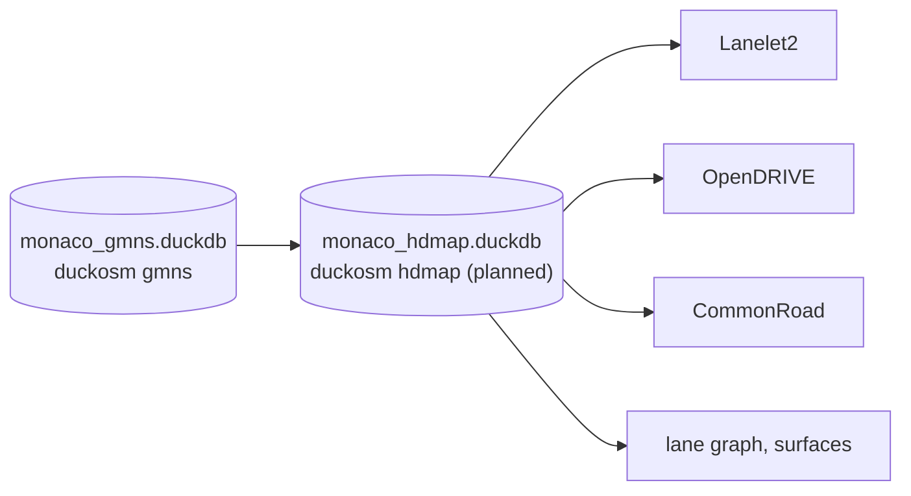

# 4. HD map

The HD map (high-definition map): each lane with its exact shape and its connections, for driving simulators and autonomous driving. These exports are experimental. These outputs read the
GMNS database of `duckosm gmns`, because it has the lanes and the turns of each lane.

| Tool | Output | Command |
|---|---|---|
| Your own lane router | [Lane-level routing](../lane-routing.md): a lane graph | `duckosm lane-graph`, `route-lanes` |
| Autoware, lanelet2 | [Lanelet2](../lanelet2.md): `.osm` | `duckosm lanelet2` |
| CARLA, esmini, Vissim | [OpenDRIVE](../opendrive.md): `.xodr` | `duckosm opendrive` |

All three are **experimental**. Tests check their structure. They are not loaded in the target tools yet.

## Planned: one HD map database

Today each output makes its own lanes from the GMNS database, so the files do not agree, and they have no stop lines,
signals or road marks. The plan: `duckosm hdmap` writes one [HD map database](../../reference/hdmap-database.md)
(`<area>_hdmap.duckdb`) from the GMNS database, and each output reads only this database.

| The database holds | |
|---|---|
| roads and lanes | each direction of a road with its reference line, its lane sections, and each lane with its width and its two borders in 3D |
| junctions | the path of each lane through each junction, the junction area, the stop lines |
| rules | the turns, the right of way, the traffic lights and the signs |
| heights | from the [ground of the area](../../concepts/ground-reference.md); bridges and tunnels by the chain rule |
| evidence | for each value: from the data, computed, or a default |

The code does not exist yet.
