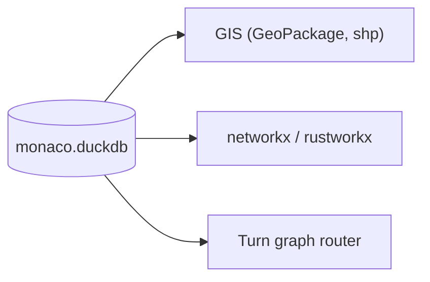

# 2. Routable network

The routable network of each mode: the edges with their `edge_id`, the nodes and the legal turns.

| Read by | Output | Command |
|---|---|---|
| Your own router | [The turn graph](../turn-graph.md): the table `edge_graph` in the database | `route()`, `Router` ([Route](../../guides/route.md)) |
| QGIS, ArcGIS, FME | [GeoPackage or shapefile](../gis.md): the network as GIS layers | `duckosm export-gis` |
| networkx | [networkx](../networkx.md): a networkx graph, GraphML or gpickle | `to_networkx()`, `duckosm export-graph` |
