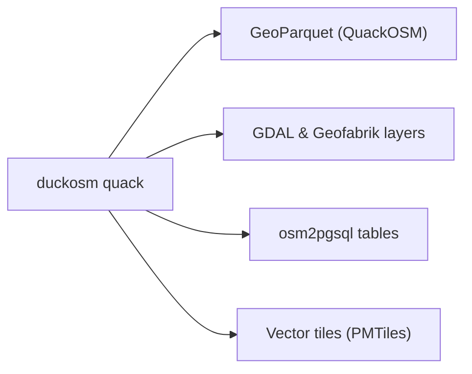

# 1. OSM data

The OSM objects of the area as tables, with no network. Each row is one OSM object. Every output takes your OSM fixes.

| Read by | Output | Command |
|---|---|---|
| DuckDB, pandas, Spark | [QuackOSM table](../../concepts/quackosm.md): one table of all OSM features, as GeoParquet or DuckDB | `duckosm quack` |
| QGIS, ArcGIS | [GDAL's OSM layers](../../concepts/gdal.md): five layers, as GeoPackage or GeoParquet | `duckosm quack --gdal` |
| QGIS, ArcGIS | [Geofabrik layers](../geofabrik.md): 20 layers, as GeoPackage, shapefiles or GeoParquet | `duckosm quack --geofabrik` |
| PostGIS map servers, OSM Carto | [osm2pgsql tables](../osm2pgsql.md): four tables, into PostGIS or as GeoParquet | `duckosm quack --osm2pgsql` |
| MapLibre, OpenLayers, QGIS | [Vector tiles (PMTiles)](../pmtiles.md): a base map in one file, Shortbread schema | `duckosm quack --pmtiles` |
