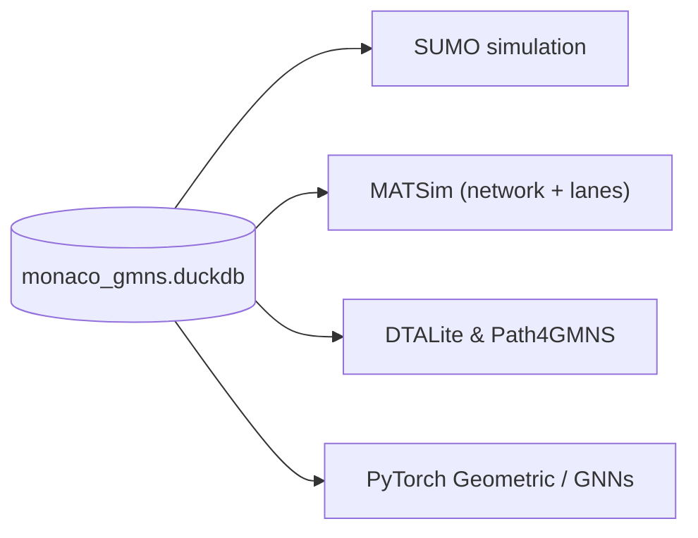

# 3. GMNS network

The multi-resolution network in the GMNS standard, from macro (links) to micro (lanes, movements, and zones), powering simulation and Graph Neural Networks.

| Read by | Output | Command |
|---|---|---|
| DTALite, Path4GMNS | [GMNS](../gmns.md): the macro tables ([all GMNS tables](../gmns_tables.md)) | `duckosm gmns` |
| PyTorch Geometric, GNNs | [PyG HeteroData](../../reference/sdk/ml.md): heterogeneous urban graph tensors | `duckosm.ml.to_pyg()` |
| mesoscopic and microscopic simulators | [GMNS meso and micro](../gmns-meso-micro.md) | `duckosm gmns --meso --micro` |
| MATSim, BEAM, eqasim | [MATSim](../matsim.md): `network.xml`, lanes and signals | `duckosm matsim`, `matsim-lanes` |
| SUMO | [SUMO](../sumo.md): plain XML and `.netccfg` (netconvert makes the `.net.xml`) | `duckosm sumo` |
| OpenTrack, RailSys (rail planning) | [railML 2.4](../railml.md) | `duckosm railml` |

railML is **experimental**. Tests check its structure. It is not loaded in the target tools yet.
