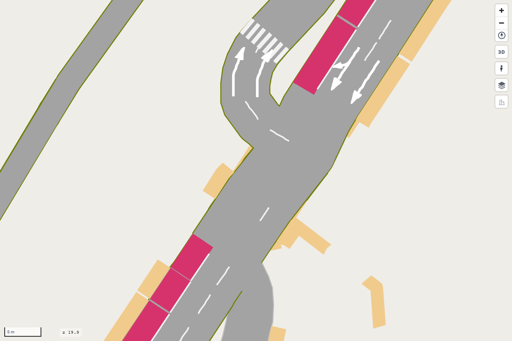

# SUMO

`duckosm sumo` writes a network for [SUMO](https://eclipse.dev/sumo/), with your OSM fixes. Each SUMO edge id is the
duckOSM `edge_id`.

| Reference and format | |
|---|---|
| Format | SUMO [plain XML](https://sumo.dlr.de/docs/Networks/PlainXML.html) (`.nod.xml`, `.edg.xml`, `.con.xml`), the bus stops (`.add.xml`) and the netconvert config (`.netccfg`). netconvert makes the [SUMO network](https://sumo.dlr.de/docs/Networks/SUMO_Road_Networks.html) `.net.xml` from them |
| Reference tool | SUMO's [netconvert](https://sumo.dlr.de/docs/netconvert.html) |
| Check | netconvert reads the plain XML and keeps each edge id and each connection. [How each output is checked](../concepts/checks.md) |

```bash
pip install "duckosm[sumo]"                      # adds SUMO's netconvert
duckosm sumo monaco.duckdb                       # -> sumo/monaco.{nod,edg,con,add}.xml and sumo/monaco.netccfg
netconvert -c sumo/monaco.netccfg                # -> sumo/monaco.net.xml
duckosm sumo monaco.duckdb --netconvert          # duckOSM runs netconvert: also monaco.net.xml and monaco.tll.xml
duckosm sumo monaco.duckdb --netconvert --join-junctions   # netconvert joins the junctions that are near each other
```

The files have all that netconvert takes from an OSM file for these items. Thus you do not give netconvert the OSM file,
which has no fixes and no `edge_id`.

## What goes in

| SUMO item | From duckOSM |
|---|---|
| edge id | `edge_id` |
| connections | the legal turns (`edge_graph`), so the turn restrictions stay. netconvert adds no turn |
| lanes | one SUMO lane for each lane, with its width and its vehicle classes, numbered from the right |
| lane classes | bus lane `bus`, bike lane `bicycle`, car lane: each road vehicle |
| walking network | one 2 m lane for pedestrians, and SUMO walking areas at the junctions |
| cycling network | one 1.5 m lane for bicycles |
| traffic lights | a node with `highway=traffic_signals` gets `type="traffic_light"` in the `.nod.xml` |
| stop signs | `highway=stop` gives `type="priority_stop"`; with `stop=all`, `type="allway_stop"` |
| bus stops | `<busStop>` in the `.add.xml` (see below) |

The coordinates are in metres, in the UTM zone of the data.

### Traffic lights and stop signs

OSM often puts a traffic light or a stop sign on a node of the way before the junction, not on the junction. duckOSM
moves the sign to the nearest network node of the same way, if it is 25 m or nearer (the distance of netconvert's
`tls.guess-signals.dist`). The traffic lights within 20 m of each other get one program: the node attribute `tl`
(netconvert's `tls.join-dist`). duckOSM does this, not netconvert, because the edges stay as they are: netconvert can
guess signals only from nodes in the network.

`highway=give_way` has no SUMO node type. A SUMO priority junction already makes the minor road wait, so duckOSM does not
change the node. On Monaco: 18 traffic-light junctions, 12 stop-sign junctions, 106 bus stops.

### The netconvert config

`<name>.netccfg` is the input of `netconvert -c`. Change it as text, or give `config={...}` to `to_sumo`.

| Line | You can change it |
|---|---|
| `node-files`, `edge-files`, `connection-files` | no: the files of duckOSM |
| `tllogic-files` | only after `--netconvert`: the signal programs (see below) |
| `output-file` | yes |
| `proj.utm` | yes: `true` gives metres in the UTM zone of the data |
| `geometry.remove` = `false` | no: with `true`, netconvert joins edges, and an edge id is no longer one `edge_id` |
| `junctions.join` = `false` | use `--join-junctions` (`config={"junctions.join": "true"}`): duckOSM then keeps the turns through the joined junction |
| `numerical-ids` = `false` | no: with `true`, netconvert gives new ids |
| `no-turnarounds.except-deadend` | yes |
| `tls.default-type` = `actuated` | yes: OSM has no signal timings, so the default program follows the traffic (`static` gives fixed times) |

### The signal programs and the bus stops

OSM seldom has signal timings, and a `.tll.xml` program must have one signal for each link of its junction, in the order
that netconvert gives. Thus duckOSM does not write programs of its own. With `--netconvert`, duckOSM copies the programs
that netconvert built (from `tls.default-type`, `tls.cycle.time` and `tls.layout`) to `<name>.tll.xml`, and adds the file
to the `.netccfg`. Edit the phases and the offsets in it, and run `netconvert -c` again: netconvert uses your programs.

`<name>.add.xml` is for SUMO itself (`sumo --additional-files`), not for netconvert. A bus stop is each OSM platform
(`highway=bus_stop`, `public_transport=platform`), and each bus `stop_position` with no platform within 30 m. It is on the
nearest edge of a bus route (`bus.route_edges`) within 30 m, on the side of the road where the stop is, on the right-most
lane that buses can use (`<edge_id>_<index>`), and 15 m long. `lines` has the refs of the bus routes on that edge.

## See it

`duckosm sumo-map sumo/monaco.net.xml` draws each SUMO lane at its width. The colors are those of
[`gmns-map`](gmns.md#see-it): a car lane is gray, a bus lane red, a bike lane blue.

<figure class="pair" markdown="span">
  
  
  <figcaption>One Monaco junction: the GMNS lanes (left, <code>duckosm gmns-map</code>) and SUMO's lanes after netconvert (right, <code>duckosm sumo-map</code>).</figcaption>
</figure>

| | GMNS | SUMO |
|---|---|---|
| Lane shape | duckOSM: the road line, moved to the side for each lane | netconvert: each lane ends at the edge of its junction |
| Inside a junction | the paths of SUMO, kept as `lane_connector` | netconvert's junction shape and its internal lanes |
| Lane ids | `<link_id>_<lane_num>`, lane 1 on the left | `<edge_id>_<index>`, index 0 on the right |
| Tools | DuckDB, Path4GMNS, DTALite | `sumo`, `sumo-gui`, `netedit` |

## Speed and memory

Mac mini (Apple M6, 12 cores, 16 GB). The plain XML only (`--no-netconvert`).

| Area (input) | Time | Memory | Output |
|---|---|---|---|
| Kentucky (148 MB) | 11 s | 5.0 GB | 1.4 GB |
| France (5.1 GB) | not run: the Mac mini has too little free disk | | |

## duckOSM and SUMO's OSM import

SUMO can also read OSM itself: `netconvert --osm-files`. The same area, both ways, on the Mac mini:

| | duckOSM (`duckosm sumo`) | SUMO's OSM import |
|---|---|---|
| Time, memory: Monaco | measuring | measuring |
| Time, memory: Kentucky | measuring | measuring |
| Edges, lanes, connections | measuring | measuring |
| Turn restrictions kept | all (from `edge_graph`) | measuring |
| OSM fixes | yes | no |
| Edge ids | `edge_id`, the same after each build | OSM way id and a part number |

## Limits

- No painted turn arrows (`turn:lanes`): SUMO's plain XML has no field for them. The [GMNS](gmns.md) export has them.
- Not yet: crossings, sidewalks, roundabouts and height. Not read: `traffic_signals:direction`.
- The bus stops are put on the right side of the road (traffic on the right).
- A turn that is open or closed to some vehicles only (`turn_permission`) goes to netconvert lane by lane, and only
  `--netconvert` writes it so. When you run netconvert yourself, these turns are open to all vehicles.
- No demand, routes or `.sumocfg`: these are your scenario.

All options: [Command line](../reference/cli.md#sumo).
