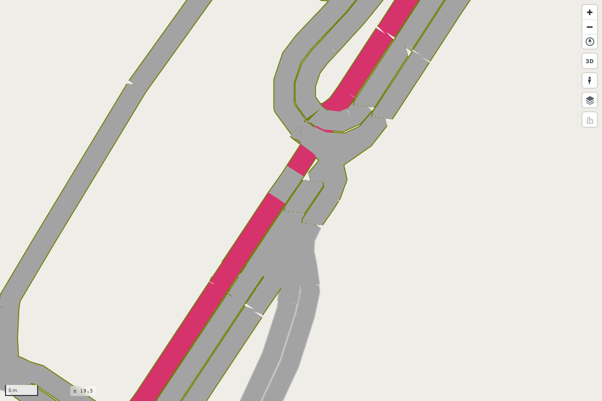

# SUMO

`duckosm sumo` writes a simulation network for [SUMO](https://eclipse.dev/sumo/) with your OSM fixes. Each SUMO edge preserves the duckOSM `edge_id`.

| Reference and format | |
|---|---|
| Format | SUMO [plain XML](https://sumo.dlr.de/docs/Networks/PlainXML.html) (`.nod.xml`, `.edg.xml`, `.con.xml`), bus stops (`.add.xml`), and netconvert config (`.netccfg`). netconvert compiles them into `.net.xml` |
| Reference tool | SUMO's [netconvert](https://sumo.dlr.de/docs/netconvert.html) |
| Check | netconvert compiles the plain XML, preserving all edge IDs and turning connections ([Validation](../concepts/checks.md)) |

```bash
pip install "duckosm[sumo]"                                 # adds SUMO's netconvert
duckosm sumo monaco.duckdb                                  # -> sumo/monaco.{nod,edg,con,add}.xml and .netccfg
netconvert -c sumo/monaco.netccfg                           # -> sumo/monaco.net.xml
duckosm sumo monaco.duckdb --netconvert                     # runs netconvert automatically: builds .net.xml and .tll.xml
duckosm sumo monaco.duckdb --netconvert --merge             # consolidates continuous road chains into single edges
duckosm sumo monaco.duckdb --netconvert --join-junctions    # merges nearby complex intersections
duckosm sumo monaco_gmns.duckdb --netconvert                # from the GMNS db: its lanes and lane connections
```

## What goes in

`duckosm sumo` reads a Level 2 db (`<area>.duckdb`) or a GMNS db (`<area>_gmns.duckdb`). It looks at the file and selects the source:

| Input | Lanes and connections | Use it for |
|---|---|---|
| Level 2 db | `lane_profile` and `edge_graph`; netconvert selects the lanes of each turn | large areas: Kentucky in 11 s, 2.6 GB |
| GMNS db | the `lane` and `lane_connector` tables: each turn goes lane to lane, as in GMNS | the same lanes as MATSim lanes and the HD map, and lane fixes made in GMNS |

`duckosm gmns` runs the Level 2 export and netconvert one time to get its lane connectors. After that, the GMNS db is the
source: the export from GMNS writes those lane connections, and netconvert does not select them again. From a GMNS db, the
bus-only links are SUMO edges with `allow="bus"`. The GMNS input has no bus stops (`.add.xml`), each signal node is its own
traffic light, and `--merge` and `--join-junctions` stop with an error. Design: `docs/design/sim_from_gmns.md`.

| SUMO item | From duckOSM |
|---|---|
| edge id | `edge_id` |
| connections | legal turns from `edge_graph` (preserves OSM turn restrictions) |
| lanes | physical width, vehicle classes, numbered from right to left |
| lane classes | `bus`, `bicycle`, general road traffic (`passenger`) |
| walking network | 2 m pedestrian lanes with junction walking areas |
| cycling network | 1.5 m dedicated bicycle lanes |
| traffic lights | nodes with `highway=traffic_signals` become `type="traffic_light"` on the junction |
| stop signs | `highway=stop` becomes `type="priority_stop"` (or `type="allway_stop"`) |
| bus stops | `<busStop>` elements in `.add.xml` |

Coordinates are projected to UTM metres. In OSM, traffic signals and stop signs are often mapped on approach roads before an intersection; duckOSM automatically attaches them to the junction node and groups adjacent signals into a single coordinated traffic light.

### Fewer edges (`--merge`) { #fewer-edges-merge }

Multimodal routing splits roads at path crossings and cycleways so pedestrian and cycling networks can cross and connect. SUMO does not need these splits for single-mode driving simulations. `--merge` (`to_sumo(..., merge=True)`) combines continuous road segments into single edges using [`driving.chains`](../reference/database.md#chains):

* **Edge IDs:** Merged edges receive a `chain_id`. Original duckOSM edge IDs are preserved in `<param key="edge_ids">` (and mapped in `duckosm.sim.edge_map`). Unmerged edges retain their `edge_id`.
* **Rules preserved:** Chains never cross traffic signals, stop signs, or turn restrictions.
* **Scope:** Driving network only (not compatible with `--join-junctions`).

### Signal timing and bus stops

* **Traffic signals (`<name>.tll.xml`):** OSM does not store signal timing plans. With `--netconvert`, duckOSM extracts netconvert's generated programs into `<name>.tll.xml` and adds them to `.netccfg`. Edit cycle phases and offsets in this file, then rerun `netconvert -c` to use your custom timing.
* **Bus stops (`<name>.add.xml`):** Generated for SUMO (`sumo -a <name>.add.xml`) from OSM platforms (`highway=bus_stop`, `public_transport=platform`) along bus routes, placed on the rightmost bus-accessible lane.

### Netconvert options (`<name>.netccfg`)

The generated `.netccfg` file configures netconvert. Customize options in text or via `config={...}` in Python:

| Key | Default | Description |
|---|---|---|
| `output-file` | `<name>.net.xml` | Output compiled network |
| `proj.utm` | `true` | Coordinates in UTM metres |
| `tls.default-type` | `actuated` | Traffic-actuated signal control (`static` for fixed time) |
| `junctions.join` | `false` | Join nearby complex junctions (`--join-junctions`) |
| `geometry.remove` | `false` | Keep `false` to preserve `edge_id`s (use `--merge` instead) |
| `numerical-ids` | `false` | Keep `false` to preserve duckOSM IDs |

## Visualizing lanes { #see-it }

`duckosm sumo-map sumo/monaco.net.xml` renders each compiled SUMO lane at its physical width:

<figure class="pair" markdown="span">
  
  
  <figcaption>One Monaco junction: GMNS lanes (left, <code>duckosm gmns-map</code>) vs SUMO compiled lanes (right, <code>duckosm sumo-map</code>).</figcaption>
</figure>

| | GMNS | SUMO |
|---|---|---|
| Lane geometry | Centerline offset by lane width | Compiled junction shapes and internal lanes |
| Junction paths | `lane_connector` tables | Netconvert internal lanes |
| Lane IDs | `<link_id>_<lane_num>` (1 on left) | `<edge_id>_<index>` (0 on right) |
| Target tools | DuckDB, Path4GMNS, DTALite | `sumo`, `sumo-gui`, `netedit` |

## Speed and memory

Mac mini (Apple M6, 12 cores, 16 GB). Plain XML export (`--no-netconvert`):

| Area (input DuckDB) | Time | Peak Memory | Output XML |
|---|---|---|---|
| Kentucky (~1.2 GB `.duckdb`) | 11 s | 2.6 GB | 1.4 GB |
| France (~35 GB `.duckdb`) | not run | (needs ~40 GB disk) | |

Files stream directly as DuckDB reads rows, bounding peak memory.

## Limits

* **Turn arrows (`turn:lanes`):** SUMO plain XML has no field for painted lane arrows. Use the [GMNS](gmns.md) export for lane-level turn markings.
* **Vehicle restrictions:** Conditional turn permissions (`turn_permission`) are written lane-by-lane by `--netconvert`. Running netconvert standalone allows all vehicles.
* **Scenario inputs:** Demand matrices, routes (`.rou.xml`), and simulation settings (`.sumocfg`) are defined by your scenario.

All options: [Command line](../reference/cli.md#sumo).
