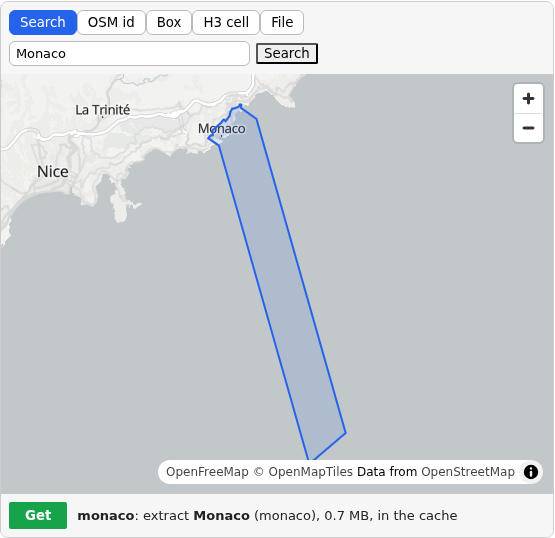

# Choose an area in Jupyter

`duckosm.AreaPicker` is a map in a Jupyter notebook. You use it to choose an area. Then you click **Get** to get the
OSM file of the area.



The widget does the same work as [`duckosm get`](../exports/osm-file.md): it finds the
boundary, takes the smallest Geofabrik extract that holds the boundary, downloads the extract and cuts it.

## Install

```bash
pip install "duckosm[widget]"
```

The extra installs only [anywidget](https://anywidget.dev). The widget works in JupyterLab, Jupyter Notebook and
VS Code.

## Use the widget

```python
import duckosm

picker = duckosm.AreaPicker(out="data")
picker
```

1. Choose an area with one of the five tabs:

    | Tab | What to do | The argument of `duckosm.get()` |
    |---|---|---|
    | Search | Type a place name and click a match. You cannot choose a match that is a point (an OSM node), because a point has no boundary. | `boundary` |
    | OSM id | Type the id of an OSM boundary relation. | `boundary` |
    | Box | Drag a box on the map, or type `west,south,east,north`. | `bbox` |
    | H3 cell | Select the level (5 to 10) and click a hexagon, or type the cell id. | `h3_cell` |
    | File | Load a GeoJSON file. | `boundary` |

2. Examine the line under the map. It shows the Geofabrik extract and its size, and if the extract is already in
   the cache folder. The map shows the boundary of the cut in blue. The widget downloads nothing in this step.

3. Click **Get**. The line next to the button shows the progress of the download and the cut.

4. Build the network of the area with the result:

    ```python
    import subprocess, sys

    area = picker.result            # area.pbf and area.boundary: paths
    subprocess.run([sys.executable, "-m", "duckosm", "build", "--pbf", str(area.pbf),
                    "--boundary", str(area.boundary), "-o", "data/area.duckdb", "-m", "driving"], check=True)
    ```

    The notebook [From an area to a network](../notebooks/01_area_to_network.md) does these steps and queries the new database.

You can also set the area and get the file from Python, with no click:

```python
picker.area = {"mode": "bbox", "bbox": [7.42, 43.728, 7.44, 43.738]}
area = picker.get()
```

## Arguments

| Argument | Default | Meaning |
|---|---|---|
| `out` | `"."` | The folder of the output files `<name>.osm.pbf` and `<name>.geojson`. |
| `fixes` | `None` | An OSM fixes file (YAML). The cut file has the fixes in it. |
| `cache` | `None` | The folder of the downloads. The default is `$DUCKOSM_CACHE`, else `~/.cache/duckosm`. |

## How it works

The widget does no OSM work in Python. When you choose an area, it runs `duckosm get --dry-run`. This command finds
the boundary and the extract, and prints them as JSON. It downloads nothing and writes no files. **Get** runs
`duckosm get`. You can run the same commands in a terminal:

```bash
duckosm get --bbox 7.42,43.728,7.44,43.738 --dry-run
duckosm get --bbox 7.42,43.728,7.44,43.738 -o data
```

The map uses [MapLibre](https://maplibre.org) and the [OpenFreeMap](https://openfreemap.org) base map. The
search uses [Photon](https://photon.komoot.io). For Search and OSM id, the browser gets the polygon from
[polygons.openstreetmap.fr](https://polygons.openstreetmap.fr), else from OpenStreetMap's
[Nominatim](https://nominatim.openstreetmap.org), and gives it to `duckosm get` as the boundary. Thus the program
does not send a request for each choice. Nominatim stops an address that sends too many requests. The notebook must have a connection
to the internet.
