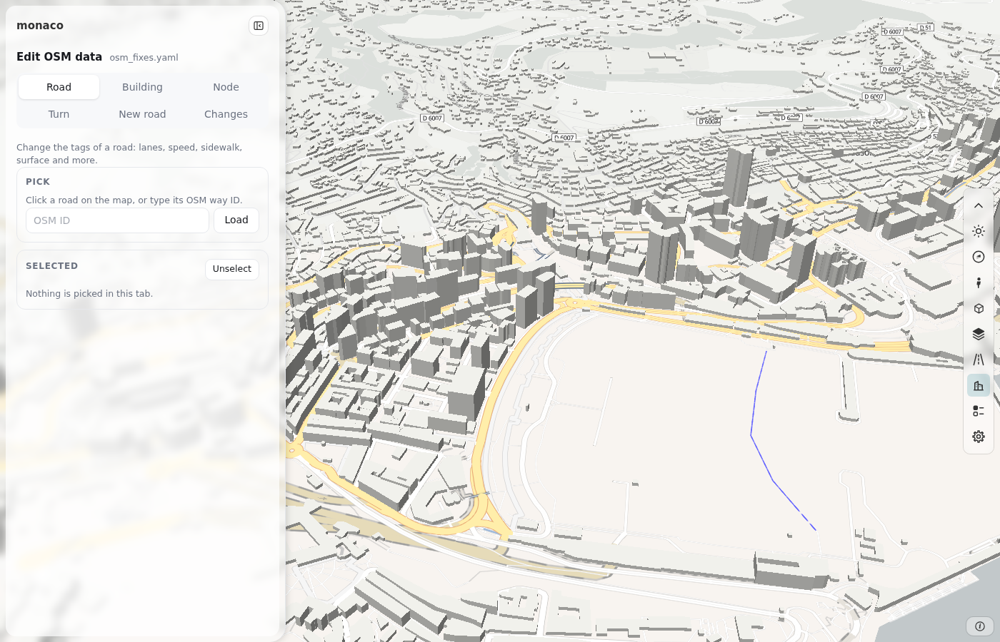
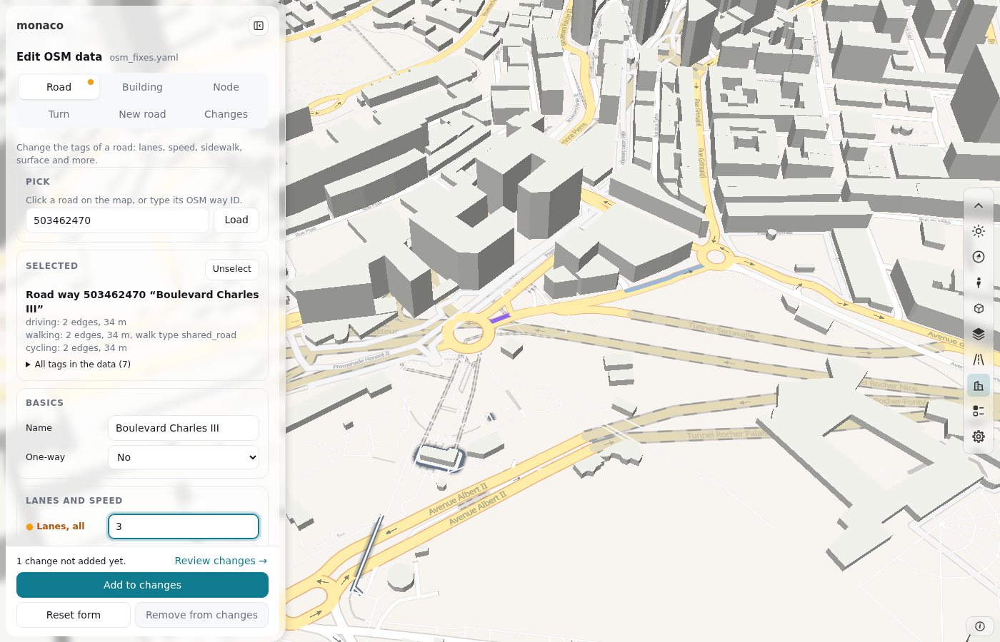
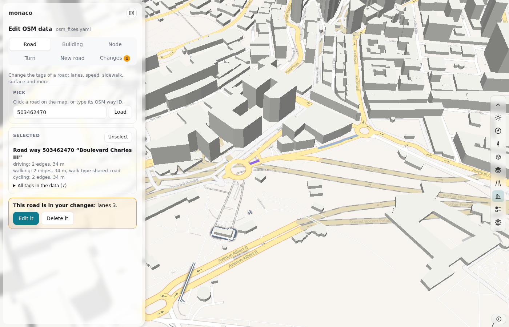
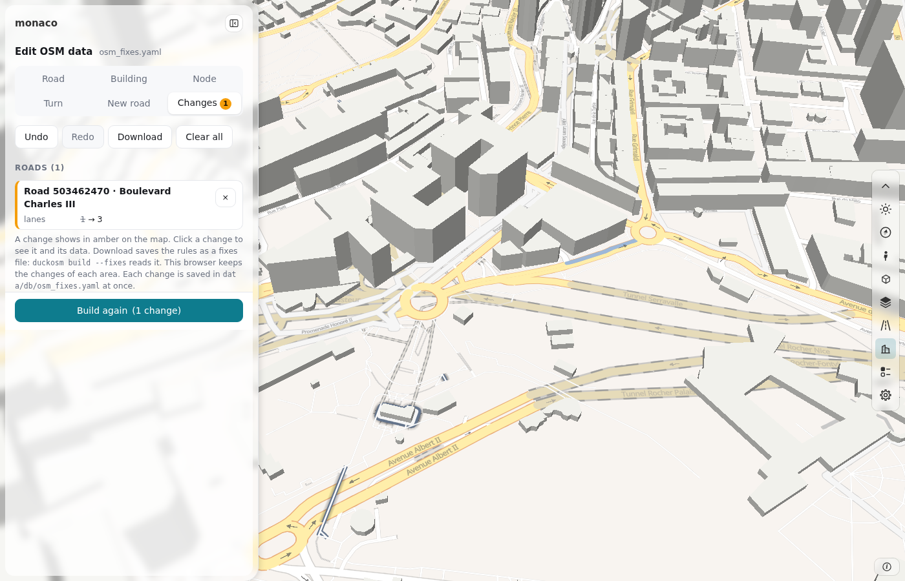

# Edit OSM data and use the fixes file

The panel **Edit OSM data** of [duckOSM Studio](https://khoshkhah.github.io/duckosm-studio/) changes the OSM data of an area on a map:
the tags of roads, buildings and nodes, turn rules, new roads and the type of each wall of a building. The panel writes the changes
as a fixes file. `duckosm build` reads the same file and gives the same tables as the page. The panel is part of duckOSM
(`web/fixes_editor/`), and the page loads it at the same duckOSM version as its build engine.

The fixes file has the keys of [Fix OSM errors](fix-osm-errors.md) (`overrides`, `new_ways`, `turn_restrictions`) and two more keys
under `extra`. A file from the page is a normal duckOSM fixes file.

## Make the changes on the page

1. On the page, build your area with **Layers** on (the layers need a region file).
2. Open **Edit OSM data**.
3. Pick the tab of what you want to change:

    | Tab | What you change | Key in the file |
    |---|---|---|
    | **Road** | the tags of a road: lanes, speed, one-way, sidewalk, surface; the networks that have the road; delete the road | `overrides` (one-way, lanes, layer, modes, delete), `extra.tag_edits` (the other tags) |
    | **Building** | the tags of a building: floors, height, roof, facade; the type of each wall and its door; delete the building | `extra.tag_edits`, `extra.building_faces`, `overrides` (delete) |
    | **Node** | a traffic signal, a crossing or another node | `extra.tag_edits` |
    | **Turn** | a turn that a driver cannot make, or must make, at a junction | `turn_restrictions` |
    | **New road** | a road that OSM does not have: click its points on the map | `new_ways` |

4. Click the object on the map, or type its OSM id and click **Load**.
5. Change the fields of the form, then click **Add to changes**. Nothing goes into the file before this step.
6. In the **Changes** tab, click **Build again** to see the changes in the tables and on the map.
7. Click **Download** to save the file (`osm_fixes.yaml`).

The page keeps the changes in your browser for each area name, so a reload of the page does not lose them.

### An object that is in your changes

When you pick an object that is in your changes already, a box shows over the form, and the form waits:

> **This road is in your changes:** lanes 2, name "B". **Edit it** **Delete it**

- **Edit it** opens the form with the values of your changes.
- **Delete it** removes the changes of the object, and the form opens with the OSM data. **Undo** in the **Changes** tab brings them back.

The box shows for a road, a building (with its walls), a node, the turn rules of a road at a junction, and a new road that you open
from the **Changes** tab.

A file that you load can have two or more rules for one object. Then the box says how many. **Edit it** joins them into one rule: for the
same key, the later rule wins, as in the build. The build result does not change. The **Changes** tab marks such an object with "2 rules".

## Edit on your computer: duckosm edit

`duckosm edit` opens the same panel on a page on your computer, for a database that you built. You do not build the area again in the
browser, and you do not download the file: the page saves each change in the fixes file at once.

1. Build the area with `duckosm build` (for example `duckosm build --config my_area.yaml`). The database keeps the record of its
   build: the config and the folder of the build.
2. Start the page:

    ```bash
    duckosm edit data/db/my_area.duckdb
    ```

    The command writes the address of the page, `http://127.0.0.1:8790/`. Open it in your browser. The page answers only on this computer.
    To use another port, add `--port 8791`. When you connect to the computer with ssh, forward the port (`ssh -L 8790:127.0.0.1:8790 ...`).

3. The page is roadstyle's dashboard of the database, with **Edit OSM data** in its panel. Make the changes as on the duckOSM Studio page:
   pick an object, change the fields, and click **Add to changes**.
4. Each change goes into `osm_fixes.yaml` beside the database at once. To use another file, start with `--fixes path/to/file.yaml`. If
   the file does not exist, the page starts with no rules, and your first change makes the file. **Download** in the **Changes** tab
   gives a copy.
5. Click **Build again** in the **Changes** tab. The build of the database runs again with the fixes file, and the page loads again with
   the new network.
6. Press Ctrl+C in the terminal to stop the page.

### The page



| Part | What it is |
|---|---|
| The panel at the left | The name of the area and **Hide panel** at the top. Under them, **Edit OSM data** with the name of the fixes file, and six tabs: **Road**, **Building**, **Node**, **Turn**, **New road** and **Changes**. |
| The map | The roads of the database, drawn by roadstyle. Click a road, a building or a node to pick it. |
| The bar at the right of the map | The map tools of roadstyle's dashboard: the light or dark theme, zoom, Street View, Google 3D, the base map and the layers, and the settings. |

To change a road, click it on the map. The form shows its tags. Change a field, for example the lanes, and click **Add to changes**:



When you pick the road again, the box "This road is in your changes" shows over the form ([An object that is in your changes](#an-object-that-is-in-your-changes)):



The **Changes** tab lists your rules. **Build again** builds the database with them, and the page loads the new network:



Before the page writes a file that was there already, it keeps the old file as `osm_fixes.yaml.bak`. The page writes the file from the
rules of the panel, so the comments of a file that you wrote by hand do not stay. If the file is not valid YAML, the page tells you and
does not change it.

**Build again** is off when the database has no record of its build: a database from an older duckOSM, from duckOSM Studio, or from
`duckosm-rust` without `--config`. The reason shows under the button. Build the database again with `duckosm build`, then it works.

`duckosm-rust edit my_area.duckdb` opens the same page from duckOSM's Rust program. Its **Build again** runs the build of the Rust program
(`duckosm-rust --config`). It writes the `.duckdb` file only, and it skips the steps that the Rust program does not have.

## Build with the file

Give the file to `duckosm build`:

```bash
duckosm build --pbf monaco-latest.osm.pbf -b monaco.geojson --fixes osm_fixes.yaml
```

A wall rule (`extra.building_faces`) needs the table `main.building_faces`. Set `options.building_faces` in the
[config file](build.md#with-a-config-file):

```yaml
osm_overrides: osm_fixes.yaml   # or --fixes on the command line
options:
  building_faces: true
```

| Key | Rust engine (the default) | `--engine python` |
|---|---|---|
| `overrides`, `new_ways`, `turn_restrictions` | yes | yes |
| `extra.tag_edits` | yes | yes |
| `extra.building_faces` | with `options.building_faces: true` | no: the build stops with an error |

On the Monaco sample, a file with every key gives the same rows as the page in all tables that the two have. The test
`tests/test_page_fixes.py` makes sure of this on each change of duckOSM.

## The keys under `extra`

### `extra.tag_edits`

Each rule sets and deletes tags of one OSM way, node or relation. The build sets the tags first, then deletes the keys.

```yaml
extra:
  tag_edits:
    - {type: way, id: 503462470, set: {sidewalk: both, surface: paved}}
    - {type: node, id: 21912089, set: {highway: traffic_signals}}
    - {type: relation, id: 393226, delete: [building]}
```

| Field | Does |
|---|---|
| `type` | `way`, `node` or `relation` (required) |
| `id` | the OSM id (required) |
| `set` | these tags get these values |
| `delete` | these tags go |
| `was` | the values before the change (the page writes them for its list of changes; the build does not read them) |
| `note` | free text |

The build changes the tags in `raw.*` before all other steps. So the networks, the layers (`features.*`), the bus routes and the
lane profile see the new tags. A rule on a relation changes its tags only, not its geometry. A rule for an object that is not in the area
does nothing.

### `extra.building_faces`

Each rule gives one wall of a building another type, or a door.

```yaml
extra:
  building_faces:
    - {building: 23715051, from_node: 256791670, to_node: 256791677, type: back}
```

| Field | Does |
|---|---|
| `building` | the OSM id of the building way or relation (required) |
| `from_node`, `to_node` | the two OSM nodes at the ends of the wall, in either order (required) |
| `type` | `front`, `back`, `side`, `party` or `court` |
| `door` | the kind of door of the wall, for example `main` or `service` (optional) |
| `note` | free text |

In [`main.building_faces`](../reference/database.md#building_faces), `face_type` has the type of the rule, `computed_type` has the type
that the build found, and `edited` is true.
