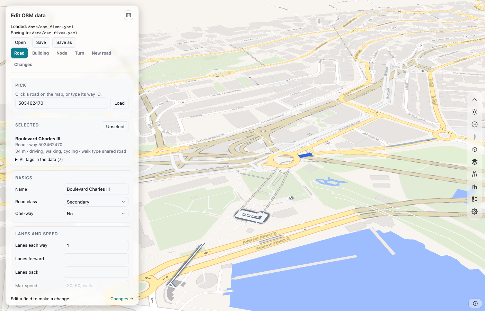
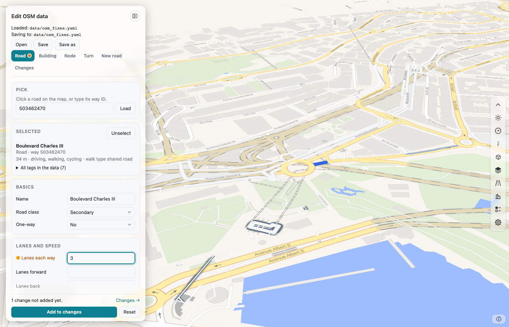
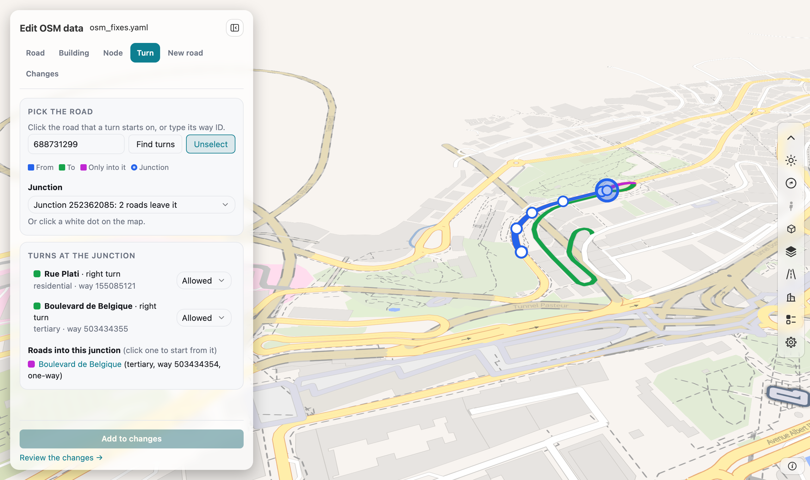

# Fix the OSM data

The editor **Edit OSM data** corrects the OSM data of an area on a map and writes the corrections to a fixes file. Each build reads the file.

```bash
duckosm edit monaco.duckdb --load osm_fixes.yaml --save osm_fixes_v2.yaml
```

## The editor

| Where | How |
|---|---|
| [duckOSM Studio](https://khoshkhah.github.io/duckosm-studio/) | the step **Edit OSM data**, after a build with **Layers** on; **Download** saves the file |
| your computer | `duckosm edit DB` opens the page at `http://127.0.0.1:8790/`; after the first **Save**, it saves each change in the save file at once |

| Option of `duckosm edit` | Does | Default |
|---|---|---|
| `--load FILE` | a fixes file that the page reads into its list; the page does not write it | none: the list is empty |
| `--save FILE` | the fixes file that the page writes, each change at once; it can be the `--load` file; the first change makes it | none: the first **Save** asks for the file |
| `--fixes FILE` | the old name of `--load FILE --save FILE`; it goes in a later release | |
| `--port PORT` | the port of the page on `127.0.0.1` | `8790` |

duckOSM does not choose a name or a folder for a fixes file. You choose the two files, so you can load a base file and save
variants of it, and the base file does not change.

## The files

The lines over the tabs show the two files: **Loaded: osm_fixes.yaml** and **Saving to: osm_fixes_v2.yaml**, or **not chosen yet**.

| Button | Does |
|---|---|
| **Open** | load another fixes file into the list; it asks first when the list has changes. The save file is then not chosen |
| **Save** | write the list to the save file; with no save file, it asks for one. After that, each change goes into the file at once |
| **Save as** | write the list to another file, which is then the save file |

On your computer, a file name is a path on the computer that runs Python or `duckosm edit`, relative to the folder where it
runs. In duckOSM Studio, **Open** reads a file from your computer and **Save** downloads the file.

When the database was built with a fixes file, the page shows **Built with data/osm_fixes.yaml. Load it?** The page does not load
it by itself. The first write to a file that exists keeps a copy of it as `FILE.bak`.



| Tab | What you change | Key in the file |
|---|---|---|
| **Road** | the tags of a road (class, lanes, speed, one-way, sidewalk, surface, access); delete the road | `overrides`, `extra.tag_edits` |
| **Building** | floors, height, roof, facade; the type of each wall and its door; delete the building | `extra.tag_edits`, `extra.building_faces`, `overrides` |
| **Node** | a traffic signal, a crossing or another node | `extra.tag_edits` |
| **Turn** | a turn that a driver cannot make, or must make, at a junction | `turn_restrictions` |
| **New road** | a road that OSM does not have: click its points on the map | `new_ways` |
| **Changes** | the list of your changes, and **Build again** | |

1. Pick a tab.
2. Click the object on the map, or type its OSM id and click **Load**.
3. Change the fields, then click **Add to changes**.
4. In the **Changes** tab, click **Build again** to see the result in the tables and on the map.



The form shows an error in red and does not add the change until you correct it. A warning in amber does not stop the change.
When you pick an object that is in your changes, a box shows **Edit it** and **Delete it**.

In the **Turn** tab, the **From** road is blue, the roads that leave the junction are green, and the roads that only arrive are violet:



| Button in **Changes** | Does |
|---|---|
| **Undo**, **Redo** | take back or do again a change while the page is open |
| **Download** | save a copy of the file |
| **Add a file** | add the changes of another fixes file; for one object, the later change stays |
| **Delete all changes** | delete every change from the list and the file; it asks first |
| **Changes on the map** | show or hide your changes on the map |
| **Build again** | build the database again with the save file; off when the database has no record of its build (build it with `duckosm build -c`). The database then records the save file, so `net.fixes` and `net.rebuild()` find it |

## The fixes file

`osm_fixes.yaml` has five keys. A rule for an object that is not in the area does nothing, so one file can hold the fixes of
all your areas. The editor adds `changed`, the time of the change, to each record; the build does not read it.

| Key | Does |
|---|---|
| `overrides` | change a way: one-way, lanes, layer, tags; remove it |
| `new_ways` | add a road that OSM does not have |
| `turn_restrictions` | forbid or force a turn |
| `extra.tag_edits` | set or delete the tags of a way, a node or a relation |
| `extra.building_faces` | give a wall of a building a type and a door |

`overrides` changes a way, by its OSM id:

```yaml
overrides:
  - {osm_id: 4230100, oneway: true}
  - {osm_id: 503462470, lanes: 3, turn_lanes_forward: left|through|through}
  - {osm_id: 4229577, remove: true}
```

| Field | Does |
|---|---|
| `oneway` | `true` or `false` |
| `lanes`, `lanes_forward`, `lanes_backward` | lanes in each direction, or in one direction |
| `layer` | the vertical level |
| `turn_lanes_forward`, `turn_lanes_backward` | the arrows, in the syntax of the OSM tag `turn:lanes` |
| `exclude_modes` | remove the way from these networks: `driving`, `walking`, `cycling` |
| `remove` | `true`: remove the way from the build |
| `tags` | set these OSM tags on the way |
| `keep_nodes` | `[from, to]`: keep only this part of the way |

`new_ways` adds a road that OSM does not have:

```yaml
new_ways:
  - id: 9000000000000
    nodes: [21911886, [7.4235072, 43.7371133], 21914340]
    tags: {highway: service, name: New lane}
```

| Field | Does |
|---|---|
| `id` | 9,000,000,000,000 or more, used one time. Do not change it: the edge ids come from it |
| `nodes` | an OSM node id, or `[lon, lat]` for a new node. Make the two ends OSM nodes, so that the road connects |
| `tags`, `tags_from` | the OSM tags, or the OSM way to copy the tags from |

`turn_restrictions` forbids or forces a turn in the driving network:

```yaml
turn_restrictions:
  - {from_way: 4230100, via_node: 21924057, to_way: 4230099, restriction: no_left_turn}
```

`restriction` is `no_u_turn` (default), `no_left_turn`, `no_right_turn`, `no_straight_on` or `only_*`.
To find the ids, use [`duckosm way`](query.md#look-up-one-osm-way) or click the road on [openstreetmap.org](https://www.openstreetmap.org).

`extra.tag_edits` sets and deletes the tags of a way, a node or a relation. `extra.building_faces` gives a wall a type and a door:

```yaml
extra:
  tag_edits:
    - {type: way, id: 503462470, set: {sidewalk: both, maxspeed: '30'}}
    - {type: relation, id: 393226, delete: [building]}
  building_faces:
    - {building: 23715051, from_node: 256791677, to_node: 256791676, type: front, door: main}
```

A wall `type` is `front`, `back`, `side`, `party` or `court`. The result is in [`main.building_faces`](../reference/database.md#building_faces).

## From Python

`duckosm.fixes` writes the same file ([reference](../reference/sdk/fixes.md)). The changes stay in memory until
`fixes.save("osm_fixes.yaml")`.

| Editor | Python |
|---|---|
| **Road** tab: a tag | `fixes.set(way=..., maxspeed=30)` |
| **Road** tab: one-way, lanes, layer | `fixes.set(way=..., oneway=True, lanes=2, layer=1)` |
| **Road** tab: delete the road | `fixes.remove(way=...)` |
| remove the way from one network | `fixes.exclude(way=..., modes=["driving"])` |
| **Save**, **Save as** | `fixes.save("osm_fixes.yaml")` |
| **Changes**: **Build again** | `net.rebuild(fixes=fixes)` |
| the editor on a map | `net.edit(load="osm_fixes.yaml", save="osm_fixes_v2.yaml")` |
| the edges that changed | `net.diff(fixed)` |

## Where the fixes are used

| Command | How |
|---|---|
| `duckosm build` | `--fixes FILE`, or the config key `osm_overrides` |
| `duckosm tiles` | the config key `osm_overrides`, or `-- --fixes FILE` at the end of the command |
| `duckosm quack` | `--fixes FILE`, in all modes (`--gdal`, `--tiles`, `--tile-zoom`). `exclude_modes`, `turn_lanes_*` and `turn_restrictions` are not OSM tags of a way, so `quack` does not use them |
| duckOSM Studio | the step **Edit OSM data**: each build of the page uses its changes |

The build applies the fixes before all other steps. Thus every table, layer and export of the database has them.
The wall rules need `options.building_faces: true` in the [config file](build.md#the-config-file).

Correct only what you checked on the ground or in imagery: a wrong `oneway` removes a direction of travel.
