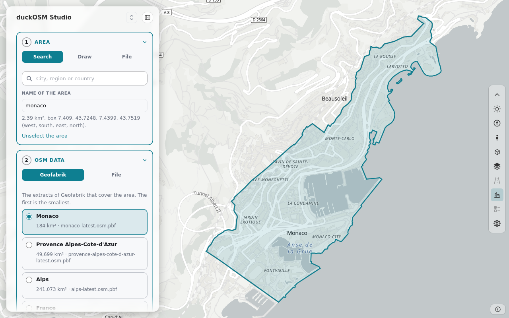

# Make the data of an area on your computer

`duckosm studio` starts a page on your computer. The page makes the data of an area in six steps. The last step opens the map of the new
area, with the panel **Edit OSM data**. The steps are the steps of [duckOSM Studio](https://khoshkhah.github.io/duckosm-studio/), the
page that runs in a browser. The two pages use the same parts of duckOSM (`web/build_steps/` and `web/ground_step/`).

The difference: here the build runs on your computer. It is `duckosm build`, so the area can be as large as your computer can build, and the
result is a `.duckdb` file on your disk.



## Start

```bash
duckosm studio areas
```

Open the address that the command prints (`http://127.0.0.1:8792/`). The page opens in the browser by itself when the computer has a desktop;
`--no-open` stops this. Each area is made in its own folder, `areas/<name>/`. The page answers only on this computer. Ctrl+C stops it.

`duckosm-rust studio` is the same page with the native engine of the Rust program. It has no base-map layers.

## The steps

1. **Area.** Choose the area in one of three ways:
    - **Search.** Type the name of a place and pick a match. The outlines come from Nominatim, so the page needs the internet for this.
    - **Draw.** Push **Draw a box on the map**, then drag on the map from one corner to the other.
    - **File.** Drop a GeoJSON file with a polygon or a multipolygon, for example the file of `duckosm boundary`.

    The name of the area is the name of its folder. You can change it.
2. **OSM data.** The tab **Geofabrik** shows the extracts of Geofabrik that cover the whole area, the smallest first. The build downloads the
   one that you pick into the folder of the area. The tab **File** takes the path of a `.osm.pbf` file on this computer. The build cuts the
   file to the area.
3. **Settings.** The networks and the options of the build. Open **Config of the build** to see the text. The keys are the keys of
   [the config of `duckosm build`](../reference/configuration.md).
4. **Ground.** The page suggests the DEM sources that cover the area, best first. Choose the source of your DEM file, download the file from it, then select the file. The
   product, the vertical datum and the license of the file come from the catalog. With no file, the area has no DEM. The choice
   **Ground: AWS Terrain Tiles** makes a DEM for the map terrain, and it is never the reference ground of the area. Read
   [The ground reference](../concepts/ground-reference.md) and [Add elevation](elevation.md). A DEM needs `pip install "duckosm[elevation]"`.
5. **Build.** Push **Build**. The page shows the download, the steps and the time. The build writes `areas/<name>/<name>.duckdb`, the config
   it used (`config.yaml`) and the boundary (`boundary.geojson`).
6. **Result.** The page shows what the build made. **Open the map and edit OSM data** opens roadstyle's dashboard of the new area, the same
   page as [`duckosm edit`](edit-osm-data.md#edit-on-your-computer-duckosm-edit). Each change goes into `areas/<name>/osm_fixes.yaml`, and
   **Build again** builds the area again with the file. The record of the build is in the database, so Build again works.

## Your areas

The areas are files on your disk, in `OUT_DIR/<name>/`. A new visit of the page lists them in the card **Your areas** (as Studio lists the areas that it keeps in the browser).
For each area the card shows the date, the size, the networks and whether it has a DEM, with two buttons:

- **Open** shows the map of the area with the panel **Edit OSM data** (the page of `duckosm edit`).
- **Load** puts the boundary and the settings of the area back into the steps 1 and 3, so that you can change them and build again. Choose the OSM data and the ground again.

The card has no Delete button. To delete an area, delete its folder.

## On a phone

The panel is a sheet at the bottom and the map is above it. Draw the box on the map, then use the steps in the sheet.

## Options

| Option | Does | Default |
|---|---|---|
| `OUT_DIR` | the folder of the areas | the current folder |
| `--port INTEGER` | the port of the page on 127.0.0.1 | `8792` |
| `--geofabrik-index URL_OR_FILE` | the list of the extracts, for a mirror or a test | `https://download.geofabrik.de/index-v1.json` |
| `--no-open` | do not open the browser | off |

## Limits

- The Rust build makes the base-map layers (`features.*`), the H3 columns and, with the setting Sea, `features.ocean`. It makes no `main.boundary_cells`, checks, report, maps or multimodal graph. The Python build (`duckosm studio`) makes them.
- The page builds one area at a time.
- A DEM file is at most 16 MB. A larger DEM does not go through the page: give it with `elevation:` in a config and run `duckosm build`.
- The page does not stop a build that runs. Stop the command, then start it again.
