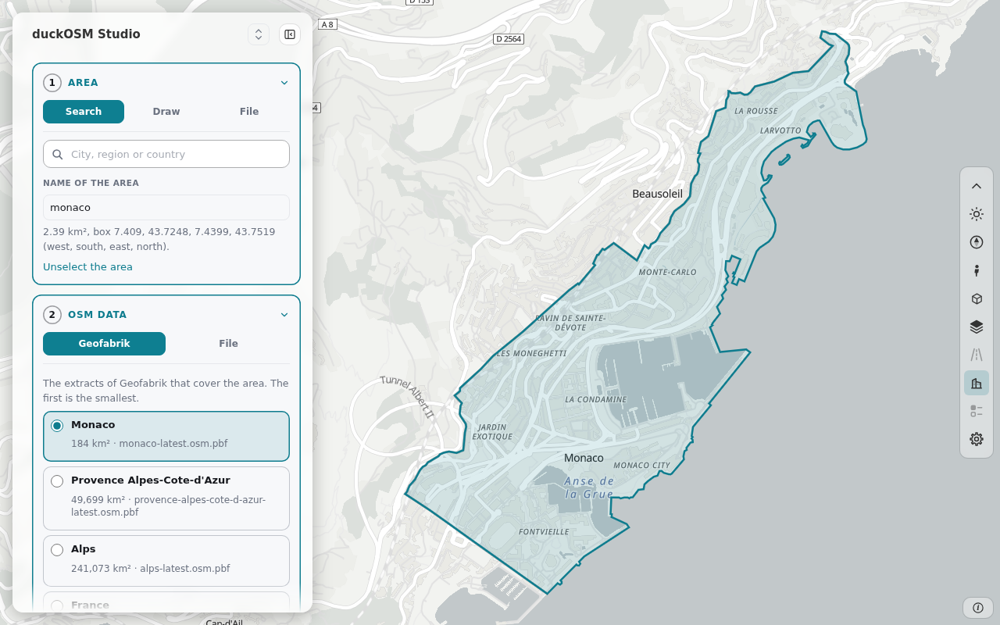

# duckOSM Studio

duckOSM Studio is the dashboard of duckOSM. Choose an area on the map, build its road network, fix the OSM data, and
export the result.

[Open duckOSM Studio](https://khoshkhah.github.io/duckosm-studio/){ .md-button .md-button--primary }
[The manual](https://khoshkhah.github.io/duckosm-studio/manual/){ .md-button }

## The steps

| Step | Does |
|---|---|
| 1. Choose an area | search a place, draw a shape, open a GeoJSON file, or select H3 cells |
| 2. The area | the name of the area and its buffer |
| 3. The data | the OSM data: a region file (a Geofabrik extract), Overpass, or a cut file |
| 4. Build | the driving, walking and cycling networks, the base-map layers, the drawing levels and the ground (a DEM) |
| 5. The result | the tables; download them as `.zip` or `.duckdb` |
| 6. Visualization | the map of a network |
| 7. Edit OSM data | change a road, a building or a turn rule, then build again |
| 8. Edit levels | set which road is on top at a bridge or a tunnel |
| 9. Edit design | the theme, the colors and the widths of the map |
| 10. Export | PMTiles, GeoPackage, GeoJSON, SUMO, MATSim and more |

## Two versions

| | Browser | Native (on your computer) |
|---|---|---|
| Start | open [the page](https://khoshkhah.github.io/duckosm-studio/) | `duckosm studio [FOLDER]`, then open `http://127.0.0.1:8792/` |
| The build runs | in the browser (WebAssembly) | in the native program |
| The areas are | in the browser's storage | in folders on your disk (default: the current folder) |
| Largest area | a country, by tiles | a country, by tiles |

Both versions use the same steps and give the same tables. Speed on France: [Home](../index.md#speed-on-france).
How the two builds work: [Browser and native builds](../concepts/browser-native.md).

The native version (its options, your areas, the limits):
[the details on GitHub](https://github.com/Khoshkhah/duckOSM/blob/main/docs/rust/studio_local.md).
