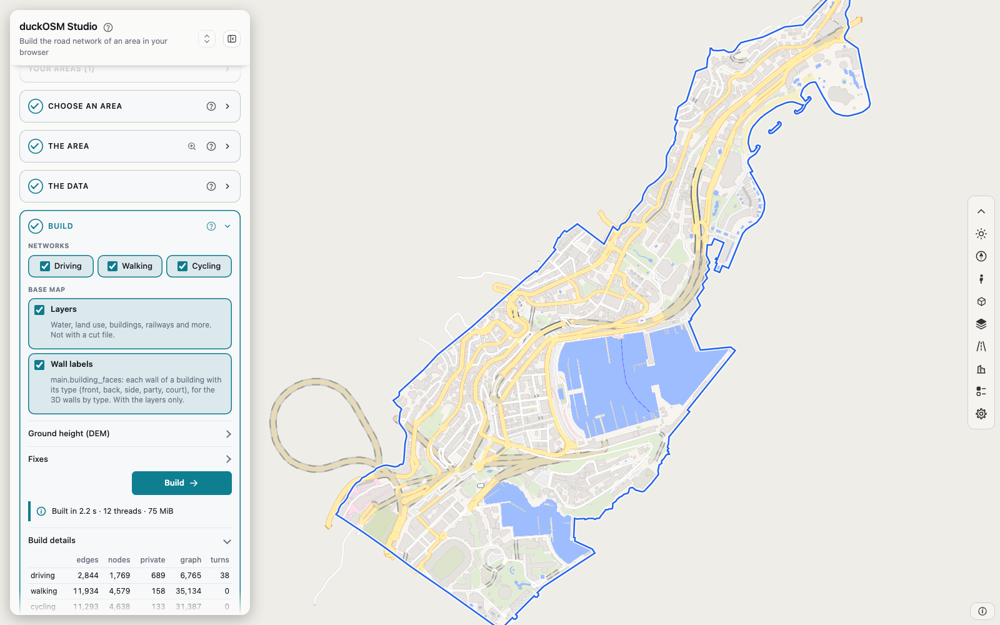
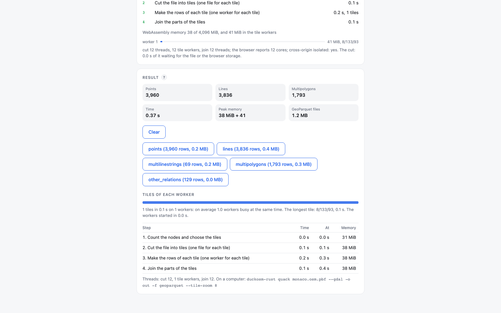
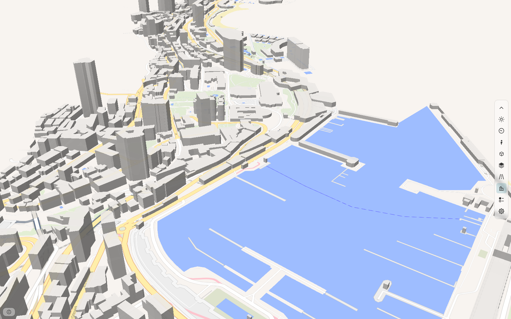

# duckOSM

**Turn OpenStreetMap into routable networks, map layers and GIS files. One Rust engine, for your computer and your browser.**

duckOSM reads an `.osm.pbf` file and makes the routable network of an area, its map layers, and files for GIS,
traffic simulation and routing. Fix the OSM data once, on a map. Your fixes go into one file, `osm_fixes.yaml`, and every step of duckOSM reads it: the OSM file, the OSM data tables, the network and every export. So all outputs show the same corrected data.

[Try it in your browser](https://khoshkhah.github.io/duckosm-studio/){ .md-button .md-button--primary }
[Install](install.md){ .md-button }
[Get started](first_network.md){ .md-button }
[Compare](compare/index.md){ .md-button }

<figure markdown="span">
  
  <figcaption>duckOSM Studio in the browser: choose an area, build its network, edit the OSM data and export.</figcaption>
</figure>

## Highlights

-   :material-road-variant:{ .lg .middle } **Routable networks**

    ---

    Driving, walking and cycling in one DuckDB file, with the graph of legal turns.
    [Build a network](guides/build.md)

-   :material-pencil-ruler:{ .lg .middle } **Fix the OSM data**

    ---

    Edit roads, buildings, nodes and turns on a map. Every output uses your fixes.
    [Edit OSM data](guides/edit-osm-data.md)

-   :material-web:{ .lg .middle } **In the browser too**

    ---

    The same Rust engine runs in a web page, with no install, and gives the same rows.
    [Browser and native](concepts/browser-native.md)

-   :material-identifier:{ .lg .middle } **Edge ids that stay**

    ---

    One id for each road **and each direction**, the same after a rebuild, a cut and an export.
    [Stable edge ids](concepts/edge-ids.md)

-   :material-car-multiple:{ .lg .middle } **Traffic simulation**

    ---

    SUMO, MATSim and GMNS (macro, meso, micro), checked with each tool's own validator.
    [Exports](exports/index.md)

-   :material-layers-triple:{ .lg .middle } **GIS layers**

    ---

    GDAL's OSM layers and QuackOSM's table, the same rows, faster, also in the browser.
    [duckOSM and GDAL](concepts/gdal.md)

-   :material-map-search:{ .lg .middle } **Any area, any size**

    ---

    A boundary, a place name, a box or an H3 cell. Countries build by map tiles, in little memory.
    [Prepare an area](guides/prepare-area.md)

-   :material-language-rust:{ .lg .middle } **One Rust program**

    ---

    The command line `duckosm`, a Python SDK and a Rust SDK, all from the same code.
    [Python SDK](reference/python.md)

## A tour

<figure markdown="span">
  
  <figcaption>Edit OSM data: the turns at a junction, in the browser or with <code>duckosm edit</code>.</figcaption>
</figure>

<figure markdown="span">
  
  <figcaption>The quack page: GDAL's five OSM layers or the QuackOSM table, made in the browser.</figcaption>
</figure>

<figure markdown="span">
  
  <figcaption>The route planner of <code>duckosm route-map</code>: a route on the turn graph, with directions.</figcaption>
</figure>

<figure markdown="span">
  
  <figcaption>The map of <code>duckosm viz</code> in 3D: the roads of all modes between the buildings, on the base map of the database.</figcaption>
</figure>

<figure markdown="span">
  
  <figcaption>GMNS lanes of Södermalm: each lane with its own width, bus lanes and turn connectors.</figcaption>
</figure>

<figure markdown="span">
  
  <figcaption>Monaco in 3D on the ground of the area: the hill behind the port and the roads that climb it (<code>duckosm elevation</code>, or the step Ground height in Studio).</figcaption>
</figure>

## What duckOSM makes

All outputs come from one `.osm.pbf` file, in five levels, and all take your OSM fixes. Each output is checked against a reference tool ([how](concepts/checks.md)).

<a class="lv" href="exports/osm-file/">0<b>The OSM file</b>.osm.pbf, cut to your area<code>pbfcut</code></a>
<a class="lv" href="exports/#1-osm-data">1<b>OSM data</b>no network<code>QuackOSM · GDAL</code></a>
<a class="lv" href="exports/#2-the-network">2<b>The network</b>edges, edge_id, turns<code>GeoPackage · networkx</code></a>
<a class="lv" href="exports/#3-traffic-simulation">3<b>Traffic simulation</b>links, nodes, turns<code>GMNS · MATSim · SUMO</code></a>
<a class="lv" href="exports/#4-lane-level-and-3d">4<b>Lane level and 3D</b>each lane, its shape<code>Lanelet2 · OpenDRIVE</code></a>

All outputs, by level: [Export](exports/index.md). Speed against other tools: [Compare](compare/index.md).

## Use it

-   :material-console:{ .lg .middle } **Command line**

    ---

    One program, `duckosm`: `build`, `quack`, `sumo`, `gmns`, `edit` and more, each with `--help`.

    [Command line](reference/cli.md) · [Quick start](install.md#quick-start)

-   :material-language-python:{ .lg .middle } **Python SDK**

    ---

    `pip install duckosm`, then `import duckosm`: build, quack, route and export from Python, all in the Rust engine.

    [Python SDK](reference/python.md) · [Quick start](install.md#quick-start)

-   :material-language-rust:{ .lg .middle } **Rust SDK**

    ---

    The crates `duckosm-core`, `duckosm-build` and others: the same engine in your own Rust program.

    [Rust SDK](reference/rust.md)

---

Map data © [OpenStreetMap contributors](https://www.openstreetmap.org/copyright) ([ODbL](https://opendatacommons.org/licenses/odbl/)). Files from [Geofabrik](https://www.geofabrik.de/). Built on [DuckDB](https://duckdb.org/). duckOSM is MIT-licensed.
