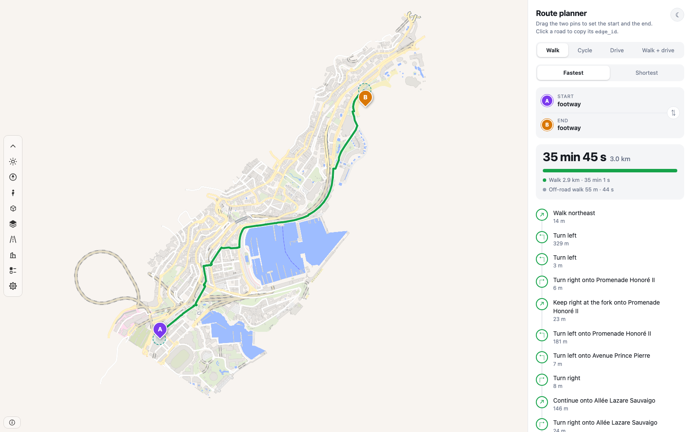
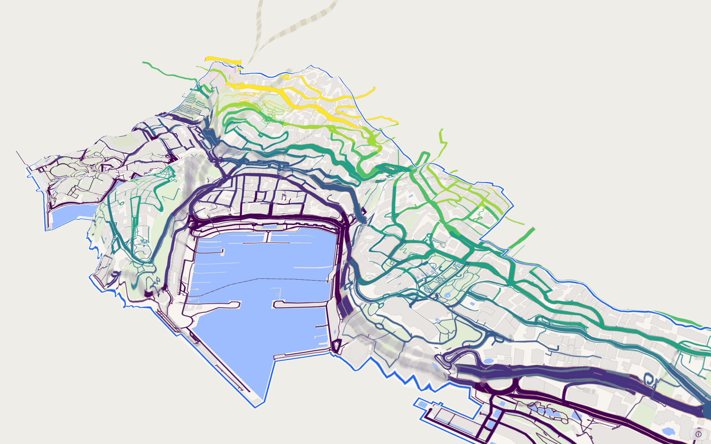

# duckOSM

**Turn OpenStreetMap into routable networks, GMNS models, and GIS layers. One Rust engine powered by DuckDB, for your computer and your browser.**

duckOSM reads an `.osm.pbf` file and builds the complete transport network of an area—from GIS layers and turn-by-turn routing to multi-scale GMNS models, traffic simulations, and Graph Neural Networks. It processes areas tile by tile, keeping memory low and speeds fast even for an entire country. Fix the OSM data once on a map: your fixes go into one YAML file and apply at build time, so every downstream table, network layer, and export inherits the same corrected data.

[Try it in your browser](https://khoshkhah.github.io/duckosm-studio/){ .md-button .md-button--primary }
[Install](install.md){ .md-button }
[Get started](first_network.md){ .md-button }
[Notebook manual](https://khoshkhah.github.io/duckOSM/book/){ .md-button }
[Compare](compare/index.md){ .md-button }

<figure markdown="span">
  
  <figcaption>duckOSM Studio in the browser: choose an area, build its network, edit the OSM data and export.</figcaption>
</figure>

## What duckOSM makes

All outputs come from one `.osm.pbf` file, in five levels, and all take your OSM fixes. Each output is checked against a reference tool ([how](concepts/checks.md)).

<a class="lv" href="exports/osm-file/">0<b>OSM file</b>.osm.pbfExact boundary cut with your fixespbfcut</a>
<a class="lv" href="exports/osm-data/">1<b>OSM data</b>from .osm.pbfFlat tables of all OSM objectsQuackOSM · GDAL · Geofabrik · PMTiles</a>
<a class="lv" href="exports/routable-network/">2<b>Routable network</b>DuckDBDrive, walk, bike Edges, edge_id, turnsGeoPackage · networkx</a>
<a class="lv" href="exports/gmns-network/">3<b>GMNS network</b>GMNS DuckDBMacro, meso, micro links, lanes, turnsGMNS · MATSim · SUMO</a>
<a class="lv" href="exports/hd-map/">4<b>HD map</b>3D geometryLane shape in 3D (experimental)Lanelet2 · OpenDRIVE</a>

All outputs, by level: [Export](exports/index.md). Speed against other tools: [Compare](compare/index.md).

## Highlights

-   :material-road-variant:{ .lg .middle } **Routable networks**

    ---

    Driving, walking and cycling in one DuckDB file, with the graph of legal turns.
    [Build a network](guides/build.md)

-   :material-pencil-ruler:{ .lg .middle } **Fix the OSM data**

    ---

    Edit roads, buildings, nodes and turns on a map. Every output uses your fixes.
    [Edit OSM data](guides/edit-osm-data.md)

-   :material-web:{ .lg .middle } **In the browser too**

    ---

    The same Rust engine runs in a web page, with no install, and gives the same rows.
    [Browser and native](concepts/browser-native.md)

-   :material-identifier:{ .lg .middle } **Edge ids that stay**

    ---

    One id for each road **and each direction**, the same after a rebuild, a cut and an export.
    [Stable edge ids](concepts/edge-ids.md)

-   :material-hub:{ .lg .middle } **GMNS in DuckDB**

    ---

    The open standard (General Modeling Network Specification) for links, lanes, and turning movements.
    The universal bridge from OSM to simulation models and Graph Neural Networks.
    [GMNS network](exports/gmns.md)

-   :material-car-multiple:{ .lg .middle } **Traffic simulation**

    ---

    SUMO, MATSim, and DTALite exports with automated validation. Simplifies continuous roads for
    faster simulation while preserving stable `edge_id`s.
    [Exports](exports/index.md)

-   :material-layers-triple:{ .lg .middle } **GIS layers**

    ---

    GDAL's OSM layers and QuackOSM's table, the same rows, faster, also in the browser.
    [duckOSM and GDAL](concepts/gdal.md)

-   :material-map-search:{ .lg .middle } **Any area, any size**

    ---

    A boundary, a place name, a box or an H3 cell. Countries build by map tiles, in little memory.
    [Prepare an area](guides/prepare-area.md)

-   :material-map-marker-path:{ .lg .middle } **GPS traces on the roads**

    ---

    Map matching with an HMM or with GPS-DTW, then counts and speeds on each edge.
    [duckosm.mobility](reference/sdk/mobility.md)

-   :material-language-rust:{ .lg .middle } **One Rust program**

    ---

    The command line `duckosm`, a Python SDK and a Rust SDK, all from the same code.
    [Python SDK](reference/python.md)

## A tour

<figure markdown="span">
  
  <figcaption>Edit OSM data: the turns at a junction, in the browser or with <code>duckosm edit</code>. <a href="guides/edit-osm-data/">Edit OSM data →</a></figcaption>
</figure>

<figure markdown="span">
  
  <figcaption>The quack page: GDAL's five OSM layers or the QuackOSM table, made in the browser. <a href="https://khoshkhah.github.io/duckosm-studio/quack.html">Open the quack page →</a></figcaption>
</figure>

<figure markdown="span">
  
  <figcaption>The route planner of <code>duckosm route-map</code>: a route on the turn graph, with directions. <a href="guides/route/">Routing →</a></figcaption>
</figure>

<figure markdown="span">
  
  <figcaption>The map of <code>duckosm viz</code> in 3D: the roads of all modes between the buildings, on the base map of the database. <a href="guides/draw-map/">Draw a map →</a></figcaption>
</figure>

<figure markdown="span">
  
  <figcaption>GMNS lane-level geometry: each lane at its physical width with its turning movements. <a href="exports/gmns/">GMNS export →</a></figcaption>
</figure>

<figure markdown="span">
  
  <figcaption>Monaco in 3D on the ground of the area: the hill behind the port and the roads that climb it (<code>duckosm elevation</code>, or the step Ground height in Studio). <a href="guides/elevation/">Elevation →</a></figcaption>
</figure>

## Use it

-   :material-console:{ .lg .middle } **Command line**

    ---

    One program, `duckosm`: `build`, `quack`, `sumo`, `gmns`, `edit` and more, each with `--help`.

    [Command line](reference/cli.md) · [Quick start](install.md#quick-start)

-   :material-language-python:{ .lg .middle } **Python SDK**

    ---

    `pip install duckosm`, then `import duckosm`: build, quack, route and export from Python, all in the Rust engine.

    [Python SDK](reference/python.md) · [Notebook manual](https://khoshkhah.github.io/duckOSM/book/) · [Quick start](install.md#quick-start)

-   :material-language-rust:{ .lg .middle } **Rust SDK**

    ---

    The crates `duckosm-core`, `duckosm-build` and others: the same engine in your own Rust program.

    [Rust SDK](reference/rust.md)

-   :material-view-dashboard:{ .lg .middle } **Dashboards & Studio**

    ---

    duckOSM Studio in the browser, or `net.dashboard()` in Python: live maps, road cards, and 3D layers. Save as offline HTML files that open anywhere without a server.

    [duckOSM Studio](guides/studio.md) · [Draw a map](guides/draw-map.md)

---

Map data © [OpenStreetMap contributors](https://www.openstreetmap.org/copyright) ([ODbL](https://opendatacommons.org/licenses/odbl/)). Files from [Geofabrik](https://www.geofabrik.de/). Built on [DuckDB](https://duckdb.org/). duckOSM is MIT-licensed.
