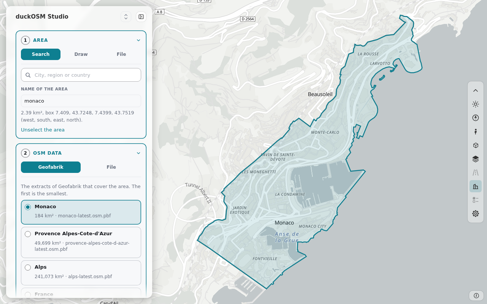
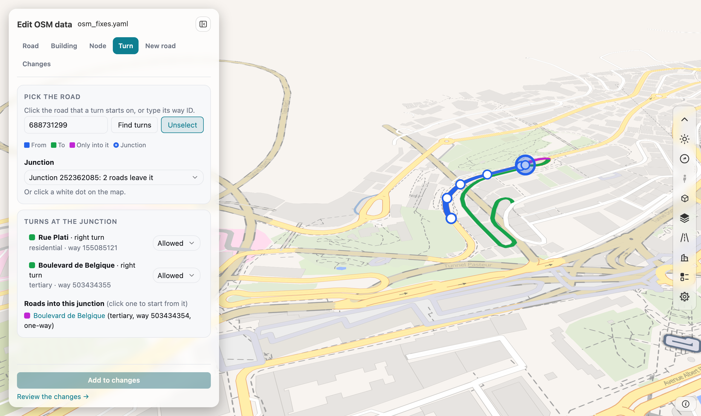
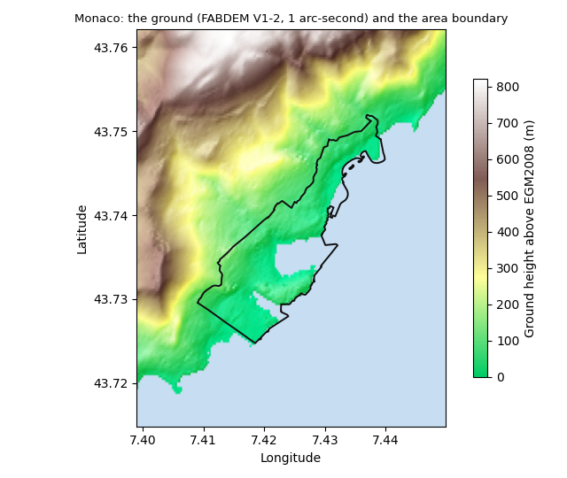

# duckOSM

**Turn OpenStreetMap into routable networks, map layers and GIS files. One Rust engine, for your computer and your browser.**

duckOSM reads an `.osm.pbf` file and makes the routable network of an area, its map layers, and files for GIS,
traffic simulation and routing. Fix the OSM data once, on a map. Your fixes go into one file, `osm_fixes.yaml`, and every step of duckOSM reads it: the OSM file, the OSM data tables, the network and every export. So all outputs show the same corrected data.

<div class="hero-actions" markdown>

[Try it in your browser](https://khoshkhah.github.io/duckosm-studio/){ .md-button .md-button--primary }
[Install](install.md){ .md-button }
[Get started](first_network.md){ .md-button }
[Compare](compare/index.md){ .md-button }

</div>

<figure markdown="span">
  
  <figcaption>duckOSM Studio in the browser: choose an area, get its OSM data, build, edit and export.</figcaption>
</figure>

## Highlights

<div class="grid cards" markdown>

-   :material-road-variant:{ .lg .middle } **Routable networks**

    ---

    Driving, walking and cycling in one DuckDB file, with the graph of legal turns.
    [Build a network](guides/build.md)

-   :material-pencil-ruler:{ .lg .middle } **Fix the OSM data**

    ---

    Edit roads, buildings, nodes and turns on a map. Every output uses your fixes.
    [Edit OSM data](guides/edit-osm-data.md)

-   :material-web:{ .lg .middle } **In the browser too**

    ---

    The same Rust engine runs in a web page, with no install, and gives the same rows.
    [Browser and native](concepts/browser-native.md)

-   :material-identifier:{ .lg .middle } **Edge ids that stay**

    ---

    One id for each road **and each direction**, the same after a rebuild, a cut and an export.
    [Stable edge ids](concepts/edge-ids.md)

-   :material-car-multiple:{ .lg .middle } **Traffic simulation**

    ---

    SUMO, MATSim and GMNS (macro, meso, micro), checked with each tool's own validator.
    [Exports](exports/index.md)

-   :material-layers-triple:{ .lg .middle } **GIS layers**

    ---

    GDAL's OSM layers and QuackOSM's table, the same rows, faster, also in the browser.
    [duckOSM and GDAL](concepts/gdal.md)

-   :material-map-search:{ .lg .middle } **Any area, any size**

    ---

    A boundary, a place name, a box or an H3 cell. Countries build by map tiles, in little memory.
    [Prepare an area](guides/prepare-area.md)

-   :material-language-rust:{ .lg .middle } **One Rust program**

    ---

    The command line `duckosm`, a Python SDK and a Rust SDK, all from the same code.
    [Python SDK](reference/python.md)

</div>

## A tour

<div class="grid tour" markdown>

<figure markdown="span">
  
  <figcaption>Edit OSM data: the turns at a junction, in the browser or with <code>duckosm edit</code>.</figcaption>
</figure>

<figure markdown="span">
  
  <figcaption>GMNS lanes of Södermalm: each lane with its own width, bus lanes and turn connectors.</figcaption>
</figure>

<figure markdown="span">
  
  <figcaption>The ground of an area: one bare-earth DEM for every height.</figcaption>
</figure>

<figure markdown="span">
  
  <figcaption>The height of each node and edge, after <code>duckosm elevation</code>.</figcaption>
</figure>

</div>

## One edge id for each direction

```text
edge_id = hash(osm_id, source, target)
```

**Each direction of a road has its own id**: a two-way street is two edges, A → B and B → A, so data per direction joins
to the right edge. The id comes only from OSM ids (the way and its two end nodes), so it stays the same after a rebuild,
a cut and every export ([how](concepts/edge-ids.md)).

## What duckOSM makes

All outputs come from one `.osm.pbf` file, in five levels, and all take your OSM fixes. Each output is checked against a reference tool ([how](concepts/checks.md)).

<div class="dk-levels">
<div class="lv"><span class="n">0</span><b>The OSM file</b><span class="s">.osm.pbf, cut to your area</span><code>pbfcut</code></div>
<a class="lv" href="exports/#1-osm-data"><span class="n">1</span><b>OSM data</b><span class="s">no network</span><code>QuackOSM · GDAL</code></a>
<a class="lv" href="exports/#2-the-network"><span class="n">2</span><b>The network</b><span class="s">edges, edge_id, turns</span><code>GeoPackage · networkx</code></a>
<a class="lv" href="exports/#3-traffic-simulation"><span class="n">3</span><b>Traffic simulation</b><span class="s">links, nodes, turns</span><code>GMNS · MATSim · SUMO</code></a>
<a class="lv" href="exports/#4-lane-level-and-3d"><span class="n">4</span><b>Lane level and 3D</b><span class="s">each lane, its shape</span><code>Lanelet2 · OpenDRIVE</code></a>
</div>

All outputs, by level: [Export](exports/index.md). Speed against other tools: [Compare](compare/index.md).

## Quick start

```bash
pip install duckosm

curl -LO https://download.geofabrik.de/europe/monaco-latest.osm.pbf
duckosm build --pbf monaco-latest.osm.pbf --output monaco.duckdb --modes driving
duckosm quack monaco-latest.osm.pbf --gdal -o out --name monaco
```

```python
import duckosm

db = duckosm.build(pbf="monaco-latest.osm.pbf", output="monaco.duckdb")  # as duckosm build

r = duckosm.route_points(db, (7.4155, 43.7285), (7.4400, 43.7480))  # Fontvieille to Larvotto (lon, lat)
r["time_s"], r["length_m"], r["edges"]  # time, length, the edge_ids in order
duckosm.to_gis(db, "monaco.gpkg")  # a GeoPackage for QGIS
```

Next: [Your first network](first_network.md). All functions: [Python SDK](reference/python.md), [Rust SDK](reference/rust.md).

---

duckOSM is MIT-licensed and built on [DuckDB](https://duckdb.org) and its spatial extension.
It is an independent project, not affiliated with or endorsed by the DuckDB Foundation.
