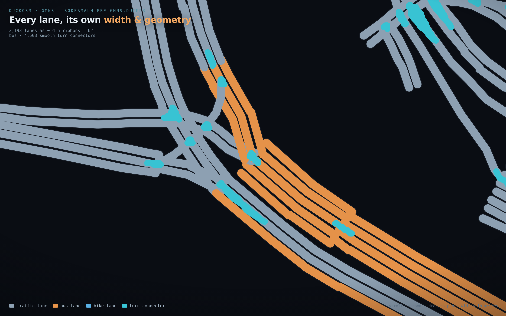
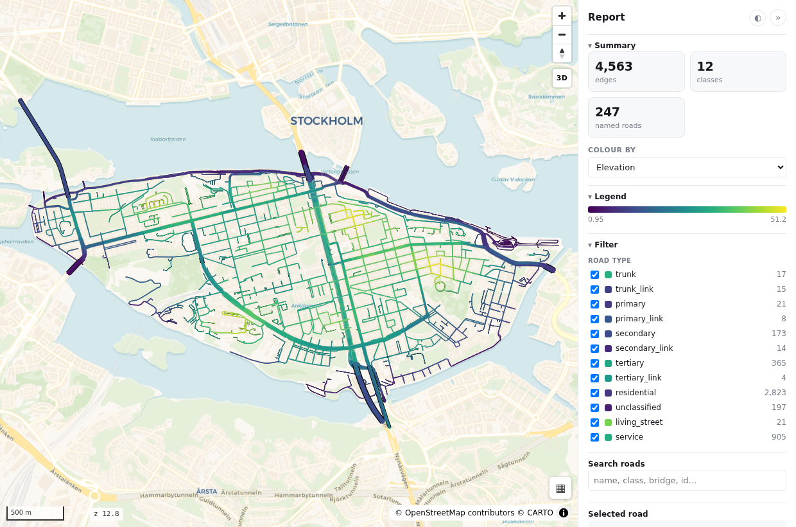

---
hide:
  - toc
---

# duckOSM

**OpenStreetMap → road networks, map layers and GIS files. One Rust program, on your computer and in the browser.**

duckOSM reads an `.osm.pbf` file and makes the routable network of an area, its map layers, and files for GIS,
traffic simulation and routing. You can fix the OSM data on a map first, and every output uses your fixes.

<div class="hero-actions" markdown>

[Try it in your browser](https://khoshkhah.github.io/duckosm-studio/){ .md-button .md-button--primary }
[Install](install.md){ .md-button }
[Get started](first_network.md){ .md-button }
[Compare](compare/index.md){ .md-button }

</div>

<figure markdown="span">
  
  <figcaption>duckOSM Studio in the browser: choose an area, get its OSM data, build, edit and export.</figcaption>
</figure>

## Highlights

<div class="grid cards" markdown>

-   :material-road-variant:{ .lg .middle } **Routable networks**

    ---

    Driving, walking and cycling in one DuckDB file, with the graph of legal turns.
    [Build a network](guides/build.md)

-   :material-pencil-ruler:{ .lg .middle } **Fix the OSM data**

    ---

    Edit roads, buildings, nodes and turns on a map. Every output uses your fixes.
    [Edit OSM data](guides/edit-osm-data.md)

-   :material-web:{ .lg .middle } **In the browser too**

    ---

    The same Rust engine runs in a web page, with no install, and gives the same rows.
    [Browser and native](concepts/browser-native.md)

-   :material-identifier:{ .lg .middle } **Edge ids that stay**

    ---

    `edge_id = hash(osm_id, source, target)`: the same after a rebuild, a cut and an export.
    [Stable edge ids](concepts/edge-ids.md)

-   :material-car-multiple:{ .lg .middle } **Traffic simulation**

    ---

    SUMO, MATSim and GMNS (macro, meso, micro), checked with each tool's own validator.
    [Exports](exports/index.md)

-   :material-layers-triple:{ .lg .middle } **GIS layers**

    ---

    GDAL's OSM layers and QuackOSM's table, the same rows, faster, also in the browser.
    [duckOSM and GDAL](concepts/gdal.md)

-   :material-map-search:{ .lg .middle } **Any area, any size**

    ---

    A boundary, a place name, a box or an H3 cell. Countries build by map tiles, in little memory.
    [Prepare an area](guides/prepare-area.md)

-   :material-language-rust:{ .lg .middle } **One Rust program**

    ---

    The command line `duckosm`, a Python SDK and a Rust SDK, all from the same code.
    [Python SDK](reference/python.md)

</div>

## A tour

<div class="grid tour" markdown>

<figure markdown="span">
  
  <figcaption>Edit OSM data: the turns at a junction, in the browser or with <code>duckosm edit</code>.</figcaption>
</figure>

<figure markdown="span">
  
  <figcaption>GMNS lanes of Södermalm: each lane with its own width, bus lanes and turn connectors.</figcaption>
</figure>

<figure markdown="span">
  
  <figcaption>The ground of an area: one bare-earth DEM for every height.</figcaption>
</figure>

<figure markdown="span">
  
  <figcaption>The height of each node and edge, after <code>duckosm elevation</code>.</figcaption>
</figure>

</div>

## What duckOSM makes

All outputs come from one `.osm.pbf` file, and all take your OSM fixes.

| Output | Command | Format | More |
|---|---|---|---|
| **Road networks**: driving, walking and cycling, and the graph of legal turns | `duckosm build` | DuckDB | [Build a network](guides/build.md) |
| **Base-map layers**: water, land use, buildings, POIs | `duckosm build` | DuckDB (`features.*`) | [Base-map layers](reference/features.md) |
| **Map data**: the drawing order of the roads, the walls of the buildings | `duckosm build` | DuckDB | [Drawing order](guides/drawing-order.md), [walls](concepts/building-walls.md) |
| **The OSM features table** of QuackOSM | `duckosm quack`, [in the browser](https://khoshkhah.github.io/duckosm-studio/quack.html) | GeoParquet, DuckDB | [duckOSM and QuackOSM](concepts/quackosm.md) |
| **GDAL's five OSM layers**, as QGIS reads them | `duckosm quack --gdal`, [in the browser](https://khoshkhah.github.io/duckosm-studio/quack.html) | GeoPackage, GeoParquet | [duckOSM and GDAL](concepts/gdal.md) |
| **Geofabrik's 20 GIS layers** (roads, POIs, buildings, land use, ...) for any area | `duckosm quack --geofabrik`, [in the browser](https://khoshkhah.github.io/duckosm-studio/quack.html) | GeoPackage, shapefile, GeoParquet | [duckOSM and Geofabrik](exports/geofabrik.md) |
| **Traffic simulation networks** | `duckosm sumo`, `matsim`, `gmns` | SUMO, MATSim, GMNS | [Exports](exports/index.md) |
| **GIS files and graphs** of the network | `duckosm export-gis`, `export-graph` | GeoPackage, shapefile, networkx | [GIS](exports/gis.md), [networkx](exports/networkx.md) |
| **Heights**: the ground height of each node | `duckosm elevation` | DuckDB | [Add elevation](guides/elevation.md) |
| **Maps and pages**: maps, a route planner, an editor, Ask | `duckosm viz`, `route-map`, `edit`, `ask` | HTML | [Draw a map](guides/draw-map.md) |

Each output is compared with a reference tool ([how each output is checked](concepts/checks.md)).

## Fix the OSM data

OSM has errors: a wrong one-way, a missing road, a wrong bridge layer. Fix them on a map. duckOSM keeps your fixes in one
file, `osm_fixes.yaml`, and applies them at each build, so a new OSM file does not remove them.

| Where | How |
|---|---|
| Browser | [duckOSM Studio](https://khoshkhah.github.io/duckosm-studio/), step **Edit OSM data** |
| Your computer | `duckosm edit my_area.duckdb` opens the same editor |
| Build | `duckosm build --fixes osm_fixes.yaml`, `duckosm quack --fixes osm_fixes.yaml` |

You can change roads (one-way, lanes, speed, class, access), buildings (floors, height, roof, the type of each wall),
nodes (traffic signals, crossings), turns, and add roads that OSM does not have.

More: [Edit OSM data](guides/edit-osm-data.md), [Fix OSM errors](guides/fix-osm-errors.md).

## Two versions, one engine

| | Native | Browser |
|---|---|---|
| Program | `duckosm` on your computer | [duckOSM Studio](https://khoshkhah.github.io/duckosm-studio/) and the [quack page](https://khoshkhah.github.io/duckosm-studio/quack.html) |
| Install | `pip install duckosm` | none |
| Storage | the disk | the browser's storage (OPFS) |
| Rows | the same | the same |

Both build every area by map tiles, cut by [pbfcut](https://github.com/Khoshkhah/pbfcut), so the memory does not grow with
the area ([Browser and native builds](concepts/browser-native.md)).

## Speed on France

France: 5.1 GB `.osm.pbf`, Mac mini (12 cores, 16 GB). Both versions build by map tiles, cut by
[pbfcut](https://github.com/Khoshkhah/pbfcut).

| Job | Native | Browser | Other tool |
|---|---|---|---|
| Road network, driving | 3 min 36 s | 5 min 16 s | |
| OSM features table (`quack`) | 2 min 9 s | 4 min 54 s | QuackOSM: 9 min 30 s |
| GDAL's layers, GeoParquet (`quack --gdal`) | 3 min 37 s | 5 min 23 s | `ogr2ogr`: 14 min 18 s |

## Quick start

```bash
pip install duckosm

curl -LO https://download.geofabrik.de/europe/monaco-latest.osm.pbf
duckosm build --pbf monaco-latest.osm.pbf --output monaco.duckdb --modes driving
duckosm quack monaco-latest.osm.pbf --gdal -o out --name monaco
```

```python
import duckosm

db = duckosm.build(pbf="monaco-latest.osm.pbf", output="monaco.duckdb")   # as duckosm build

r = duckosm.route_points(db, (7.4155, 43.7285), (7.4400, 43.7480))   # (lon, lat): Fontvieille to Larvotto
r["time_s"], r["length_m"], r["edges"]   # the fastest path, door to door, and the ordered edge_ids
duckosm.to_gis(db, "monaco.gpkg")         # a GeoPackage for QGIS
```

Next: [Your first network](first_network.md). All functions: [Python SDK](reference/python.md), [Rust SDK](reference/rust.md).

---

duckOSM is MIT-licensed and built on [DuckDB](https://duckdb.org) and its spatial extension.
It is an independent project, not affiliated with or endorsed by the DuckDB Foundation.
