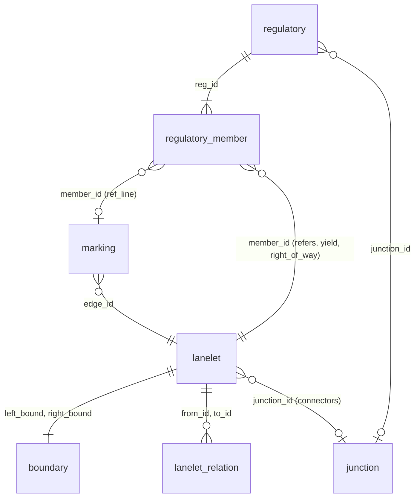

# HD map database

!!! warning "Planned"
    This page is the specification of the HD map database. The code does not exist yet. The design and the reasons
    for each decision are in
    [`docs/design/hdmap_duckdb.md`](https://github.com/Khoshkhah/duckOSM/blob/main/docs/design/hdmap_duckdb.md).

The HD map database (`<area>_hdmap.duckdb`) is the lane map of an area for automated driving: each lane as a lanelet
with its left and right border, the next lanelets, the lanes on each side, the junctions, the stop lines, the
crosswalks and the traffic rules. `duckosm hdmap` makes it from a [GMNS database](../exports/gmns_tables.md). The
Lanelet2, CommonRoad and OpenDRIVE exporters, the lane graph and `surfaces` read it.

```bash
duckosm build --config config/sample_monaco.yaml       # Level 2: monaco.duckdb
duckosm gmns monaco.duckdb                             # Level 3: monaco_gmns.duckdb (the lanes)
duckosm hdmap monaco_gmns.duckdb --source monaco.duckdb   # Level 4: monaco_hdmap.duckdb
duckosm lanelet2 monaco_hdmap.duckdb                   # a file from it
```

```python
from duckosm import hdmap
hdmap.build("monaco_gmns.duckdb", source="monaco.duckdb")      # -> monaco_hdmap.duckdb
hdmap.to_lanelet2("monaco_hdmap.duckdb", "monaco.osm")
```

## The command

`duckosm hdmap GMNS_DB [OPTIONS]`

| Option | Default | Effect |
|---|---|---|
| `--out PATH` | `<gmns name without _gmns>_hdmap.duckdb`, next to the GMNS database | the HD map database. A run writes the whole file again |
| `--mode NAME` | `driving` | a mode of the GMNS database. Give it more than one time for more modes. Only `driving` has lane connectors |
| `--source PATH` | none | the Level 2 database. The step reads the ground of the area from its `main.elevation_metadata`. Without it, `meta.ground_id` is empty |
| `--default-width M` | `3.25` | the width of a lane or a connector that has no width |

The step opens the GMNS database and the Level 2 database read-only. It does not change them.

## Rules

| Rule | |
|---|---|
| File | one DuckDB file, complete without the GMNS database. Each row holds its own line, width and speed |
| Schemas | one for each mode, with the name of the mode: `driving.lanelet`, `driving.boundary`, … |
| Text ids | from the GMNS keys: `lane_id` = `<edge_id>_<lane_num>`, `connector_id` = `<from_lane_id>><to_lane_id>`. Two builds of the same GMNS database give the same ids |
| Integer ids | `num_id = (hash(<text id>) >> 1)::BIGINT`, the formula of the duckOSM `edge_id`. For the formats that need integers (Lanelet2, CommonRoad). A build stops with an error if two rows of one table get the same `num_id` |
| No sequences | no id comes from a row number or a sequence |
| Coordinates | longitude and latitude, EPSG:4326, as in the GMNS database. `meta.utm_crs` is the metric CRS that each exporter and each length use |
| Units | metres, km/h |
| Direction | each line goes in the direction of travel |
| Lane numbers | lane 1 is the leftmost lane in the direction of travel. A bike lane on the left of a one-way road is lane -1 |
| Left and right | in the direction of travel |

## The tables

| Table | One row is | Rows on Monaco (`driving`) |
|---|---|---|
| [`meta`](#meta) | the database: source, CRS, ground | 1 |
| [`lanelet`](#lanelet) | a lane of a link, or a lane connector through a junction | 7117 (3176 lanes, 3941 connectors) |
| [`boundary`](#boundary) | one border line. Two lanes side by side share it | about 13 841 (5959 lane borders, 7882 connector borders) ¹ |
| [`lanelet_relation`](#lanelet_relation) | a next lanelet, or a lanelet on the left or on the right | |
| [`junction`](#junction) | a node with lane connectors | 1678 |
| [`marking`](#marking) | a stop line, or a crosswalk | crosswalks: 494 |
| [`regulatory`](#regulatory) | a traffic rule: a traffic light, a stop sign, a yield sign | |
| [`regulatory_member`](#regulatory_member) | a lanelet or a line that a rule applies to | |

¹ Each link has one border more than its lanes (3176 lanes on 2783 links: 5959), and each connector has two (2 × 3941).
Turn pockets add a few rows.



The columns below have a "From" column: the GMNS table and column, or **new** for a value that this step makes.

## meta

One row.

| Column | Type | Null | From | Holds |
|---|---|---|---|---|
| `mode` | VARCHAR | no | | the mode of the schema, for example `driving` |
| `gmns_db` | VARCHAR | no | | the path of the GMNS database |
| `gmns_version` | VARCHAR | yes | `config.version_number` | the GMNS version, for example `0.97` |
| `utm_crs` | VARCHAR | no | new | the UTM zone of the center of the area, for example `EPSG:32632` for Monaco |
| `default_width` | DOUBLE | no | | the `--default-width`, 3.25 |
| `ground_id` | VARCHAR | yes | Level 2 `elevation_metadata.sha256` | the [ground](../concepts/ground-reference.md) of the area. Empty without `--source`, or when the area has no ground |
| `ground_product` | VARCHAR | yes | `elevation_metadata.product` | `DTM` or `DSM` |
| `vertical_datum` | VARCHAR | yes | `elevation_metadata.vertical_datum` | for example `EGM2008` |
| `z_source` | VARCHAR | yes | new | `node` when the heights come from `node.z_coord`; empty when the GMNS nodes have no heights |
| `duckosm_version` | VARCHAR | no | | the duckOSM version that made the file |
| `built_at` | VARCHAR | no | | the UTC time, ISO 8601 |

## lanelet

One row for each GMNS lane (`kind = 'lane'`) and each lane connector (`kind = 'connector'`).

| Column | Type | Null | Key | From | Holds |
|---|---|---|---|---|---|
| `lanelet_id` | VARCHAR | no | primary | `lane.lane_id`, `lane_connector.connector_id` | |
| `num_id` | BIGINT | no | unique | new | the hash of `lanelet_id` |
| `kind` | VARCHAR | no | | new | `lane` or `connector` |
| `edge_id` | BIGINT | no | | `lane.link_id`; for a connector the link of `from_lane_id` | the duckOSM `edge_id` |
| `to_edge_id` | BIGINT | yes | | the link of `to_lane_id` | connectors only |
| `lane_num` | INTEGER | yes | | `lane.lane_num` | lanes only |
| `from_lanelet`, `to_lanelet` | VARCHAR | yes | → `lanelet` | `lane_connector.from_lane_id`, `to_lane_id` | connectors only: the lane in and the lane out |
| `mvmt_id` | VARCHAR | yes | | `lane_connector.mvmt_id` | connectors only: the GMNS movement |
| `junction_id` | BIGINT | yes | → `junction` | `movement.node_id` | connectors only |
| `turn` | VARCHAR | yes | | lanes: `lane.turn` (the `turn:lanes` value); connectors: `movement.type` | for example `left;through`; `left`, `thru`, `right`, `uturn`, `merge`, `diverge` |
| `allowed_uses` | VARCHAR | no | | `lane.allowed_uses`; a connector takes the uses of its lane in | `auto`, `bus`, `bike`, `bus,bike`, `walk` |
| `subtype` | VARCHAR | no | | new, from `allowed_uses` | see [subtype](#subtype) |
| `width` | DOUBLE | no | | `lane.width`, `lane_connector.width`; else `meta.default_width` | metres |
| `speed_limit` | DOUBLE | yes | | `link.free_speed` of `edge_id` | km/h |
| `name` | VARCHAR | yes | | `link.name` | the street name |
| `level` | INTEGER | no | | `link.layer`, else `bridge` 1, `tunnel` -1, else 0 | the vertical level, as `_level` in `gmns.py` |
| `left_bound`, `right_bound` | VARCHAR | no | → `boundary` | new | the two borders |
| `length` | DOUBLE | no | | new | metres: the length of `geom` in `meta.utm_crs` |
| `z_start`, `z_end` | DOUBLE | yes | | new | see [Heights](#heights) |
| `geom` | GEOMETRY | no | | lanes: `lane.geom_cut`, else `lane.geom`; connectors: `lane_connector.geom` | the center line, `LINESTRING` |

A lane line ends at the edge of the junction (`geom_cut`), where its connectors start. So the lanes and the
connectors of a junction do not overlap.

### subtype

The Lanelet2 words. The first use in `allowed_uses` decides.

| `allowed_uses` starts with | `subtype` | CommonRoad `laneletType` | OpenDRIVE lane `type` |
|---|---|---|---|
| `auto` | `road` | `urban` | `driving` |
| `bus` | `bus_lane` | `busLane` | `bus` |
| `bike` | `bicycle_lane` | `bicycleLane` | `biking` |
| `walk` | `walkway` | `sidewalk` | `sidewalk` |

## boundary

One row for each border line. Two lanes side by side of one link use the same row.

| Column | Type | Null | Key | Holds |
|---|---|---|---|---|
| `bound_id` | VARCHAR | no | primary | see [Border ids](#border-ids) |
| `num_id` | BIGINT | no | unique | the hash of `bound_id` |
| `kind` | VARCHAR | no | | `lane` or `connector` |
| `edge_id` | BIGINT | no | | the link; for a connector, the link in |
| `line_type` | VARCHAR | no | | `line_thin`, `curbstone`, `virtual` |
| `line_subtype` | VARCHAR | no | | `solid` or `dashed` |
| `color` | VARCHAR | no | | `white` |
| `lane_change` | BOOLEAN | no | | true when a vehicle can go across the line |
| `z_start`, `z_end` | DOUBLE | yes | | as in `lanelet` |
| `geom` | GEOMETRY | no | | the line, `LINESTRING`, in the direction of travel |

### Border ids

| Border | `bound_id` | Example (Monaco) |
|---|---|---|
| left border of the leftmost lane of a link | `<edge_id>_b0` | `117961209473327056_b0` |
| border between lane `k` and the lane on its right | `<edge_id>_b<k>` | `117961209473327056_b1`: between lanes 1 and 2 |
| right border of the rightmost lane (`k` = the number of the last lane) | `<edge_id>_b<k>` | `117961209473327056_b3` on a link with 3 lanes |
| left border of a lane connector | `<connector_id>_l` | `8660669654026136811_1>6865949183698550743_1_l` |
| right border of a lane connector | `<connector_id>_r` | |

On a link with a bike lane on the left (lane -1), the borders start at `b-1`: `<edge_id>_b-1` is its left border, and
`<edge_id>_b0` is the border between the bike lane and lane 1.

### How a border is made

1. The step takes the lanes of a link in the order of `lane_num`, from left to right.
2. The left border of the first lane is its center line, offset to the left by half its width.
3. The border on the right of lane `k` is the center line of lane `k`, offset to the right by half its width.
4. The lane on the right of lane `k` uses this row as its left border. It does not get a line of its own.
5. When the two lanes do not have the same length (a turn pocket), the shared border is cut to the shorter lane. The
   longer lane gets a second row for the rest of its length, `<bound_id>x`, with the `line_type` of an outer border.
6. A connector border is its center line, offset by half its width. The step then sets its first point to the end
   point of the same border of the lane in, and its last point to the start point of the same border of the lane out.
   So each lanelet touches the next lanelet at both borders.

The offsets are made in `meta.utm_crs` with shapely `offset_curve` (one call for all lines), then go back to EPSG:4326.
DuckDB `spatial` has no offset function.

### Line types

The first row that applies:

| Border | `line_type` | `line_subtype` | `lane_change` |
|---|---|---|---|
| a connector border | `virtual` | `solid` | false |
| the right border of the rightmost lane | `curbstone` | `solid` | false |
| the left border of the leftmost lane, on a link that has a link in the other direction (the center line) | `line_thin` | `solid` | false |
| the left border of the leftmost lane of a one-way road | `curbstone` | `solid` | false |
| between two lanes with different `allowed_uses` | `line_thin` | `solid` | false |
| between two lanes with the same `allowed_uses` | `line_thin` | `dashed` | true |

OSM has few tags for road marks. These values are the default, not a survey.

## lanelet_relation

One row for each pair of lanelets that touch.

| Column | Type | Null | Key | Holds |
|---|---|---|---|---|
| `from_id` | VARCHAR | no | primary, with `to_id` and `relation` | a `lanelet_id` |
| `to_id` | VARCHAR | no | primary | a `lanelet_id` |
| `relation` | VARCHAR | no | primary | `successor`, `left`, `right` |
| `lane_change` | BOOLEAN | yes | | `left` and `right` only: the `lane_change` of the shared border |

| `relation` | Rows from | Rule |
|---|---|---|
| `successor` | `lane_connector` | two rows for each connector: lane in → connector, connector → lane out |
| `successor` | two lanes that continue with no junction between them | a lane that ends at a node with one link out and no connector: the lane with the same `lane_num` on the next link |
| `left` | lanes of one link | lane `k + 1` → lane `k` (from the right lane, the lane on its left) |
| `right` | lanes of one link | lane `k` → lane `k + 1` |

`left` and `right` rows are only for lanes of the same link in the same direction. The lanes of the other direction
are not neighbours in this table.

## junction

One row for each node that has one or more lane connectors.

| Column | Type | Null | Key | From | Holds |
|---|---|---|---|---|---|
| `junction_id` | BIGINT | no | primary | `node.node_id` | the OSM node id (negative for a virtual node) |
| `num_id` | BIGINT | no | unique | new | the hash of `junction_id` as text |
| `ctrl_type` | VARCHAR | yes | | `node.ctrl_type` | `signal`, `stop_4_way`, `stop`, `stop_2_way`, `yield` |
| `node_type` | VARCHAR | yes | | `node.node_type` | `intersection`, `mini_roundabout`, … |
| `connectors` | INTEGER | no | | new | the number of connectors |
| `z` | DOUBLE | yes | | `node.z_coord` | metres |
| `geom` | GEOMETRY | no | | `node.geom` | the point |

The surface of a junction is not stored: `surfaces()` makes it from the connectors.

## marking

Road marks that are not lane borders.

| Column | Type | Null | Key | Holds |
|---|---|---|---|---|
| `marking_id` | VARCHAR | no | primary | `<edge_id>_stop`, or the GMNS `crossing_id` (`w<osm_id>`, `n<osm_id>`) |
| `num_id` | BIGINT | no | unique | the hash of `marking_id` |
| `kind` | VARCHAR | no | | `stop_line` or `crosswalk` |
| `edge_id` | BIGINT | yes | | the link of a stop line |
| `painted` | BOOLEAN | no | | a stop line: true; a crosswalk: `crossing.painted` |
| `crossing_type` | VARCHAR | yes | | a crosswalk: `crossing.crossing_type` |
| `width` | DOUBLE | yes | | metres. A crosswalk: `crossing.width` |
| `geom` | GEOMETRY | no | | a stop line: `LINESTRING`; a crosswalk: `POLYGON` (`crossing.geom`) |

A stop line:

- A link gets one when a [`regulatory`](#regulatory) row of kind `traffic_light` or `stop` is on it.
- The line goes across all lanes of the link, from the start of `<edge_id>_b0` to its right border, at the end of the
  lanes (the end of `geom_cut`).

The lanes that a crosswalk covers are in the GMNS `lane_crossing` table. The HD map database does not copy them: an
exporter finds them with `ST_Intersects(marking.geom, lanelet.geom)`.

## regulatory

A traffic rule. The model is the Lanelet2 regulatory element: CommonRoad and OpenDRIVE need less.

| Column | Type | Null | Key | Holds |
|---|---|---|---|---|
| `reg_id` | VARCHAR | no | primary | `<kind>_<edge_id>`, for example `traffic_light_117961209473327056` |
| `num_id` | BIGINT | no | unique | the hash of `reg_id` |
| `kind` | VARCHAR | no | | `traffic_light`, `stop`, `yield` |
| `edge_id` | BIGINT | no | | the link that the rule controls |
| `junction_id` | BIGINT | yes | → `junction` | the junction at the end of the link |
| `osm_id` | BIGINT | yes | | the OSM node of the light or the sign, when it is known |
| `source` | VARCHAR | no | | `movement` or `location` |
| `geom` | GEOMETRY | no | | the point of the light or the sign; else the end of the lane lines of the link |

A link gets a rule from two sources. One row for each link and kind:

| Source | Rule |
|---|---|
| `movement.ctrl_type` | `signal` → `traffic_light`, `stop` → `stop`, `yield` → `yield`, on the link in (`ib_link_id`) |
| `location.loc_type` | `traffic_signals` → `traffic_light`, `stop` → `stop`, `give_way` → `yield`, on its `link_id`. `osm_id` and `geom` come from this row |

On Monaco, `movement` has 4 signal, 8 stop and 59 yield rows, and `location` has 31 `traffic_signals`, 18 `stop` and
99 `give_way` rows. When both sources give the same kind for a link, the step keeps one row, with `osm_id` and `geom`
from `location`.

## regulatory_member

| Column | Type | Null | Key | Holds |
|---|---|---|---|---|
| `reg_id` | VARCHAR | no | primary, with `member_id` and `role` | → `regulatory` |
| `member_id` | VARCHAR | no | primary | a `lanelet_id` or a `marking_id` |
| `role` | VARCHAR | no | primary | see below |

| `role` | Members | For the kinds |
|---|---|---|
| `refers` | each lane of the link: the lanes that must obey the rule | all |
| `ref_line` | the stop line of the link | `traffic_light`, `stop` |
| `yield` | the connectors that start on the link | `stop`, `yield` |
| `right_of_way` | the connectors of the same junction that start on a link with no rule | `stop`, `yield` |

OSM has no signal phases, so a traffic light has no phases and no times.

## Heights

The heights come from the [ground of the area](../concepts/ground-reference.md) and no other source.

| Column | Value |
|---|---|
| `lanelet.z_start`, `z_end` of a lane | `node.z_coord` of the `from_node_id` and of the `to_node_id` of its link |
| `lanelet.z_start`, `z_end` of a connector | `z_end` of its lane in and `z_start` of its lane out |
| `boundary.z_start`, `z_end` | the values of the lanelet that has it as its left border; a border `b0` takes the values of lane 1 |
| `junction.z` | `node.z_coord` |
| any height on a link with `level <> 0` (a bridge, a tunnel) | empty: the ground is not the road there |

All heights are empty when the GMNS nodes have no heights (`duckosm elevation` did not run). The geometry is 2D. A
height on each point comes when SimReady gives the road heights; then a column `geom_z` (`LINESTRING Z`) is added and
the other columns do not change.

## What each exporter reads

### Lanelet2

| Lanelet2 | From |
|---|---|
| node | each point of each `boundary.geom`. Two borders with the same end point get the same node, so the router finds the next lanelet |
| way, `type`, `subtype` | a `boundary` row: `type` = `line_type`, `subtype` = `line_subtype`, `color`. Id: `num_id` |
| node tag `ele` | `z_start` to `z_end` along the border, when the heights are known |
| relation `type=lanelet` | a `lanelet` row: members `left` and `right`, tags `subtype`, `location=urban`, `one_way=yes`, `speed_limit`, `duckosm:edge_id`, `duckosm:lanelet_id`. Id: `num_id` |
| way `type=stop_line` | a `marking` of kind `stop_line` |
| lanelet `subtype=crosswalk` | a `marking` of kind `crosswalk`: its two long sides are the borders |
| relation `type=regulatory_element` | a `regulatory` row: `subtype` `traffic_light`, `traffic_sign` (stop, yield) or `right_of_way`; the members with their `role` |
| map tag `duckosm:ground` | `meta.ground_id` |

### CommonRoad

| CommonRoad | From |
|---|---|
| `lanelet` | a `lanelet` row. `leftBound`, `rightBound`: the two `boundary` lines in `meta.utm_crs`, in metres from the center of the area, both resampled to the same number of points (a rule of the format). Id: `num_id` |
| `lineMarking` of a border | `line_subtype`: `solid`, `dashed`; `virtual` → `no_marking` |
| `predecessor`, `successor` | `lanelet_relation` `successor` |
| `adjacentLeft`, `adjacentRight` (`sameDirection`) | `lanelet_relation` `left`, `right` |
| `laneletType`, `userOneWay` | `subtype` |
| `stopLine` | the `marking` of kind `stop_line` of the link of the lanelet |
| `trafficLight`, `trafficSign` (stop 206, yield 205) | `regulatory` and its `refers` members |
| `intersection`, `incoming` | a `junction`: one incoming for each link in; its successors left, straight and right from the `turn` of the connectors |
| `location` | the center of the area in longitude and latitude |

### OpenDRIVE

| OpenDRIVE | From |
|---|---|
| `road` | the lanes of one link (`kind = 'lane'`, one `edge_id`). Id: `edge_id`. Reference line: the left border of the leftmost lane (`b0` or `b-1`), in `meta.utm_crs` |
| `lane` (`id` -1, -2, …) | the lanes, in the order of `lane_num`. `width`: `lanelet.width`. `type`: from `subtype` |
| `roadMark` | `boundary.line_subtype` of the right border of each lane; `curbstone` → `curb` |
| `elevationProfile` | `z_start`, `z_end`, linear along the road |
| connecting `road` | a `lanelet` of kind `connector`, one lane. Id: `num_id` |
| `junction`, `connection`, `laneLink` | a `junction` row; one connection for each connector, with `laneLink` from the lane in to the connector lane |
| `signal` | a `regulatory` row, at the end of the road: 1000001 (traffic light), 206 (stop), 205 (yield) |
| `object` crosswalk | a `marking` of kind `crosswalk` |
| `header`, `geoReference` | `meta.utm_crs`; `<userData code="ground">` from `meta.ground_id` |

OpenDRIVE without junctions keeps its read of the Level 2 database.

### Lane graph, routes, surfaces

| Function | Reads |
|---|---|
| `lane_graph` | `lanelet_relation`: `successor` rows are turns or straight on, `left` and `right` rows with `lane_change = true` are lane changes. It writes `lane_<mode>.lane_edges` into the HD map database |
| `route_lanes` | the lane graph, and `lanelet.geom` for the route line |
| `surfaces` | `lanelet.geom` and `width` for the lanes; the connectors of each `junction` for the junction surfaces |

## Example queries

```sql
-- the lanelets of one road, with their borders
SELECT l.lanelet_id, l.lane_num, l.width, lb.line_subtype AS left_line, rb.line_subtype AS right_line
FROM driving.lanelet l
JOIN driving.boundary lb ON lb.bound_id = l.left_bound
JOIN driving.boundary rb ON rb.bound_id = l.right_bound
WHERE l.edge_id = 117961209473327056
ORDER BY l.lane_num;

-- the lanes that a vehicle can change into, from one lane
SELECT to_id, relation FROM driving.lanelet_relation
WHERE from_id = '117961209473327056_2' AND relation IN ('left', 'right') AND lane_change;

-- the traffic lights and the lanes that obey them
SELECT r.reg_id, m.member_id FROM driving.regulatory r
JOIN driving.regulatory_member m USING (reg_id)
WHERE r.kind = 'traffic_light' AND m.role = 'refers';

-- one table to GeoParquet (DuckDB writes the GeoParquet metadata when spatial is loaded)
COPY driving.lanelet TO 'monaco_lanelet.parquet' (FORMAT parquet);
```

## Checks

The step stops with an error when a check fails. The tests run them on Monaco.

| Check | Passes when |
|---|---|
| unique ids | each `num_id` is unique in its table |
| stable ids | two builds of the same GMNS database give the same rows and ids |
| borders exist | each `left_bound` and `right_bound` is a `boundary` row |
| shared borders | the `right_bound` of lane `k` is the `left_bound` of the lane on its right |
| lanelets meet | for each `successor` row, the end points of the two borders of `from_id` equal the start points of the borders of `to_id` |
| connectors | each lane connector gives 2 `successor` rows |
| rules | each `traffic_light` and `stop` row has one `ref_line` member and one or more `refers` members |
| heights | no height on a link with `level <> 0` |

## Limits

| Limit | Why |
|---|---|
| Borders are correct to about 1 m, not to cm | they come from OSM center lines and lane widths, not from a survey |
| Line types are a default (the [line type table](#line-types)) | OSM has few road mark tags |
| A traffic light has no phases | OSM has no signal timing |
| A `traffic_signals` node in the middle of a two-way road gives a rule for each direction | GMNS `location` has no `traffic_signals:direction` |
| No heights on bridges and in tunnels | the ground is not the road there; SimReady makes the road heights |
| Lane connectors only in `driving` | they come from SUMO's netconvert |
| No turn arrows, no parking spaces, no road edges past the outer lane | not in the GMNS data |
