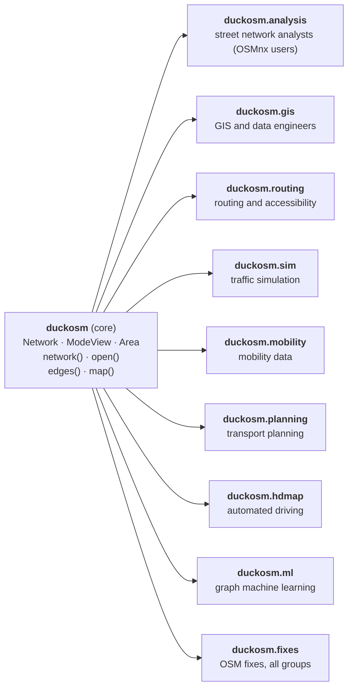

# Python SDK: the modules

The Python SDK has one core and one module for each group of users. This page shows the plan and the decision for
each module. The full design is in the
[SDK design document](https://github.com/Khoshkhah/duckOSM/blob/main/docs/proposals/python-sdk.md).

## The modules and the decisions

| # | Module | Users (their tools today) | What the module gives (exists today in bold) | Decision |
|---|---|---|---|---|
|  | `duckosm` (core) | All | `Network`, `ModeView`, `Area`, `network()`, `open()`, `edges()`, `nodes()`, `sql()`, `summary()`, `map()`, `dashboard()`; **`get`, `build`** | Approved |
| 1 | `duckosm.analysis` | Street network analysts (OSMnx, momepy, cityseer) | Statistics, bearings, nearest nodes and edges, largest component, clip, elevation, `to_osmnx` | To decide |
| 2 | `duckosm.gis` | GIS and data engineers (osmium, QuackOSM) | Features as a GeoDataFrame, OSM XML; **GIS formats, QuackOSM, Geofabrik, PMTiles** | To decide |
| 3 | `duckosm.routing` | Routing, accessibility, logistics (openrouteservice, OSRM, r5py, pandana) | Many routes, k shortest paths, travel time matrices, isochrones, accessibility; **routes, point routes, multimodal, directions** | To decide |
| 4 | `duckosm.sim` | Traffic simulation (SUMO, MATSim) | The map from SUMO and MATSim ids back to `edge_id`; **SUMO, MATSim, MATSim lanes** | To decide |
| 5 | `duckosm.mobility` | Mobility data (movingpandas, trackintel, leuvenmapmatching) | Map matching onto `edge_id`, snap, join, aggregate, the `edge_id` map between builds | To decide |
| 6 | `duckosm.planning` | Transport planning (AequilibraE, osm2gmns, path4gmns) | AequilibraE project; **GMNS, meso and micro networks, checks** | To decide |
| 7 | `duckosm.hdmap` | Automated driving (scenariogeneration, CARLA, Lanelet2, CommonRoad) | CommonRoad; **OpenDRIVE, Lanelet2, lane graph, lane routes** | To decide |
| 8 | `duckosm.ml` | Graph machine learning (PyTorch Geometric, DGL) | `to_pyg`, `to_dgl`; **networkx, rustworkx** | To decide |
| 9 | `duckosm.fixes` | All groups | Edit the OSM fixes from Python, rebuild, diff; **the fixes file, `duckosm edit`** | To decide |

The decision for each module is one of these:

| Decision | What it means |
|---|---|
| Approved | The module is in the plan of work |
| Later | The module waits; the functions that exist today stay where they are |
| No | The module is not made |
