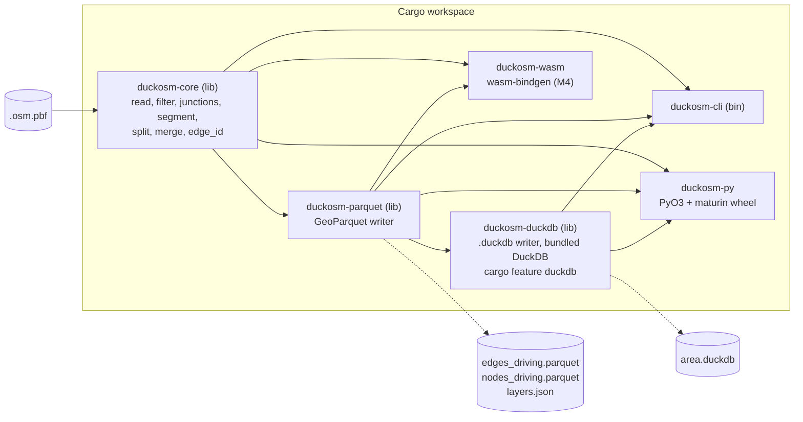

# Design of duckosm-rust

Status: started as a draft for review by Kaveh on 2026-10-21. The Rust code exists. The tables of sections 2 and 3
give the state of each part.

The repository is `duckosm-rust`. It is a Cargo workspace. Its first crate is `duckosm-core`.

This document is based on duckOSM 0.6.0 (git tag `v0.6.0`) and DuckDB 1.5.3. The numbers come from
`monaco.duckdb` in the duckOSM folder, built on 2026-10-21. The experiments in section 5 are in
[tools/edge_id_reference.py](../tools/edge_id_reference.py).

## 1. Goal and non-goals

**Goal.** The first scope is the core. Read an `.osm.pbf` file and write the same road edges and
nodes as duckOSM, with the same `edge_id` values. The Rust program does not need Python or an
installed DuckDB to run. The long-term goal is
larger: move every part of duckOSM that suits Rust to Rust, one part at a time (sections 10 to 12).
Give people three ways to run it:

1. `pip install duckosm-rust` (a wheel with a Python API).
2. One CLI program.
3. A WebAssembly package for the browser.

**Decision (Kaveh, 2026-10-22): the main goal is item 3, that duckOSM runs in the browser.** The speed of the
native program is a side effect. The plan is in [browser.md](browser.md): first the data without the map, then
the map.

The CLI and the wheel write a `.duckdb` file by default, with the same tables as duckOSM. They also
write GeoParquet. This needs DuckDB inside the program (section 3). The WebAssembly package has no
DuckDB and writes GeoParquet. The page loads these files into duckdb-wasm and can give a `.duckdb` file from them.

**Non-goals.**

- A rewrite of duckOSM in one step. Version 0.1 does only the network step. Python duckOSM stays and
  keeps the other parts (GMNS, the exporters, routing, elevation, the `features.*` layers) until
  each part moves (sections 11 and 12).
- A new `edge_id`. Downstream projects (sensor-matching, SonoFlow, fetching-sweden-data) join on it.
- Planet-scale builds. The target is a city, a region or a small country.

## 2. What the Python pipeline does today

`DuckOSM(config).run()` in `src/duckosm/importer.py` runs a list of SQL steps in one DuckDB file.
The next table lists every step and says if the Rust core does it in version 0.1.
The features of version 0.1 are complete after milestone M2. M3 releases them (section 9).

| # | Python step (file) | Rust in 0.1 | Note |
|---|---|---|---|
| 1 | Cut the PBF to the boundary with `osmium` (`importer.py`) | Yes (B4) | `pbf::read_area`: a polygon cut in Rust with the result of osmium's `complete_ways` (browser.md, step B4). |
| 2 | Read OSM into `raw.*` with `ST_READOSM` | Yes | Rust keeps only highway ways, the tags it needs, and the nodes of these ways. |
| 3 | Load the boundary, boundary cells | Partly | `main.boundary` is written (`area.rs`). The boundary cells are not. |
| 4 | Global junctions (`global_junctions.py`) | Yes | Needed in every mode: a footway that crosses a road cuts the road. |
| 5 | Filter roads per mode (`road_filter.py`): class, access, one-way direction, lanes | Yes | Driving, walking and cycling are done. The dismount flag of cycling is done. The sidewalk rule (`separate_sidewalks.py`, step 5b) is done too (`sidewalks.rs`, option `--no-sidewalk-inference`). |
| 6 | OSM fixes (`osm_overrides.py`, `DuckOSM._raw_way_fixes`) | Yes | Done on 2026-10-22 (`fixes.rs`, section 6, item 6c). The rules for the arrows of the lanes and the extra turn restrictions are not part of the network step. |
| 7 | Cut ways into edges at junctions, join the node coordinates, compute `length_m` (`graph_simplifier.py`) | Yes | |
| 8 | Split self-loops, same-direction parallel arcs and antiparallel pairs with virtual nodes (`node_id < 0`) | Yes | Needed for a unique `(osm_id, source, target)`. |
| 9 | Merge same-road chains, write `edge_id_map` (`_contract_chains`) | Yes | Done (2026-10-21). With `global_junctions` on, Monaco has no chains to merge in any mode, so the merge is tested with `global_junctions: false` (section 6). |
| 10 | Add the reverse edge of each two-way way | Yes | |
| 11 | Compute `edge_id` and `edge_ref`, check that they are unique, correct `length_m` of split edges | Yes | |
| 12 | Move private roads, bus-only roads and pedestrian streets to `private_edges` | Yes | A filter on `access` and `highway`. |
| 13 | Component filter (keep the largest connected part) | Yes | Python runs it only when a boundary is set. Rust uses an option. |
| 14 | Connect dangling paths, mark dismount edges | Yes | Done (2026-10-21). The connector adds the same edges as duckOSM. See the note on connector direction in section 6. |
| 15 | Speeds, travel-time costs, walk and cycle type | Yes | Done (2026-10-21). Speeds and costs: `maxspeed_kmh` replaces `maxspeed`, and `cost_s` is added, with the `f32` arithmetic of the SQL. `--no-speeds` and `--no-costs` switch them off (then the raw `maxspeed` stays). `walk_type` (walking) and `cycle_type` (cycling) are written as in duckOSM (`filter.rs`; a cycling edge that is walked has the type `dismount`); `--no-functional-types` switches them off. |
| 16 | Turn restrictions, edge graph | Yes | Done on 2026-10-22 (`graph.rs`, [edge_graph.md](edge_graph.md)): `edge_graph`, `turn_permission`, and in driving `turn_restrictions` and `turn_path_restrictions`, with the synthetic rules of the OSM fixes. Options `build_graph` and `extract_restrictions` (CLI `--no-graph`, `--no-restrictions`). |
| 17 | H3 cells | No | |
| 18 | Multimodal graph, `features.*`, bus routes, lane profile, drawing order | Partly | `mm.transfers` and the view `mm.edges`, `bus.*` ([bus.md](bus.md)), the lane profile ([lane_profile.md](lane_profile.md)) and the drawing order ([levels.md](levels.md)) are done. `features.*` comes from `raw.*` with duckOSM's SQL (`features.sql`, [features.md](features.md)): the page runs it in duckdb-wasm. The rest of the multimodal graph is not done. |
| 19 | `edge_id_hash` macros, metadata, time zone, report, maps | Partly | The macros, `main.visualization_metadata` and its time zone are written. Python keeps the report and the maps. |

### Facts that decide if the results are equal

The Rust code must copy these behaviors of the Python code. Some look like faults, but a different
choice gives different `edge_id` values.

- A way tagged `oneway=-1` is turned round in the filter. After that, its first node is its source.
- A road is cut at the global road junctions. A footway or path is cut at every junction of any mode.
- A node without coordinates leaves the node list without an error (an inner join in SQL).
- The split step chooses which arc to split with `length_m` before the length correction in step 11.
  The tie-break is the text order of `refs::VARCHAR`, for example `'[10, 2]'` before `'[2, 3]'`.
  This is text order, not number order.
- The midpoint and the two halves of a split arc come from planar interpolation in degrees (GEOS),
  not from the haversine length. Each half gets `length_m / 2`. Step 11 then corrects the halves
  that are more than 0.1 % wrong.
- `length_m` is a 32-bit float. It is the haversine sum of the vertex distances, with the Earth
  diameter `12742000` m.
- The reverse edge of a one-way way exists only for a bus lane. Its `access` is `bus`.
- `edge_ref` numbers the forward edges of a way by the position of the source node in the original node list. A virtual node comes last.

## 3. Architecture



Later crates join this workspace (section 12).

`duckosm-core` has no file code. It reads from a `Read` value (a file or the bytes of a file) and
returns the network of one mode in memory (`Network`: the edges, the private edges, the nodes and
`edge_id_map`). This lets the same code run in the CLI, in Python and in the browser. Decision
(Kaveh, 2026-10-22): the network stays in memory. A streaming build (rows to a `Sink` while the way
is cut) is not planned, because the target (a region or a small country, section 1) fits: Estonia uses
1.5 GB. Section 7 has the limit (Iran, 219 MB, does not fit in 4 GB).

`duckosm-core` also has no format code: it does not depend on arrow, parquet or roadstyle (since 2026-10-24).
`duckosm-build` (not in the diagram) has the pipeline (`run`, all steps of a build) and the drawing levels
(roadstyle-rs). The CLI, the Python module and the WebAssembly module call it.

### Crate choices

| Need | Choice | Why |
|---|---|---|
| PBF reader | `osmpbf` 0.3.8 | It streams blocks, so memory stays small. `osmpbfreader` 0.19.1 loads whole objects into a map, which uses more memory. `osmpbf` must use a pure-Rust zlib for WebAssembly. M0 checks this. |
| Geometry | Own functions, plus `geo-types` for the types | Rust needs only haversine, planar interpolation and substring on a line. These are about 100 lines. The `geo` crate adds a large dependency for little use. Tests compare the results with DuckDB. |
| Parquet and Arrow | `parquet` and `arrow-array` (version 60, pinned) | These are the standard crates. They release a new major version often, so the project pins the exact version. |
| GeoParquet | Own code on top of `parquet`: a WKB column and the `geo` metadata key | The format needs only a binary column and one JSON text. The `geoparquet` crate (0.9.0) is still 0.x and changes its API. Revisit it after 1.0. |
| DuckDB output | `duckdb` crate 1.10506.1 with the features `bundled` and `parquet`, in the crate `duckosm-duckdb`, behind the cargo feature `duckdb` | The crate builds DuckDB 1.5 into the program, so the user needs no DuckDB. The first build takes several minutes (it compiles the DuckDB C++ code). The feature is on by default for the CLI and the wheel, and off for WebAssembly. The writer loads the GeoParquet files with DuckDB itself, so the column types are the DuckDB types of duckOSM. |
| CLI | `clap` 4 | The usual choice. |
| Python binding | `pyo3` 0.30 with `maturin` 1.15, `abi3` wheel | One wheel for each system works for all Python 3.9+ versions. The GIL is released during a build. |
| WebAssembly | `wasm-bindgen` | M4. |
| Parallel work | `rayon`, through `osmpbf` | In the WebAssembly module without threads, `rayon` uses the current thread. The module with threads gives `rayon` a pool of Web Workers (section 7). |
| Hash | Own module, no dependency | About 25 lines. See section 5. |

Versions come from crates.io on 2026-10-21.

### Output

The CLI and the wheel write both formats by default. `--format geoparquet` or `--format duckdb`
chooses one. The WebAssembly build has no `duckdb` feature and writes GeoParquet. The page makes the DuckDB
tables from these files in duckdb-wasm.

**GeoParquet.** For each mode the Rust core writes files with the same names as
`duckosm export-gis -f geoparquet`: `edges_<mode>.parquet`, `nodes_<mode>.parquet` and
`private_edges_<mode>.parquet`, and `layers.json`, the list of the edge and node files with their counts
(the format of `export-gis`; written since 2026-10-22). roadstyle, mapstyle and the GeoLibre plugin can
then open the folder.

**DuckDB.** The file `<name>.duckdb` has the tables of duckOSM, with the same column types. Version 0.1
writes this part of what duckOSM writes today (checked in `monaco.duckdb` of 2026-10-21):

| duckOSM today | Version 0.1 writes |
|---|---|
| `<mode>.edges` | Yes. Columns (without the speed step) `edge_id`, `edge_ref`, `source`, `target`, `osm_id`, `highway`, `name`, `oneway`, `lanes`, `surface`, `access`, `junction`, `layer`, `bridge`, `tunnel`, `service`, `refs`, `geometry`, `is_reverse`, `length_m`. It also has `maxspeed` (text). With the speed step (the default) `maxspeed` is replaced by `maxspeed_kmh` and `cost_s`, as in duckOSM. |
| `edges`: `from_cell`, `to_cell`, `lca_res` | No. H3 is not ported. |
| `<mode>.nodes` | Yes. `node_id` and `geom`. The column `h3_cell` is not written. |
| `<mode>.private_edges` | Yes. |
| `main.edge_id_hash`, `main.edge_id_hash_v1` (macros) | Yes. The same SQL as `edge_id.py`. They call the `hash()` of the DuckDB in the file, so they agree with the ids only for DuckDB 1.3 and later (section 5). |
| `<mode>.edge_id_map` | Yes (with `merge_segments`). |
| `<mode>.edge_graph`, `<mode>.turn_permission`, `driving.turn_restrictions`, `driving.turn_path_restrictions` | Yes (with `build_graph` and `extract_restrictions`, both on by default). |
| `lane_profile`, `virtual_nodes`, `way_nodes`, `ways` | Yes. `virtual_nodes` is empty, as in duckOSM (the virtual nodes are in `nodes`). `--no-ways-tables` removes `ways` and `way_nodes`. |
| `main.global_junctions`, `main.boundary`, `main.visualization_metadata`, `bus.*`, `mm.*`, `visualization.*` | Yes. `main.boundary` and `bus.*` need a boundary. `mm.*` is `mm.transfers` and the view `mm.edges`. |
| `raw.*`, `features.*` | `raw.*` only as Parquet files (`--raw`, with a boundary). `features.*` only in the page. |

Python duckOSM can read the file and continue with the steps that are not ported. The DuckDB in the
program can be newer than the DuckDB in the Python environment of the user. Today the program has
DuckDB 1.5.6 (crate 1.10506.1) and duckOSM has 1.5.3. The file written by 1.5.6 opens in 1.5.3. This
is checked only for these two versions. Open question 10.

Common to both formats:

- Edge columns have the types of the DuckDB `edges` table. `geometry` is WKB in longitude and
  latitude (EPSG:4326).
- The rows are sorted by `edge_id` and `node_id`. Two runs give identical files.
- `refs` is a list column. `export-gis` does not write it. Rust writes it by default, because the
  tests need it. The option `--no-refs` removes it. (Not built yet.)

## 4. Python API

Status 2026-10-21: the module `duckosm_rust` exists (crate `duckosm-py`, PyO3 and maturin, one `abi3` wheel for
Python 3.9 and newer; the build runs without the GIL). It has `build(...)`, `build_from_config(...)` and `edge_id_hash(...)`. The
plan below is what it follows. A CI workflow builds the wheels on 5 systems for each tag `v*` of the GitHub
repository `Khoshkhah/duckosm-rust` (private, created on 2026-10-22); on
this machine a `manylinux2014` wheel (glibc 2.17 or newer) was built with zig and tested. A plain build here has
the tag `manylinux_2_35`. See [development.md](development.md).

The names follow duckOSM. The keyword names are the config keys of duckOSM.

```python
import duckosm_rust as dr

res = dr.build("monaco.osm.pbf", "out/", modes=["driving", "walking"], formats=["duckdb", "geoparquet"],
               merge_segments=True, global_junctions=True, keep_largest_component=True)
res["modes"]        # {"driving": {"edges": 2765, "nodes": 1719, "private_edges": ..., ...}, ...}
res["files"]        # {"duckdb": "out/monaco.duckdb", "edges_driving": "out/edges_driving.parquet", ...}
res["seconds"]      # the time of each step

dr.build_from_config("config/sample_monaco.yaml")   # a subset of the config keys
dr.edge_id_hash(osm_id, source, target)             # same name and result as duckosm.edge_id_hash
```

- `build_from_config(path, formats=None, out=None, pbf_is_cut=False, strict=True)` and the CLI option
  `--config` read a duckOSM config file (`duckosm-build/src/config.rs`). The keys and defaults are those of
  duckOSM. Relative paths resolve against the current folder, as in duckOSM. The rules:
  - A key that duckOSM does not know is an error (duckOSM only warns; it is almost always a typo).
  - A key that changes the result and is not supported is an error: `source.type: duckdb`, `boundary.place`,
    `bbox`, `h3_cell`, `buffer_m`, `clip.predicate` other than `intersects`, `clip.min_component_edges` > 1.
  - With a boundary, the program cuts the PBF to it, as osmium's `complete_ways` does (no `osmium` is
    necessary). When the PBF is already cut, say so (`pbf_is_cut=True`, CLI `--pbf-is-cut`): then the program
    does not cut. The component filter runs as in duckOSM (with a boundary and `build_graph` on).
  - A duckOSM step that the program does not have (H3, `features.*`, the
    drawing order, the bus routes, the sea, the checks, the report, the maps, the multimodal
    graph) is an error. Most of them are on by default in duckOSM, so a usual config needs `strict=False`
    (CLI `--allow-skipped`). The result then lists them under `skipped`.
  - Keys that only tune DuckDB in duckOSM (`memory_limit`, `threads`, `simplify_batches`, `clip_strategy`,
    `h3_resolution`) have no effect. The result lists them under `ignored`.
- Python duckOSM can later call this API with a config option `engine: rust`. Rust then builds the
  network and Python continues the other steps in DuckDB (section 12).

## 5. The edge_id problem

duckOSM defines `edge_id = (hash(osm_id, source, target) >> 1)::BIGINT` with the DuckDB function
`hash()`. A virtual node gets `-(hash(osm_id, source, refs::VARCHAR) >> 2)`. The docs say that `hash()`
is internal to DuckDB and can change in a new **major** version. The code pins `duckdb>=1.0.0,<2`.

### What the experiments show

DuckDB 1.5.3, 2026-10-21. The script is `tools/edge_id_reference.py`.

1. **`edge_id` is a pure function of three integers.** All 25,641 edges in Monaco (driving 2,765,
   walking 11,752, cycling 11,124) match the formula. No `is_reverse` and no row number are in it.
2. **The hash can be written in 25 lines.** For `BIGINT` arguments, DuckDB 1.5.3 computes
   `mix(x)`, then combines the next argument with `((h ^ (h >> 32)) * C) ^ mix(y)`.
   `mix` is `x ^= x >> 32; x *= C; x ^= x >> 32; x *= C; x ^= x >> 32` and
   `C = 0xd6e8feb86659fd93`. A negative integer is read as an unsigned 64-bit value.
   2,000 random triples, including the full 64-bit range, give no difference.
3. **The text hash can be written too.** For a `VARCHAR`, the start value is
   `0xe17a1465 ^ (length * 0xc6a4a7935bd1e995)`. For each 8-byte word (little endian, padded with
   zero bytes): `h = (h ^ word) * C`. The end is `mix(h)`. 2,000 random strings, and the
   virtual-node form `(osm_id, source, refs::VARCHAR)`, give no difference.
4. **The result is not stable across DuckDB versions, even minor versions.**

   | DuckDB | `hash(1,2,3)` as BIGINT | `hash('[1, 2, 3]')` |
   |---|---|---|
   | 1.0.0 and 1.1.3 | `17668602753667955124` | `10944178924961040006` |
   | 1.2.2 | `12722334483198565868` | `10944178924961040006` |
   | 1.3.2, 1.4.4, 1.5.3, 1.5.6 (bundled in the Rust program) | `12722334483198565868` | `12537961803640074991` |
   | 2.0.0 (released 2026-10-21; needs Python 3.11 or newer) | `12722334483198565868` | `12537961803640074991` |

   The integer hash changed in 1.2. The text hash changed in 1.3. DuckDB 2.0.0 has the same hash as
   1.3 to 1.5 (4,000 random checks, tested on the day of its release). The pin `<2` does not protect the
   ids. A database that was built with DuckDB 1.0 or 1.1 has other `edge_id` values than one built
   with 1.5.3. Edges next to a virtual node also differ in 1.2.

### Options

| Option | What it means | For | Against |
|---|---|---|---|
| A. Freeze v2 as a written spec | Rust implements the hash above. The spec has test vectors from DuckDB. | Same ids as today, so no downstream change. No dependency on DuckDB. Easy to test. | The text hash has an odd rule that is only a copy of DuckDB. |
| B. New v3 hash plus a crosswalk | Define a new id, for example XXH3 over fixed bytes. Write a table `v2 -> v3`. | A clean spec. | Every downstream project must re-match. Rust can write the crosswalk, but no gain today. |
| C. Call DuckDB from Rust | Link the DuckDB library to compute `hash()`. | Always equal to DuckDB. | Breaks the aim: no DuckDB in the wheel, and it does not work in WebAssembly. |

### Recommendation: option A

1. Freeze v2 as the spec "DuckDB 1.3 and later". Keep the reference in `tools/edge_id_reference.py`
   and write test vectors from DuckDB into `tests/vectors/edge_id.json`.
2. Run a check against DuckDB 1.3, 1.4 and 1.5 in the test suite. A new DuckDB version that changes
   `hash()` then fails a test and does not change ids in silence.
3. Do not define v3 now. If DuckDB changes `hash()` again, duckOSM can keep v2 by calling the
   reference function instead of `hash()`. A v3 is then a free choice and not an emergency.
4. Ask Kaveh if any database that downstream projects use came from DuckDB older than 1.2.
   Open question 3.

## 6. Test plan

Rule: a skipped test is not a pass.

1. **Hash vectors.** The Rust `edge_id` module gives the values in `tests/vectors/edge_id.json`.
   The script makes the file with DuckDB, so a change in DuckDB shows up as a diff.
2. **Golden Monaco.** `tools/make_golden.py` runs duckOSM `v0.6.0` with DuckDB 1.5.3 on the cut
   Monaco PBF (about 600 KB). The config is in `tests/golden/`: no `osm_overrides`,
   `connectivity_rescue: false`, `merge_segments` on, and a second run with it off. The script
   writes one Parquet file for each mode, sorted by `edge_id`. Three modes need about 1.5 MB
   (measured with zstd compression), so the files go into the repository.
3. **Compare every row.** The test joins the Rust output and the golden file on `edge_id`.
   - The set of `edge_id` values must be equal. This is the first milestone.
   - `source`, `target`, `osm_id`, `is_reverse`, `oneway`, `highway`, `name`, `lanes`, `surface`,
     `access`, `junction`, `layer`, `bridge`, `tunnel`, `service`, `refs` and `edge_ref` must be equal.
   - `length_m` must differ by less than 1e-6 of its value. The value is a 32-bit float.
   - Every vertex must differ by less than 1e-9 degrees.
   - On failure the test prints the first 20 different rows.
3b. **Three modes, four variants (done).** `tests/modes.rs` builds the sample file of Monaco in driving, walking
   and cycling, with `merge_segments` and `global_junctions` on or off (and four more variants: the component filter, the sidewalk rule, the dangling-path connector, and the connector with the component filter), and compares the counts and a checksum
   of every edge and private edge with duckOSM (`tests/data/monaco_modes_summary.tsv`, made by
   `tools/make_golden_summary.py`). With `global_junctions` on, Monaco has no mergeable chain (duckOSM
   gives 0 rows in `edge_id_map`), so the variants with it off give the real test of the merge: 114, 265
   and 291 chains in driving, walking and cycling, and 361, 1,124 and 1,159 rows in `edge_id_map`.
3c. **Connector direction (closed on 2026-10-23).** duckOSM `123910c` takes the dangling ends in the order of the
   node id and uses `min(highway)`, as duckosm-rust does. On Monaco with the connector on, the two programs are now
   equal on every edge row in the three modes. The text below describes the difference before that change.
   The dangling-path connector finds the same connectors, the same `edge_id` values, the
   same nodes and the same component filter result as duckOSM (24 test cases). One thing is not equal, and it
   cannot be: when two dangling ends face each other, the pair is one connector, and the end that is processed
   first decides which edge is "forward" (`is_reverse`, `edge_ref`) and, if the two ends are different path
   classes, the `highway`. duckOSM processes the ends in the order of a SQL result, which is not defined.
   Two builds of duckOSM on the same file already differ in 20 cycling rows. duckosm-rust processes the ends
   in the order of the node id, so its result is always the same. The tests and `tools/compare_with_duckosm.py`
   (columns `edge_ref`, `is_reverse`, `highway` of connectors) show this difference; the test checksum does
   not include these three columns.
4. **Small fixtures.** Hand-made OSM files test each rule of section 2: `oneway=-1`, a self-loop, a
   figure-8 way, an antiparallel pair, a node without coordinates, a footway that crosses a road.
   Each fixture has an expected result that is written down in the test.
5. **Invariants on any input.** `(osm_id, source, target)` is unique. Each edge geometry starts and
   ends at the coordinates of its nodes. The sum of the edge lengths of a way equals the length of the way, within 0.1 %.
6a. **Tartu (done, 2026-10-21).** The cut file `pbf/tartu.smart.b433d09b44.osm.pbf` of duckOSM (3 MB, 273,651
   nodes, 45,619 ways), all three modes, three variants. Python builds with `bench/python_steps.py` and the
   config `tests/data/golden_monaco_modes.yaml` (the commands are in [development.md](development.md)).

   | Variant | Settings | Result |
   |---|---|---|
   | t1 | `merge_segments`, `global_junctions`, sidewalk rule and connector on; no boundary | Same edges, private edges and nodes in all modes (driving 28,611 edges; walking 60,978; cycling 59,795). 26 connector rows differ only in `edge_ref`, `is_reverse` or `highway` (the order issue in 3c). |
   | t2 | as t1, with the Tartu boundary (component filter) | The same, with 28,340, 60,412 and 59,176 edges. 18 connector rows differ in the labels. |
   | t3 | `global_junctions` off, `merge_segments` on, no sidewalk rule, no connector | Every row equal in all columns, and `edge_id_map` equal (1,045, 2,952 and 2,842 rows). |

   The sidewalk rule finds 104 roads in Tartu. This test is not in `cargo test`: the PBF is 3 MB and the
   golden databases are large. A run of the program on this file takes 0.5 s for the three modes (one run, no
   benchmark).
6b. **Local goldens.** Larger areas (Tartu has virtual nodes, Estonia is a scale test) are built with
   the same script. They stay in `tests/local/`, which git ignores.
6c. **OSM fixes (done, 2026-10-22).** `fixes.rs` applies the rules file of duckOSM (the config key
   `osm_overrides`, CLI `--fixes FILE`, Python `osm_overrides=`). As in duckOSM, the rules act at two
   points. `remove`, `keep_nodes`, `tags` and `new_ways` change the ways as read, before pass 2. `oneway`,
   the lanes, `layer` and `exclude_modes` change the ways of each mode, after the road filter. An unknown
   key in the file is an error. The results with the file of duckOSM (`osm_overrides/osm_overrides.yaml`):

   - Monaco against `monaco.duckdb`, which duckOSM built with the fixes: in the driving mode, every row is
     equal in all columns. Before, 78 rows were different in `lanes`. In walking and cycling, only connector
     rows are different, in the labels (item 3c). 37, 11 and 37 rules match a way.
   - Tartu against `data/db/tartu.duckdb` of duckOSM (2026-09-30, with the fixes): the `layer` rule of way
     1429337399 gives `0` on its 6 edges, as in duckOSM. The other differences against this old database
     are the same with and without the fixes.
   - `cargo test` runs the unit tests in `fixes.rs` and the test `osm_fixes_file` (duckosm-build).

   Limits: the reader keeps only highway ways and ferry lines, so a `tags` rule or `tags_from` on another
   way has no effect. A tag value that YAML reads as true or false is an error, so write it in quotes. The
   WebAssembly page does not take a fixes file yet.
6c2. **Tag edits, `extra.tag_edits` (2026-11-03).** An extension of duckosm-rust for the page's fixes panel ([osm-editing.md](osm-editing.md)). The key `extra`
   is new, so a file with only duckOSM keys has no change in its output, and duckOSM (Python) ignores the key: it reads only `overrides`. Each rule
   sets and deletes tags of one way, node or relation: `{type: way|node|relation, id, set: {key: value}, delete: [key], note}`. The tags are set first, then
   deleted. The rule acts at the same point as `tags` of a rule in `overrides`: on the ways as read (so the network sees them) and on `raw.*` (so the
   base-map layers see them). A node edit and a relation edit act on `raw.*` only. So a crossing or a traffic signal (a node) and a multipolygon building (a
   relation) can change. A rule for an element that is not in the area does nothing. `tests/tag_edits.rs`: a `sidewalk` tag on a road of Monaco changes the walking
   type of its edges from `shared_road` to `sidewalk`.

6d. **Estonia (done, 2026-10-22).** The scale test: `estonia-latest.osm.pbf` (121 MB), the three modes,
   everything of the network step on (merge, global junctions, the sidewalk rule, the connector, speeds,
   costs, the walk and cycle types), the OSM fixes of duckOSM, no boundary. The golden comes from duckOSM
   with `bench/python_steps.py` and the same settings.

   | | duckosm-rust | duckOSM |
   |---|---|---|
   | Time, three modes | 19.2 s (all threads), 23.5 s (one thread) | 1,545 s (the lane profile off) |
   | Peak memory (RSS) | 1.53 GB (all threads), 1.31 GB (one thread) | 10.2 GB |
   | Edges: driving, walking, cycling | 821,074, 1,402,628, 1,376,472 | the same |

   Driving: every row of `edges`, `private_edges` and `nodes` is equal in all columns. Walking and cycling:
   `private_edges`, `nodes` and `edge_id_map` are equal. In `edges`, only connector rows are different
   (88 in walking and 238 in cycling), in the labels of item 3c and in the columns that come from them
   (`walk_type`, `cycle_type`, and in cycling `dismount`, `maxspeed_kmh` and `cost_s`). No OSM way is
   different. The sidewalk rule takes 4.7 s, the longest step. Other jobs used about 1.5 cores of the
   20 cores during the test.

## 7. Memory and streaming

Reference size: the Estonia database has 13,189,432 nodes, 1,633,374 ways, 186,080 driving ways and
738,655 driving edges.

The build reads the file in passes and never loads the whole file:

1. **Pass 1, ways.** Keep the highway ways with only the tags the filters use. Store the node lists
   in one array. Count how often each node is used. This gives the junctions.
2. **Pass 2, nodes.** Keep the coordinates of the nodes that a kept way uses. Each entry is 16 bytes
   (node id and two 32-bit coordinates). The upper bound for Estonia is 13.2 M x 16 B = 211 MB.
3. **Pass 3, edges.** Cut, split and measure each way on its own. This part is parallel.
   Only the merge step and the component filter need all edges together. 739 K edges fit in memory.
4. **Write.** Write Parquet in row groups of 64 K rows.

Targets for M3: Estonia in less than 2 GB of memory. Measured on 2026-10-22: 1.53 GB for the three
modes (section 6, item 6d). The time target is open until
the first measurement.

**WebAssembly.** One tab has at most 4 GB of address space, so the target is a city or a small
region. Since 2026-10-22, the browser is the main goal ([browser.md](browser.md)). The crate
`duckosm-wasm` has four build functions: `build` (the bytes of a PBF file that is cut to the area),
`build_area` and `build_area_bytes` (a region PBF and a boundary, cut while it is read) and `build_osm_json`
(the answer of the Overpass API). They use the default options of the CLI and return all files of the
chosen modes. All four call `duckosm_build::run`, the function that the native build also calls. The page
`crates/duckosm-wasm/www/index.html` builds in a Web Worker, loads the tables into duckdb-wasm for SQL,
and gives the files. [development.md](development.md) tells how to build and test it.

- `pbf::read_ways_bytes` and `pbf::read_coords_bytes` read the PBF from a byte slice
  (`ElementReader::new(Cursor<&[u8]>)`). The path functions use the same parse code.
- The writers of `duckosm-parquet` write to a `Write` value (`write_edges_to`, `write_nodes_to`,
  `write_edge_id_map_to`). In WebAssembly, the writer sends the bytes to JavaScript in parts of
  1 MB, so the output files are not in the WebAssembly memory. Each file is an array of
  `Uint8Array` parts, and `new Blob(parts)` gives the file.
- `duckosm_build::run` has all steps of the build and uses no file system. It gets the input (`Input`: a
  path, the bytes of a PBF file, OSM JSON, or a region PBF and a boundary), the OSM fixes, and a function
  that gives a writer for each file name. `duckosm_build::build` gives files in a folder. `duckosm-wasm`
  gives JavaScript arrays. The caller also gives the clock of `StepLog`, because `Instant::now` and
  `SystemTime::now` panic in `wasm32-unknown-unknown`.
- `osmpbf` uses `rayon`. In the module without threads (`pkg/`), `rayon` cannot start threads, so it does
  all the work on the current thread. It does not panic. The module with threads (`pkg-threads/`) gives
  `rayon` a pool of Web Workers ([development.md](development.md), "WebAssembly").
- `parquet` uses Snappy. The `zstd` feature needs a C compiler for WebAssembly (`clang`), so it
  is off.
- The `.duckdb` writer has no WebAssembly build.

Measured with the same `.wasm` file in Node 24 and in headless Chromium, driving. The `.wasm` file
is 4.4 MB (0.81 MB with gzip, `wasm-opt` is not used). The native program uses all threads.

| Area | PBF | Node | Chromium | WebAssembly memory | Native program |
|---|---|---|---|---|---|
| Monaco | 0.6 MB | 0.08 s | 0.09 s | 11 MiB | 0.04 s |
| Stockholm county | 70 MB | 5.5 s | Not measured | 537 MiB | Not measured |
| Estonia, 769,662 edges | 121 MB | 10.4 s | 9.7 s | 710 MiB | see item 6d |
| Kentucky, 2,114,699 edges | 148 MB | 22.1 s | 20.1 s | 2,053 MiB | 11.8 s, 3.24 GB |
| Iran | 219 MB | Fails at 3,816 MiB | Not measured | | Not measured |

The Monaco row is from 2026-10-22, after the rebase onto the speed step, the sidewalk rule and the
connector. The other rows are from 2026-10-21 and 2026-10-22, before the rebase. They are not
measured again, because the tests use Monaco (and Tartu) only until Kaveh asks for a large area.
Other jobs used the computer during some measurements, so the times can change by some seconds.

The Estonia row is from 2026-10-22, after the rebase. In Node, the walking mode of Estonia takes 21.6 s
and 1,460 MiB, and the cycling mode takes 12.4 s and 1,450 MiB.

For Monaco, in the three modes, all rows of the four files are equal to the native output. In the
driving mode, the files are also equal, byte for byte, to the native output with Snappy (the test
`bytes_equal_files`). For Estonia, driving and cycling are equal on all rows. In walking, one road
(2 of 1,391,194 edges) is not equal, because of `cos` (see below). Before the rebase, all rows for
Kentucky were equal to the native output. Kentucky is the largest area that is tested and fits.

**`cos` in WebAssembly.** The sidewalk rule computes a local metre frame with `cos(lat0)`. On Linux,
Rust and Python duckOSM use the `cos` of glibc. In WebAssembly, Rust uses the `cos` of the `libm`
crate. For about 2 % of the latitudes from 57 to 60 degrees, the two results are different in the last
bit. In Estonia, this changes the decision of the rule for one road: the native program and duckOSM
give `sidewalk=separate` to 578 roads, and WebAssembly to 579 roads. Where the two are different, glibc
gives the correctly rounded value in 1,025 of 1,037 checked cases, so glibc is not always correct either.
Thus a different `cos` in Rust cannot make all results equal. The `cos` of macOS and Windows can also
give such a difference. This is a known limit of a rule with float thresholds. When an area does not fit, an
allocation fails, and the module stops with `RuntimeError: unreachable`.

**Changes that make the memory smaller (2026-10-21 and 2026-10-22).** Two probes measured the memory
after each step: a counting allocator in a native program (the heap), and `memory_size` in
WebAssembly (the WebAssembly memory only grows, so it shows the peak). Before the changes, Kentucky
needed a heap peak of 5,665 MiB and did not fit. After the changes, its heap peak is 2,145 MiB on
one thread, and it uses 2,053 MiB of WebAssembly memory. The changes:

- The edges of a way share one `Arc<Attrs>`, which holds the 9 columns that come from the way.
  Before, each edge had its own copy of each string. An `Edge` now has 128 bytes, not 360 bytes,
  and it does not allocate strings. A connector gets an `Attrs` with only `highway`.
- An edge keeps `seq`. The writer makes the `edge_ref` text (`Edge::edge_ref`).
- The speed step does not clear the raw `maxspeed`, because `Attrs` is shared. The writer leaves out
  the `maxspeed` column when the speed step ran, so the output is the same.
- Step 9 moves the private edges out with `Vec::extract_if`. Before, `partition` made a second copy
  of all the edges.
- Step 5 and `node_uses` allocate the exact capacity. `read_ways` releases the capacity that the
  list of ways does not use.
- `Tags` keeps the values of a way in one string, with a short list of keys. A `Way` now has
  64 bytes, not 560 bytes. The ways of Kentucky use 133 MiB, not 428 MiB. `Tags::set` replaces a
  value (the sidewalk rule uses it).
- `global_junctions` and `local_junctions` sort a list of (node, flags) and count each run. Before,
  each one had a hash map of all nodes (400 MiB for Kentucky).
- `Coords` is a list sorted by node id, with 24 bytes for each node and no unused capacity. Before,
  it was a hash map that grew by doubling. A lookup is a binary search. The native time of
  Kentucky did not change (11 s).
- Step 2 (self-loops) runs on each edge when step 1 makes it, so the forward edges are not copied
  to a second list. The order of the edges does not change.
- In WebAssembly, the Parquet files go to JavaScript while they are written (see above). Before,
  the output `Vec<u8>` values grew by doubling and added 768 MiB to the WebAssembly memory of
  Kentucky. The module also releases the ways and the coordinates before it writes.

The output did not change. The native program is also faster: Kentucky took 44.6 s before.

After these changes, the WebAssembly memory of Kentucky grows in many small steps. The largest are
`read_coords` (plus 531 MiB: the set of the necessary nodes and the list before the sort) and the
edges themselves (steps 1 to 5, plus 881 MiB).

Iran does not fit: on one thread, the native program has a heap peak of 5,222 MiB. For areas of
this size, the build must write the edges while it makes them, and not keep all of them.

## 8. Risks

| Risk | Effect | Action |
|---|---|---|
| DuckDB changes `hash()` again | New builds of Python duckOSM get other ids than Rust | Section 5: tests against DuckDB 1.3 to 1.5, and a spec. |
| Float and geometry differences between Rust and GEOS | A near-tie in a split choice can change an `edge_id` | Same formulas, same 32-bit rounding, tests on Monaco and Tartu. |
| Python duckOSM changes after v0.6.0 | Golden files go out of date | Pin the tag. Make the golden files again at each duckOSM release. A difference needs a decision about which side is right. |
| Python order is not defined for ties (`row_number()` over equal keys) | A golden file can change between runs | Check in M0: build Monaco twice and compare. |
| The two engines drift | Different results in time | Golden tests in both repositories. |
| A crate does not build for WebAssembly | M4 slips | Spike in M0. |
| `arrow` and `parquet` release a new major version often | Build breaks on update | Pin exact versions. Update on purpose. |
| The bundled DuckDB makes the build slow and the program large | The first build takes several minutes. The release program is 56 MB with DuckDB and 7.9 MB without it. | The `duckdb` feature is optional. A user who needs only GeoParquet builds without it. |
| The name contains "duck" | The DuckDB trademark question for duckOSM can apply here too | Open question 2. |
| One maintainer | Scope grows | Keep the non-goals. Ship M3 before M4. |
| `cos` differs in the last bit between the C libraries of Linux, macOS, Windows and the `libm` crate (WebAssembly) | The sidewalk rule has float thresholds, so one road in a large area can get a different result on another system (section 7: one road of Estonia in WebAssembly) | Accepted. The golden tests run on Linux. A rule with a tolerance would hide the problem, not remove it. |

## 9. Milestones

| M | Content | Exit criteria |
|---|---|---|
| M0 | Setup and spike. Rust installed. Cargo workspace. `edge_id` module. Golden files. A CLI that builds the driving network of one PBF and writes `.duckdb` and GeoParquet. | `cargo test` passes the hash vectors and the Monaco golden test. **Done on 2026-10-21.** The Python output is the same on each run (two golden builds of Monaco: 0 rows differ). The build for `wasm32-unknown-unknown` is checked for compile only (section 7). |
| M1 | Monaco, driving. All steps in the table that are marked "Yes", for driving, without `merge_segments`. | All 2,765 `edge_id` values equal the golden file. All columns in section 6 pass. GeoPandas and DuckDB read the output. **Reached in the spike** for the output in `.duckdb` and GeoParquet (see [benchmark.md](benchmark.md) for the speed; only Monaco is tested). |
| M2 | Walking and cycling. `merge_segments` and `edge_id_map`. `lanes`. `private_edges`. | The same checks pass for the three modes, with `merge_segments` on and off. Tartu passes as a local golden (done, see section 6). **Reached on Monaco on 2026-10-21** for 9 variants (`merge_segments` and `global_junctions` on or off, the component filter, the sidewalk rule, the connector, the connector with the component filter, and everything on with speeds and the walk and cycle types) in the three modes: 0 rows differ in `edges`, `private_edges`, `nodes` and `edge_id_map`. Tartu is done (section 6). The sidewalk rule finds the same 46 roads in Monaco as duckOSM. It is a geometric rule with float thresholds, so a different area can give a difference at a threshold. It assumes right-hand traffic, as duckOSM does. |
| M3 | Release 0.1.0. CLI, Python wheel, config subset, `layers.json`. | A fresh virtual environment runs `pip install` and builds Monaco with an equal result. The CLI binary does the same. The Estonia numbers are written down. Wheels build for Linux, macOS and Windows. **Estonia done on 2026-10-22** (section 6, item 6d). The CI built and tested the wheels for Linux, macOS and Windows on 2026-10-22 (Windows without sccache). `layers.json` is written. A tag `v*` makes a GitHub Release with the wheels (no PyPI yet, open question 2). **Released as v0.1.0 and v0.2.0 on 2026-10-22. Checked again on 2026-10-23 for 0.3.0** (the browser work and the git dependency roadstyle-rs): a new virtual environment with the wheel passes `tests/test_wheel.py`, and the wheel and the CLI each build duckOSM's `config/sample_monaco.yaml` with a result equal to duckOSM's `monaco.duckdb` (`tools/compare_tables.py` and `tools/compare_with_duckosm.py`; only the connector labels of item 3c differ). The check found one bug: a `.duckdb` build without costs failed in the view `mm.edges`. Now, as in duckOSM, such a build has no `mm.*`. From 0.3.0, the release also has the CLI program for the 5 systems. |
| M4 | WebAssembly and large areas. | A browser page turns a city PBF into GeoParquet. Estonia meets the targets. Optional: speeds and costs, turn restrictions. **Browser page done on 2026-10-21** (section 7): Monaco gives the same rows as the native output in the three modes. Estonia uses 710 MiB in the driving mode, and Kentucky (148 MB PBF) fits in 2,053 MiB. Not done: the large-area targets of the native program. |

## 10. Long-term vision

Kaveh wants more than the core. Over time, every part of duckOSM that suits Rust moves to Rust.
Python duckOSM then becomes a thin layer: the CLI, the config, and the parts that use Python libraries.

The reasons are speed, one install without DuckDB, and the same code in the browser. Three things do
not change: the tables and the `edge_id` values, the Python API, and the config keys.

A part suits Rust when it is pure CPU work on a large amount of data, and has few Python library
calls. A part stays in Python when it is glue to an external tool or a Python library.

## 11. Which parts move to Rust

Ratings: **Now** (in version 0.1), **Later** (suits Rust, in the listed order) and **Keep** (stays in
Python). Line counts come from `src/duckosm` in duckOSM 0.6.0. The order of the "Later" rows is a
proposal: high gain and low effort first.

| Part (Python files) | Lines | Rating | Why |
|---|---|---|---|
| Network build: road filter, global junctions, graph simplifier, edge_id, private split, component filter (`processors/`) | about 1,500 | **Now** | Pure CPU. Large data. It is the main cost of a build. Section 2. |
| GeoParquet output (part of `gis.py`) | small | **Now** | Rust writes it itself. |
| Speeds, costs, walk and cycle type, dismount, lane profile (`processors/`) | about 450 | **Later, 1st** | Rules for one edge at a time. They need only the tags that Rust already reads. |
| Turn restrictions, edge graph (`processors/restrictions.py`, `edge_graph.py`) | about 440 | **Done** (2026-10-22) | Pure CPU. The edge graph is large. Needs the OSM relations. See [edge_graph.md](edge_graph.md). |
| Dangling-path connector, H3 cells (`path_connector.py`, `h3_indexer.py`, `utils/h3_calc.py`) | about 320 | **Later, 3rd** | Pure CPU. A Rust H3 crate exists (`h3o`). |
| Routing: shortest path, point routing, lane routing, directions | about 1,100 | **Later, 4th** | Graph search is a good fit for Rust and gives a large speed gain. The export to networkx stays in Python, because networkx is a Python library. |
| GMNS and crossings (`gmns.py`, `crossings.py`, `gmns_sumo.py`, `gmns_check.py`) | about 2,900 | **Later, 5th** | Large, CPU heavy, and uses shapely and numpy today. The lane rules still change, so port a table only when its rules are stable. |
| Base-map layers `features.*` (`features/`), bus routes (`bus.py`), multimodal graph (`processors/multimodal.py`) | about 1,100 | **Later, 6th** | Data heavy. The layers need polygons built from OSM relations. DuckDB spatial and GDAL do this today. This is the largest piece of new work. |
| XML exporters: MATSim, OpenDrive, Lanelet2, railML | about 900 | **Later, 7th** | They only write XML from tables. Easy, but the gain is small. Port when a user asks. |
| SUMO export (`sumo.py`, `sumo_compare.py`) | about 700 | **Keep** | Uses `sumolib` and the external `netconvert`. |
| GeoPackage and shapefile export, GIS check (`gis.py`, `gis_debug.py`) | about 900 | **Keep** | GDAL (`ogr2ogr`) and GeoPandas do the work. |
| Elevation (`elevation.py`) | about 400 | **Keep** | Uses rasterio, pyproj and GDAL. Check again when a Rust GeoTIFF reader is good enough. |
| Area and boundary: name search, boundary lookup, clip from a parent database (`area.py`, `admin.py`, `extract.py`) | about 520 | **Keep** | Glue to `ogr2ogr`, the Nominatim web service and DuckDB. A polygon cut of the PBF can move later, so `osmium` is not needed. |
| Maps and drawing order (`viz.py`, `levels.py`, `levels_edit.py`, `route_map.py`, `gmns_viewer.py`) | about 900 | **Keep** | They call roadstyle and mapstyle, which are Python libraries. |
| CLI, config, validation, report, query, GTFS (`cli.py`, `config.py`, `validate.py`, `report.py`, `query.py`, `gtfs.py`) | about 2,000 | **Keep** | Thin glue (click, YAML, pandas). The Rust CLI has only the ported parts. Rust reads the same config keys. |

## 12. Migration method

The method is the strangler pattern: the new code grows around the old code and replaces it part by part.

1. **One crate for each part.** The Cargo workspace gets a new crate when a part moves. For example,
   `duckosm-core` (network), then crates for attributes, restrictions, routing and GMNS. The crate names
   are examples. One Python wheel holds all crates in one module.
2. **Tables are the interface.** Every part reads and writes tables (Parquet or Arrow), not DuckDB
   connections. Python reads the Rust output into DuckDB with `read_parquet` and continues. A part can
   then be Rust or Python, and the other parts do not notice.
3. **Python duckOSM keeps its API.** The CLI, the config and the function names stay. For each moved
   part, a config option `engine: rust` (or `python`) chooses the code. The default stays `python`
   until the Rust part has passed the golden tests in two duckOSM releases. **Done for the network step
   on 2026-10-22**: `options.engine: rust` (CLI `--engine rust`) in duckOSM calls `duckosm_rust.build()`
   one time for all modes and loads the four tables of each mode; RoadFilter and the later steps run in
   Python as before. See `docs/design/rust_engine.md` in duckOSM.
4. **A design document first.** Each part gets a short design document and the approval of Kaveh before code.
5. **A golden test for each step.** The Python output is the reference. A step is done when the Rust
   output is equal on Monaco and on one more area (section 6). A difference needs a decision about
   which side is right. The decision goes into `docs/`.
6. **The ids never change.** `edge_id` and the other keys stay as they are.
7. **The Python code stays as the reference** until the next release after the default changes. Then
   Kaveh decides if the code is removed (open question 9).

## 13. Repository name

Decision (Kaveh, 2026-10-21): the repository is `duckosm-rust`.

- The repository is a workspace that holds many crates (section 12). Its name must not be the name of one crate.
- The first crate keeps the name `duckosm-core`.
- The name `duckosm-rs` is not used. In the projects of Kaveh, `rs` means roadstyle
  (`rs.render_edges`, `window.rs*`).

## 14. Open questions for Kaveh

1. ~~Can I install Rust?~~ Decided by Kaveh on 2026-10-21: yes, with `rustup` at user level. Done (Rust 1.99.1). See [development.md](development.md).
2. What are the names of the PyPI package, the Python module and the CLI program? The proposal is
   `duckosm-rust` for the package and the CLI, and `duckosm_rust` for the module. The name has
   "duck" in it. The PyPI release of duckOSM waits for the DuckDB trademark reply, so this can apply.
3. ~~Do you accept option A for `edge_id` (section 5)?~~ Option A is in use since M0, and every golden
   test passes with it (closed on 2026-10-22). Open: are there databases, used by sensor-matching,
   SonoFlow or fetching-sweden-data, that DuckDB older than 1.2 built? Their ids are different.
4. ~~Is version 0.1 without speeds, costs, turn restrictions, the edge graph and connector edges
   acceptable?~~ Speeds, costs and the connectors are done (closed on 2026-10-22). The edge graph and the
   turn restrictions are done too (section 11).
5. ~~OSM overrides change ways before the graph is built. Can the Rust core read the YAML file for the
   way rules, or must Python apply them to the PBF first?~~ Decided by Kaveh on 2026-10-22: the Rust core
   reads the YAML file. Done (section 6, item 6c).
6. ~~Is the strangler method in section 12 right: Python duckOSM calls the Rust wheel part by part,
   with `engine: rust` as the switch?~~ Decided by Kaveh on 2026-10-22: yes. Done for the network step:
   duckOSM has `options.engine: rust` (duckOSM `docs/design/rust_engine.md`). Its test
   `tests/test_engine_rust.py` builds the Monaco sample with both engines and compares the tables.
7. ~~Cut to the boundary: keep `osmium` outside, or add a polygon cut to the Rust core in M3 or M4?~~
   Decided by Kaveh on 2026-10-22: a polygon cut in the Rust core, because the browser needs it. Done
   (browser.md, step B4): the Rust cut gives the same ways and coordinates as osmium on Monaco, and the same
   20 tables on Tartu from the Estonia file.
8. ~~Large areas are not tested yet. Which PBF is the scale test, and when do you want it?~~ Decided by
   Kaveh on 2026-10-22: Estonia (`osm-traffic-enrichment/map/estonia-latest.osm.pbf`, 121 MB). Done
   (section 6, item 6d).

9. Is the order of the "Later" parts in section 11 right? After a part moves, do you delete its
   Python code or keep it as the reference?
10. ~~Which DuckDB version should the `.duckdb` file have?~~ Decided by Kaveh on 2026-10-21: keep the bundled
    DuckDB 1.5.6 (crate `duckdb` 1.10506.1), and move to DuckDB 2 when the Rust crate supports it. The crate
    has no 2.0 version yet (issue duckdb/duckdb-rs#913, opened on 2026-10-21). The order of the upgrade
    matters. DuckDB 2.0.0 opens files that 1.5.x wrote, but DuckDB 1.5.3 cannot open a file that 2.0.0
    wrote ("created with an newer version of DuckDB"). So the Python side must move to 2.x (it needs Python
    3.11 or newer) before, or at the same time as, the Rust program. `edge_id` is the same in 2.0.0.

## Terms

- **PBF**: the binary file format of OpenStreetMap data.
- **GeoParquet**: a column file format for geodata. It is a Parquet file with a `geo` metadata key.
- **WKB**: well-known binary, a byte format for geometry.
- **Crate**: a Rust package. A **workspace** holds more than one crate.
- **Wheel**: a Python package file that you install with `pip`. **PyO3** and **maturin** build it.
- **WebAssembly (WASM)**: code that runs in the browser.
- **Virtual node**: a node with `node_id < 0` that duckOSM adds in the middle of an edge to make
  `(osm_id, source, target)` unique.
- **Strangler pattern**: a way to replace old code. New code takes over one part at a time, and the old code stays until the last part has moved.
- **Golden file**: a saved output of the Python duckOSM. Tests compare the Rust output with it.
